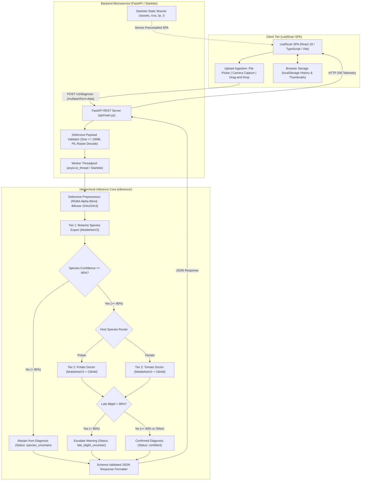
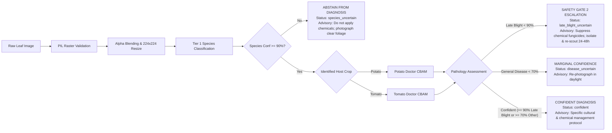

# Plant Disease Detection — Hierarchical Deep Learning System (V2)

[](https://www.python.org/)
[](https://www.tensorflow.org/)
[](https://keras.io/)
[](https://fastapi.tiangolo.com/)
[](https://react.dev/)
[](https://www.typescriptlang.org/)
[](https://vitejs.dev/)
[](https://onnxruntime.ai/)
[](https://pytest.org/)
[](https://vitest.dev/)

Production-grade hierarchical deep learning system for high-consequence agricultural foliar pathology diagnosis in Solanaceous crops (*Solanum tuberosum* — Potato and *Solanum lycopersicum* — Tomato). Built with **MobileNetV2**, **Convolutional Block Attention Module (CBAM)**, **Dual Confidence Safety Gates**, a high-throughput **FastAPI** REST microservice, **ONNX Runtime** deployment graphs, and the **LeafScan** modern Single Page Application (React 18 / TypeScript / Vite).

---

## 1. Project Title
**Plant Disease Detection — Hierarchical Deep Learning System (V2)**

A specialized agricultural computer vision system that couples a two-tier convolutional neural network cascade with attention mechanisms and conservative confidence safety gates to deliver reliable, actionable foliar disease screening for Solanaceous crops.

---

## 2. Project Overview

### 2.1 The Problem
Foliar diseases in Solanaceous crops represent an existential threat to commercial agricultural yields and global food security:
- **Early Blight (*Alternaria solani*):** A destructive fungal pathogen producing dark brown-to-black necrotic lesions marked by concentric rings ("target-board" patterning), driving accelerated senescence and defoliation.
- **Late Blight (*Phytophthora infestans*):** A high-consequence oomycete pathogen notorious as the causative agent of the Great Irish Famine. Spreading rapidly under cool, high-humidity conditions, water-soaked foliar lesions expand into blighted leaf collapse that can destroy entire canopy stands within 7 to 10 days.

Traditional automated computer vision systems applied to plant pathology frequently suffer from three critical architectural flaws:
1. **Cross-Crop Classification Confusion:** Monolithic, flat multi-class models attempt to distinguish between potato blights and tomato blights simultaneously, often generating severe misdiagnoses when foliage shapes or lesions overlap.
2. **Synthetic Data Leakage & Inflated Metrics:** Public benchmark datasets (such as PlantVillage) contain extensive duplicate and synthetically augmented images. Naive random train/test splits inadvertently place augmented variants of the identical physical leaf across both training and evaluation subsets, masking severe real-world generalization failure.
3. **Reckless Forced Diagnoses:** Standard classifiers force a classification decision even when presented with ambiguous leaf imagery, non-host plants, or marginal lesion confidence, leading to premature or dangerous chemical fungicide prescriptions.

### 2.2 The Solution
This repository implements an end-to-end engineered solution to these challenges:
- **Two-Tier Cascaded Classification:** Decouples host crop identification (Tier 1 Botanist Species Expert) from specialized pathology diagnosis (Tier 2 Crop Doctors), eliminating cross-crop misclassification.
- **CBAM Attention Mechanism:** Injects spatial and channel attention submodules directly into terminal MobileNetV2 feature maps, allowing the network to focus on concentric necrotic rings rather than background soil or leaf veins.
- **Zero-Leakage Specimen Partitioning:** Uses Disjoint Set Union (DSU) graph clustering with perceptual hashing to resolve 66.88% synthetic dataset redundancy, guaranteeing 0.0% biological specimen leakage between splits.
- **Dual Confidence Safety Gating:** Implements rigorous programmatic safety gates that deliberately abstain from disease diagnosis on uncertain host species (<90%) and escalate ambiguous Late Blight predictions (<90%) to suppress unjustified chemical spraying.
- **Multi-Modal Client Interfaces:** Accessible via a dependency-free production SPA (**LeafScan**), high-performance **FastAPI** REST API, and standalone Python CLI.

### 2.3 Intended Users & Interaction Modes
- **Agronomists & Plant Pathologists:** Can inspect detailed probability distributions, review CBAM attention-refined diagnosis, and review technical metadata.
- **Agricultural Extension Workers & Farmers:** Can upload photographs in the field via smartphone camera, system file browser, or drag-and-drop to receive actionable cultural management advisories and spray-suppression guidance.
- **Developers & Systems Engineers:** Can integrate the stateless REST microservice (`/v2/diagnose`) or embed the microsecond-latency ONNX Runtime CPU graphs into edge pipelines.

---

## 3. Key Features

- **Decoupled Two-Tier Hierarchical Cascade:**
  - **Tier 1 (Botanist Species Expert):** Accurately distinguishes between Potato and Tomato foliage.
  - **Tier 2 (Crop Doctor Specialists):** Dedicated specialist networks trained exclusively on diseases of the identified host species (`Early Blight`, `Late Blight`, `Healthy`).
- **Injected CBAM Attention Mechanism:**
  - Injects a 206,258-parameter Convolutional Block Attention Module directly into the $7 \times 7 \times 1280$ terminal feature maps of MobileNetV2.
  - Dynamically computes channel weights ($r=16$) and spatial feature masks to localize subtle foliar lesion margins.
- **Forensically Audited Zero-Leakage Dataset:**
  - Master manifest of 11,988 images clustered into 3,971 true biological leaf specimens using DSU graph grouping and perceptual dHash/aHash.
  - Strictly held-out test split of 603 unique specimens with 0.0% biological leakage against training subsets.
- **Dual Confidence Safety Gates & Agronomic Decision Support:**
  - **Species Gate (90%):** Deliberately abstains from disease diagnosis if host species confidence is $<90\%$, preventing cross-crop chemical treatment errors.
  - **Late Blight Escalation Gate (90%):** Enforces a 90% confidence threshold on *Phytophthora infestans*. If confidence is marginal, the system flags `late_blight_uncertain`, suppresses aggressive systemic fungicide advisories, and prescribes physical quarantine and 24–48h re-scouting.
  - **General Disease Gate (70%):** Flags marginal diagnoses below 70% with advisory recommendations for clear re-imaging.
- **Defensive Image Ingestion & Preprocessing:**
  - Handles RGB, RGBA (alpha-composited onto pure white to eliminate dark edge artifacts), CMYK, Grayscale, and NumPy arrays.
  - Resizes to $224 \times 224 \times 3$ via bilinear interpolation and normalizes tensors defensively.
- **Dual Runtime Deployment:**
  - Native Keras 3 deserialization with strict `safe_mode=True` validation.
  - Headless ONNX Runtime CPU computation graphs providing $\sim 52\text{x}\text{--}59\text{x}$ inference acceleration (1.58–1.89 ms latency) with numerical parity ($\le 3.46 \times 10^{-6}$).
- **Modern Full-Stack Architecture (LeafScan):**
  - **Frontend:** Built with React 18, TypeScript 5, Vite 5, TanStack Query v5, and React Router v6 HashRouter (`web/`), compiling to a self-contained production bundle (`frontend/`) served directly by FastAPI without CDN dependencies.
  - **Multi-Modal Upload:** Browse Files, Take Photo (HTML5 device camera capture), and Drag-and-Drop file ingestion with flicker-free drag counter.
  - **Local Diagnosis History:** Browser-persistent `localStorage` scan history (capped at 25 items with automated canvas thumbnail generation and quota exhaustion protection).
  - **Accessibility:** WCAG 2.1 AA compliant, screen-reader live regions, accessible progress meters, and reduced-motion support.
- **Comprehensive Testing Infrastructure:**
  - 46 automated Pytest backend unit, regression, and API tests (100% passing).
  - 67 automated Vitest frontend tests across 16 test files (100% passing).
  - End-to-End browser test suite powered by Playwright.

---

## 4. Application Screenshots

The LeafScan web application renders a complete, responsive user interface served directly from `frontend/`.

- **Live Application Access:** When the FastAPI server is running (see [Running the Application](#12-running-the-application)), navigate to **`http://127.0.0.1:8000`** in any web browser.
- **Interface Structure:**
  1. **Specimen Ingestion (`#/scan`):** Drag-and-drop dropzone, system file picker, or device camera capture.
  2. **Specimen Preview & Metadata:** High-resolution preview with filename, image dimensions, and payload byte size.
  3. **Diagnostic Results (`#/result/:id`):** Visual safety status banner (Green for Confident, Slate for Species Abstention, Red for Late Blight Uncertainty, Amber for Marginal Confidence), Tier 1 Botanist card, Tier 2 Specialist card, animated probability breakdown meters, actionable agronomic management protocol, and collapsible debug telemetry.
  4. **Diagnostic History (`#/history`):** Persistent table of previous scans with canvas-rendered thumbnails and direct deep-linking.
  5. **System Telemetry (`#/system`):** Backend health status, model caching telemetry, and direct links to interactive OpenAPI / Swagger documentation.
- **Quantitative Audit Plots:** While static UI screenshot image captures are not stored in the repository, empirical dataset distribution and convergence plots are archived under `audit/artifacts/`:
  - `audit/artifacts/class_distribution.png` — Specimen distribution across pathological classes.
  - `audit/artifacts/data_leakage_comparison.png` — Comparison of naive random splitting vs. DSU specimen splitting.
  - `audit/artifacts/augmentation_breakdown.png` — Breakdown of original biological leaves vs. synthetic augmentations.
  - `audit/artifacts/v2_training_curves.png` — Loss and accuracy convergence curves across Phase A and Phase B training.

---

## 5. System Architecture

The LeafScan V2 system couples a decoupled client-side Single Page Application with an asynchronous FastAPI microservice and a two-tier deep learning inference pipeline:



---

## 6. Prediction Workflow

The prediction pipeline follows a deterministic, safe decision flow from user ingestion to agronomic advice:



### Step-by-Step Execution Lifecycle
1. **Upload & Inspection:** The client validates payload size ($\le 10$ MB) and MIME types (`image/jpeg`, `image/png`, `image/webp`).
2. **Defensive Ingestion:** The FastAPI endpoint (`api/main.py`) reads up to 10 MB + 1 byte. Payloads exceeding 10 MB are rejected with HTTP 413. Empty files are rejected with HTTP 400. Pillow rasterizes bytes to verify image integrity; unsupported formats trigger HTTP 415.
3. **Preprocessing:** RGBA images are alpha-blended onto a pure white background `(255, 255, 255)` to prevent black edge halos. Grayscale or CMYK formats are converted to 3-channel RGB. The raster is resized to $224 \times 224$ via bilinear interpolation and converted into a `(1, 224, 224, 3)` `float32` array in $[0.0, 255.0]$.
4. **Tier 1 Inference:** The tensor passes into `models/v2/species_expert_v2.keras`. MobileNetV2 normalizes values to $[-1, 1]$ via internal `preprocess_input` layers and outputs softmax probabilities over `Potato` and `Tomato`.
5. **Safety Gate 1 Evaluation:**
   - If species confidence is $<90\%$, the pipeline **abstains** (`status: species_uncertain`). Pathology fields are populated with `None`/`{}`, and the user is advised to re-photograph the leaf.
   - If species confidence is $\ge 90\%$, execution proceeds to Tier 2.
6. **Tier 2 Inference:** The tensor is routed to the corresponding specialist model (`potato_expert_v2.keras` or `tomato_expert_v2.keras`), executing feature extraction with terminal CBAM attention.
7. **Safety Gate 2 Evaluation:**
   - If the predicted condition is `Late Blight` and confidence is $<90\%$, status is set to `late_blight_uncertain`. Chemical spray recommendations are suppressed, and physical quarantine is prescribed.
   - If disease confidence is $<70\%$ for other classes, status is set to `disease_uncertain`.
   - If confidence meets or exceeds thresholds, status is set to `confident`.
8. **Response Packaging:** `response_formatter.py` builds the structured JSON payload including probability distributions, warnings, actionable advisories, and execution latency.

---

## 7. Machine Learning Pipeline

### 7.1 Neural Network Architectures

```text
====================================================================================================
V2 PRODUCTION MODEL SPECIFICATIONS
====================================================================================================
Model Designation         File Path                            Total Params  Trainable  Target Classes
----------------------------------------------------------------------------------------------------
Species Expert V2         models/v2/species_expert_v2.keras     2,340,098    1,745,474  2 (Potato, Tomato)
Potato Doctor CBAM V2     models/v2/potato_expert_v2.keras      2,628,597    2,033,973  3 (Early Blight, Late Blight, Healthy)
Tomato Doctor CBAM V2     models/v2/tomato_expert_v2.keras      2,628,597    2,033,973  3 (Early Blight, Late Blight, Healthy)
====================================================================================================
```

#### CBAM Attention Submodule Anatomy
Integrated directly into the terminal $7 \times 7 \times 1280$ feature maps of MobileNetV2:
- **Channel Attention (206,160 parameters):** Computes global spatial average pooling and global spatial max pooling across the 1280 channels. Passes pooled vectors through a shared two-layer dense MLP with reduction ratio $r=16$ ($1280 \to 80 \to 1280$, ReLU activated), summed, and passed through a sigmoid activation to yield channel scale factors $\mathbf{M}_c \in \mathbb{R}^{1 \times 1 \times 1280}$.
- **Spatial Attention (98 parameters):** Computes channel average and channel max pooling across the channel-refined feature maps. Concatenates slices into a $7 \times 7 \times 2$ tensor, convolves via a $7 \times 7 \times 2 \times 1$ kernel without bias, and applies sigmoid activation to produce spatial scale factors $\mathbf{M}_s \in \mathbb{R}^{7 \times 7 \times 1}$.
- **Total CBAM Parameters:** Exactly **206,258 parameters** per crop doctor model.

### 7.2 Zero-Leakage Dataset Grouping

```text
====================================================================================================
DATASET AUDIT & PARTITIONING (CANONICAL SPECIMEN MANIFESTS)
====================================================================================================
Split Manifest                     Unique Biological Specimens  Raw Image Equivalent  Biological Leakage
----------------------------------------------------------------------------------------------------
Train Specimen Manifest            2,776                        8,256                 0.0%
Validation Specimen Manifest         592                        1,860                 0.0%
Held-Out Test Specimen Manifest      603                        1,872                 0.0%
----------------------------------------------------------------------------------------------------
Total Unique Biological Leaves     3,971                       11,988                 0.0%
====================================================================================================
```

- **Forensic Discovery:** Analysis of the raw 11,988 PlantVillage images revealed that **66.88% (8,017 images)** were synthetic offline augmentations (`_ccrp_` center crops, `_gblr_` Gaussian blurs, `_rrot_` random rotations) or identical file duplicates. In particular, `potato/healthy` contained only **90 unique physical leaves** duplicated into 1,998 files.
- **DSU Graph Clustering:** By linking images sharing perceptual hashes (dHash and aHash within Hamming distance thresholds) and SHA-256 digests into connected graph components, 3,971 true biological leaf specimens were isolated. Splitting was conducted strictly at the specimen group level, guaranteeing zero overlap across splits.

### 7.3 Empirical Performance Metrics
Evaluated across **603 strictly held-out biological leaf specimens** never seen during training:

| Model / System Tier | Test Accuracy | Macro Precision | Macro Recall | Macro F1-Score |
|---|---:|---:|---:|---:|
| **Species Expert V2** | **98.01%** | 0.9760 | 0.9774 | **0.9767** |
| **Potato Doctor CBAM V2** | **97.84%** | 0.9678 | 0.9669 | **0.9673** |
| **Tomato Doctor CBAM V2** | **89.95%** | 0.8872 | 0.8870 | **0.8870** |
| **Hierarchical System (Ungated)** | **91.85%** | — | — | — |
| **Hierarchical System (End-to-End)** | **84.08%** | — | — | — |

- **Routing Precision:** Only 3 out of 603 test specimens were misrouted by the Botanist Species Expert.
- **Abstention Rate:** The system deliberately abstained on **51 ambiguous specimens (8.46%)**, safely refusing to guess on marginal imagery.

### 7.4 ONNX Runtime Compilation & Parity
All three production models were converted to ONNX computation graphs (Opset 17) via `export_to_onnx.py`.

| Exported ONNX Graph | File Size | Max Abs Parity Difference vs Keras | Argmax Agreement | CPU Inference Latency |
|---|---:|---:|:---:|---:|
| `models/onnx/v2/species_expert_v2.onnx` | 8.82 MB | **$7.75 \times 10^{-7}$** | 100% | **1.58 ms** |
| `models/onnx/v2/potato_expert_v2.onnx` | 9.92 MB | **$1.73 \times 10^{-6}$** | 100% | **1.89 ms** |
| `models/onnx/v2/tomato_expert_v2.onnx` | 9.92 MB | **$3.46 \times 10^{-6}$** | 100% | **1.89 ms** |

*Benchmarking demonstrates a **52.6x to 59.2x CPU inference speedup** over native Keras CPU execution (~95 ms), with zero loss of numerical precision.*

---

## 8. Technology Stack

| Category | Verified Technologies | Purpose & Role |
|---|---|---|
| **Programming Languages** | Python 3.10.0 (Windows `.venv`) / Python 3.12.3 (WSL)<br/>TypeScript 5.6.3 | Core backend machine learning runtime<br/>Strongly typed frontend application logic |
| **Frontend Framework & SPA** | React 18.3.1<br/>Vite 5.4.11<br/>React Router DOM 6.28.0 (`HashRouter`) | Component-driven Single Page Application<br/>Fast bundler and dev server proxy<br/>Client-side URL hash routing |
| **Frontend State & Integration** | TanStack React Query 5.62.7<br/>`openapi-fetch` 0.13.4 | Asynchronous query caching and polling<br/>Type-safe REST API client consuming OpenAPI schema |
| **Styles & Design System** | Scoped CSS Modules (`*.module.css`)<br/>CSS Custom Properties (`tokens.css`) | Zero-collision modular styling<br/>Design tokens (deep agronomic green `#1f6f43`, alert tokens) |
| **Backend Web Framework** | FastAPI 0.143.0<br/>Starlette 1.7.0<br/>Uvicorn 0.54.0<br/>Pydantic 2.14.0 | High-performance asynchronous REST microservice<br/>Static file mounts and worker threadpool<br/>ASGI server implementation<br/>Data parsing and validation |
| **Deep Learning & Computer Vision** | TensorFlow 2.21.0<br/>Keras 3.12.1 | Deep learning model development and serialization<br/>Keras 3 neural layers and custom model APIs |
| **Inference Optimization & MLOps** | ONNX 1.23.2<br/>ONNX Runtime 1.20.0<br/>tf2onnx 1.17.0 | Portable computation graph format<br/>High-performance CPU graph execution engine<br/>TensorFlow-to-ONNX graph compiler |
| **Data & Image Processing** | Pillow (PIL) 12.1.1<br/>NumPy 2.2.6<br/>Matplotlib 3.10.8 | Defensive image loading, format conversion, resizing<br/>Vectorized array and tensor manipulation<br/>Evaluation and training plot generation |
| **Testing & Quality Assurance** | Pytest 8.3.5 (46 tests)<br/>Vitest 2.1.8 (67 tests)<br/>Playwright 1.49.1<br/>axe-core 4.10.2 | Python unit, regression, and API testing<br/>Frontend component and hook unit testing<br/>Cross-browser End-to-End integration testing<br/>Automated WCAG accessibility validation |
| **Environment & Scripting** | PowerShell 7 / Windows PowerShell<br/>Bash / Linux Ext4 | Host automation and environment management<br/>WSL automated setup and environment isolation |

---

## 9. Repository Structure

```text
plant-disease-detection/
├── api/                                      # FastAPI REST microservice package
│   ├── __init__.py                           # Package marker (LeafScan API)
│   └── main.py                               # FastAPI routes, CORS, validation, static mounts
│
├── archive/                                  # Archived legacy implementations
│   ├── frontend-v1/                          # Legacy Vanilla HTML5/CSS/JS frontend
│   │   ├── assets/                           # Legacy visual assets
│   │   ├── css/                              # Legacy CSS styles
│   │   ├── js/                               # Legacy procedural JavaScript
│   │   └── index.html                        # Legacy static SPA entry point
│   └── v1/                                   # Legacy V1 prototype checkpoints & scripts
│       ├── models/                           # Deprecated V1 Keras checkpoints
│       ├── predict_hierarchical.py           # Deprecated V1 inference script
│       └── README.md                         # Historical V1 provenance documentation
│
├── audit/                                    # Dataset forensics, manifests, and charts
│   ├── artifacts/                            # PNG charts (distribution, leakage, curves)
│   ├── audit_summary.json                    # Summary of dataset audit metrics
│   ├── dataset_manifest.csv                  # Master manifest of all 11,988 images
│   ├── generate_specimen_manifest.py         # DSU grouping and hashing script
│   ├── run_phase2_audit.py                   # Automated Phase 2 audit harness
│   ├── specimen_manifest.csv                 # Canonical 3,971 biological specimens
│   ├── specimen_manifest_summary.json        # Class counts across unique specimens
│   ├── test_manifest.csv / train_manifest.csv / validation_manifest.csv
│   └── test_specimen_manifest.csv / train_specimen_manifest.csv / validation_specimen_manifest.csv
│
├── dataset/                                  # Raw image data (git-ignored)
│   ├── potato/                               # Early_blight, Late_blight, healthy
│   └── tomato/                               # Early_blight, Late_blight, healthy
│
├── docs/                                     # Architectural audits and specifications
│   ├── architecture/                         # Exhaustive frontend/backend system analysis
│   ├── API_CONTRACT.md                       # Comprehensive REST API contract specification
│   ├── END_TO_END_AUDIT_REPORT.md            # Complete forensic audit report
│   ├── FINAL_PROJECT_ANALYSIS_REPORT.md      # Final multi-phase project engineering report
│   ├── FRONTEND_BASELINE_AUDIT.md            # Legacy frontend evaluation report
│   ├── FRONTEND_IMPLEMENTATION_REPORT.md     # Phase 3 frontend implementation report
│   └── FRONTEND_MIGRATION_REPORT.md          # React 18 / Vite 5 modernization report
│
├── frontend/                                 # Vite production distribution (served by FastAPI)
│   ├── assets/                               # Compiled hashed JS, CSS, and SVG assets
│   ├── css/                                  # Static mount (tokens.css, .gitkeep)
│   ├── js/                                   # Static mount (.gitkeep)
│   └── index.html                            # Compiled production SPA entry point
│
├── inference/                                # Production V2 inference engine
│   ├── __init__.py                           # Exports predict_v2 and HierarchicalPredictorV2
│   ├── inference_config.json                 # Runtime thresholds (90%/70%) and advisories
│   ├── model_loader.py                       # Thread-safe model cache with safe_mode=True
│   ├── predictor.py                          # HierarchicalPredictorV2 orchestration class
│   ├── preprocessing.py                      # Defensive image loading, RGBA blend, resizing
│   └── response_formatter.py                 # Standardized JSON response formatting
│
├── models/                                   # Production trained model checkpoints
│   ├── v2/                                   # Production Keras 3 models (.keras zip format)
│   │   ├── species_expert_v2.keras           # Tier 1 Botanist Species Expert (23.9 MB)
│   │   ├── potato_expert_v2.keras            # Tier 2 Potato Doctor CBAM (27.4 MB)
│   │   └── tomato_expert_v2.keras            # Tier 2 Tomato Doctor CBAM (27.4 MB)
│   └── onnx/v2/                              # Compiled ONNX Runtime deployment graphs
│       ├── species_expert_v2.onnx            # Tier 1 ONNX graph (8.82 MB, Opset 17)
│       ├── potato_expert_v2.onnx             # Tier 2 Potato Doctor ONNX (9.92 MB, Opset 17)
│       └── tomato_expert_v2.onnx             # Tier 2 Tomato Doctor ONNX (9.92 MB, Opset 17)
│
├── reports/                                  # Formal engineering phase completion reports
│   ├── END_TO_END_PROJECT_ANALYSIS_REPORT.md
│   ├── PHASE_1_ENVIRONMENT_AND_DEPLOYMENT_HARDENING.md
│   └── PHASE_2_PROJECT_CLEANUP_AND_ORGANIZATION.md
│
├── test_images/                              # Verified sample leaf specimens for testing
│   └── sample_leaf.JPG                       # Valid tomato leaf specimen
│
├── tests/                                    # Automated Pytest and E2E test suites
│   ├── conftest.py                           # Pytest fixtures and synthetic tensor mocks
│   ├── test_api.py                           # 14 tests: FastAPI endpoints & static routing
│   ├── test_data_pipeline.py                 # 13 tests: tf.data pipeline, corrupt file handling
│   ├── test_losses.py                        # 12 tests: Focal loss, alpha weighting, gradients
│   ├── test_v2_inference.py                  # 7 tests: V2 inference, CBAM, safety gate boundaries
│   └── e2e/                                  # Playwright end-to-end browser test suites
│       └── leafscan.spec.ts                  # Multi-scenario browser validation tests
│
├── training/                                 # Training, model builders, and evaluation tools
│   ├── logs/                                 # Training convergence CSV logs
│   ├── augmentation.py                       # Online data augmentation layers
│   ├── class_mappings.json                   # Explicit index-to-label mappings
│   ├── data_pipeline.py                      # Manifest-driven tf.data dataset generator
│   ├── evaluate_v2_system.py                 # Full 603-specimen test evaluation harness
│   ├── losses.py                             # SparseCategoricalFocalLoss & class weights
│   ├── models.py                             # MobileNetV2 + CBAM custom layer construction
│   ├── run_preflight_and_smoke_tests.py      # Hardware audit and architecture smoke tests
│   ├── train_utils.py                        # Two-phase transfer learning training loop
│   ├── training_config.json                  # Training hyperparameters & optimizer configs
│   └── verify_v2_artifacts.py                # Deep artifact checksum and parameter reconciler
│
├── web/                                      # Modernized React 18 / TypeScript frontend source
│   ├── public/                               # Static assets (logo.svg, sample_leaf.jpg)
│   ├── scripts/clean-dist.mjs                # Safe distribution cleaner
│   ├── src/
│   │   ├── api/                              # Type-safe API clients (diagnose, health)
│   │   ├── components/                       # Modular UI components (Dropzone, Cards, Meters)
│   │   ├── hooks/                            # Custom hooks (useLocalHistory, useThumbnail, etc.)
│   │   ├── lib/                              # Validation, formatting, and safety status helpers
│   │   ├── routes/                           # HashRouter routes (Scan, Result, History, About, System)
│   │   ├── styles/                           # Design tokens (tokens.css) and global styling
│   │   ├── App.tsx                           # Main application shell and navigation
│   │   ├── main.tsx                          # React entry point and QueryClient configuration
│   │   └── vite-env.d.ts                     # Vite environment type declarations
│   ├── package.json                          # Frontend dependencies and npm scripts
│   ├── playwright.config.ts                  # Playwright E2E configuration
│   ├── tsconfig.json                         # Strict TypeScript configuration
│   ├── vite.config.ts                        # Vite 5 bundler configuration & dev API proxy
│   └── vitest.config.ts                      # Vitest test runner configuration
│
├── export_to_onnx.py                         # Production ONNX export and parity validation script
├── predict_hierarchical_v2.py                # CLI diagnosis entry point with JSON output support
├── pytest.ini                                # Pytest markers and configuration
├── requirements.txt                          # Pinned production runtime dependencies
├── requirements-dev.txt                      # Pinned development and testing dependencies
├── setup_wsl_env.sh                          # Turnkey automated WSL environment setup script
├── train_potato_doctor.py                    # Root entry point: Train Potato Doctor CBAM
├── train_species.py                          # Root entry point: Train Botanist Species Expert
└── train_tomato_doctor.py                    # Root entry point: Train Tomato Doctor CBAM
```

---

## 10. System Requirements

### 10.1 Hardware Requirements
- **Processor (CPU):** x86_64 architecture with AVX2 instruction support. Minimum 2 physical cores (4+ cores recommended).
- **System Memory (RAM):**
  - Minimum: 4 GB RAM (sufficient for running inference, web microservice, and ONNX Runtime).
  - Recommended: 8 GB+ RAM (required if running full model re-training or system-wide evaluation).
- **Disk Storage:** Minimum 2 GB free disk space (models and repository assets require $\sim 350$ MB; dataset requires $\sim 1.2$ GB if downloaded).
- **GPU Acceleration:** Optional. TensorFlow 2.21 executes on CPU by default on native Windows. For CUDA GPU acceleration, Linux or WSL2 (Ubuntu 22.04+) with the NVIDIA Container Toolkit is supported.

### 10.2 Operating System & Software Compatibility
- **Operating Systems:**
  - Windows 10 / Windows 11 (tested and verified with Windows PowerShell and `.venv`).
  - Linux (Ubuntu 20.04+, Debian 11+, or Fedora) and Windows Subsystem for Linux (WSL2).
  - macOS (x86_64 or Apple Silicon using Python 3.10+).
- **Python Version:** Python **3.10.x** (verified in Windows `.venv`) or Python **3.12.x** (verified in WSL).
- **Node.js & npm (Frontend Development Only):** Node.js 18.x or 20.x, npm 9.x or 10.x.  
  *(Note: Node.js is only required if modifying or re-building the frontend source in `web/`. Serving the application via FastAPI uses pre-compiled assets in `frontend/` and requires Python alone).*

---

## 11. Installation and Environment Setup

### 11.1 Windows PowerShell Setup (Python 3.10)

1. **Clone the repository:**
   ```powershell
   git clone https://github.com/ranitadhikari2023/plant-disease-detection.git
   cd plant-disease-detection
   ```

2. **Create and activate a virtual environment:**
   ```powershell
   py -3.10 -m venv .venv
   .\.venv\Scripts\Activate.ps1
   ```

3. **Upgrade pip and install pinned runtime dependencies:**
   ```powershell
   python -m pip install --upgrade pip
   pip install -r requirements.txt
   ```

4. **(Optional) Install development and test dependencies:**
   ```powershell
   pip install -r requirements-dev.txt
   ```

5. **Verify environment integrity:**
   ```powershell
   python -m pip check
   ```

### 11.2 Linux & WSL Setup (Python 3.12)

For Linux environments and Windows Subsystem for Linux (WSL2), an automated isolation script is provided:

```bash
bash setup_wsl_env.sh
```

Or perform manual setup:

```bash
python3 -m venv .venv
source .venv/bin/activate
python -m pip install --upgrade pip
pip install -r requirements.txt
pip install -r requirements-dev.txt
python -m pip check
```

### 11.3 Frontend Setup (Optional — for UI Development)

To modify or rebuild the modernized React 18 / TypeScript frontend in `web/`:

```powershell
cd web
npm install
cd ..
```

---

## 12. Running the Application

### 12.1 Method 1: Production Web Mode (FastAPI Serving LeafScan SPA)

In production mode, the FastAPI backend serves both the REST API endpoints and the precompiled, optimized LeafScan Single Page Application from `frontend/`:

```powershell
# Activate virtual environment
.\.venv\Scripts\Activate.ps1

# Start the web server
uvicorn api.main:app --host 127.0.0.1 --port 8000 --reload
```

- **Open in Browser:** **`http://127.0.0.1:8000`**
- **Interactive OpenAPI Documentation (Swagger UI):** `http://127.0.0.1:8000/docs`
- **Alternative ReDoc Documentation:** `http://127.0.0.1:8000/redoc`

### 12.2 Method 2: Frontend Development Mode (Hot-Reloading with Dev Proxy)

When developing the frontend UI, run the Vite development server alongside the backend. Vite automatically proxies `/v2`, `/health`, `/docs`, `/redoc`, and `/openapi.json` calls to the FastAPI backend at `http://127.0.0.1:8000`:

1. **Terminal 1 (Backend):**
   ```powershell
   .\.venv\Scripts\Activate.ps1
   uvicorn api.main:app --host 127.0.0.1 --port 8000 --reload
   ```

2. **Terminal 2 (Frontend Dev Server):**
   ```powershell
   cd web
   npm run dev
   ```

- **Open in Browser:** **`http://127.0.0.1:3000`**

To recompile the frontend source into `frontend/` after making edits:
```powershell
npm --prefix web run build
```

### 12.3 Method 3: Command-Line Interface (CLI Diagnosis)

Run inference directly on any foliar image without launching a web server:

```powershell
# Formatted console diagnostic report (defaults to test_images/sample_leaf.JPG)
python predict_hierarchical_v2.py

# Diagnose a specific leaf photograph
python predict_hierarchical_v2.py --image test_images/sample_leaf.JPG

# Machine-readable JSON output for automated scripting
python predict_hierarchical_v2.py --image test_images/sample_leaf.JPG --json
```

**Example CLI Output:**
```text
=================================================================
🌿 V2 HIERARCHICAL PLANT PATHOLOGY DIAGNOSIS (CBAM ATTENTION)
=================================================================
🌱 BOTANIST SPECIES: TOMATO (Confidence: 94.41%)
   Distribution: [Potato: 5.6%, Tomato: 94.4%]
-----------------------------------------------------------------
🔬 SPECIALIST DIAGNOSIS: Late Blight (Confidence: 69.64%)
   Distribution: [Early Blight: 30.2%, Late Blight: 69.6%, Healthy: 0.2%]

⚠️  SAFETY GATE 2 TRIGGERED: LATE BLIGHT UNCERTAINTY (<90%)
   • Potential early lesions detected, but Late Blight confidence (69.64%) is below the safety threshold (90%). Possible mechanical abrasion, environmental damage, or early Alternaria lesion.
=================================================================
📋 ACTIONABLE ADVISORY:
LATE BLIGHT UNCERTAINTY: Folio symptoms indicate potential early lesions, but diagnostic confidence is below the high-consequence threshold (<90%). Lesions may indicate mechanical injury, environmental necrosis, or early Alternaria spots. DO NOT apply aggressive systemic fungicides at this stage. Isolate specimen, monitor closely, and re-inspect within 24 to 48 hours. Consult a certified agronomic consultant if symptoms expand.

⏱️  Latency: 1295.8 ms | Model: V2 MobileNetV2 + CBAM
=================================================================
```

---

## 13. Model Training and Evaluation

> [!IMPORTANT]
> The repository includes fully trained production checkpoints in `models/v2/`. Retraining is **not required** to perform inference, export ONNX graphs, run the web application, or execute tests.

### 13.1 Re-Training Models from Scratch
If you wish to retrain models using the leak-free biological specimen manifests:

```powershell
# 1. Train Tier 1 Botanist Species Expert V2
python train_species.py --epochs_phase1 10 --epochs_phase2 10 --batch_size 16

# 2. Train Tier 2 Potato Doctor CBAM V2
python train_potato_doctor.py --epochs_phase1 10 --epochs_phase2 10 --batch_size 16

# 3. Train Tier 2 Tomato Doctor CBAM V2
python train_tomato_doctor.py --epochs_phase1 10 --epochs_phase2 10 --batch_size 16
```

#### Training Protocol Details
Training uses a two-phase transfer learning schedule:
- **Phase A (Warmup):** The MobileNetV2 backbone is frozen. Only the classification head (and CBAM attention module) is trained using the Adam optimizer with initial learning rate $\eta = 10^{-4}$.
- **Phase B (Fine-Tuning):** The top 40 layers of MobileNetV2 are unfrozen, with all `BatchNormalization` layers retained in inference mode (`training=False`) to protect running mean/variance statistics. The network is fine-tuned at reduced learning rate $\eta = 10^{-5}$.
- **Loss Function:** Standard Sparse Categorical Crossentropy or Alpha-Weighted Sparse Categorical Focal Loss (`--focal_loss`, $\gamma=2.0$).

### 13.2 Full System Evaluation
Evaluate the entire two-tier hierarchical decision cascade across all 603 held-out biological leaf specimens:

```powershell
python training/evaluate_v2_system.py
```

### 13.3 ONNX Model Export & Parity Verification
Recompile Keras 3 checkpoints into optimized ONNX computation graphs and run automated numerical parity checks:

```powershell
python export_to_onnx.py
```

**Available CLI Flags:**
- `--models-dir`: Source directory containing `.keras` models (default: `models/v2`).
- `--output-dir`: Destination directory for `.onnx` models (default: `models/onnx/v2`).
- `--model-path`: Export a single specific `.keras` checkpoint.
- `--opset`: Target ONNX operator set version (default: `17`).
- `--tolerance`: Maximum allowable absolute probability difference against Keras (default: `1e-4`).
- `--no-verify`: Skip ONNX Runtime session verification.
- `--no-parity`: Skip empirical numerical parity checking.

---

## 14. API Documentation

The LeafScan REST API complies with the OpenAPI 3.1.0 specification and is served via FastAPI.

### 14.1 System Health Check

```http
GET /health
```
- **Purpose:** Lightweight container liveness and readiness probe. Checks service availability and reports whether deep learning model weights are actively cached in memory without forcing heavy cold-start model deserialization.
- **Request Headers:** `Accept: application/json`
- **Response (200 OK):**
  ```json
  {
    "status": "healthy",
    "model_version": "v2",
    "architecture": "MobileNetV2 + CBAM Attention",
    "models_loaded": false
  }
  ```

---

### 14.2 Hierarchical Diagnostic Screening

```http
POST /v2/diagnose
```
- **Purpose:** Receives a single uploaded leaf photograph, validates image dimensions and raster integrity, executes the two-tier hierarchical deep learning cascade, enforces dual confidence safety gates, and returns structured diagnosis and actionable agronomic advisories.
- **Content-Type:** `multipart/form-data`
- **Form Fields:**
  - `image` (binary file, **required**): Raw image file (JPEG, PNG, or WebP up to 10 MB).

#### Successful Diagnostic Responses (200 OK)

##### Scenario A: Confident Diagnosis (`safety_status: "confident"`)
```json
{
  "success": true,
  "model_version": "v2",
  "plant_species": "Potato",
  "species_confidence": 0.9850,
  "disease": "Early Blight",
  "disease_confidence": 0.9240,
  "diagnosis": "Potato - Early Blight",
  "safety_status": "confident",
  "safety_warnings": [],
  "advisory": "EARLY BLIGHT DETECTED: Symptoms are characteristic of Early Blight (Alternaria solani) with high diagnostic confidence. Recommended management options: prune lower senescent leaves to minimize soil-splash inoculation; ensure proper plant spacing for canopy drying. If chemical control is warranted, consult certified agricultural extension guidelines for locally approved preventive fungicides.",
  "species_probabilities": {
    "Potato": 0.9850,
    "Tomato": 0.0150
  },
  "probabilities": {
    "Early Blight": 0.9240,
    "Late Blight": 0.0710,
    "Healthy": 0.0050
  },
  "metadata": {
    "execution_time_ms": 94.20,
    "architecture": "MobileNetV2 + CBAM Attention"
  }
}
```

##### Scenario B: Species Uncertainty Gate Triggered (`safety_status: "species_uncertain"`)
*Occurs when botanical species confidence is $<90\%$. The system deliberately abstains from disease classification to prevent crop misdiagnosis:*
```json
{
  "success": true,
  "model_version": "v2",
  "plant_species": "Tomato",
  "species_confidence": 0.7230,
  "disease": null,
  "disease_confidence": null,
  "diagnosis": "Tomato (Abstained - Species Uncertain)",
  "safety_status": "species_uncertain",
  "safety_warnings": [
    "Species confidence (72.30%) is below the safety threshold (90%). Disease classification abstained to prevent crop misdiagnosis."
  ],
  "advisory": "SPECIES UNCERTAINTY: Automated botanist confidence is below the safety threshold (<90%). Specimen disease diagnosis has been abstained to avoid crop misdiagnosis. Provide a clear, well-lit photograph showing leaf margins and venation, or submit a sample to an accredited agricultural extension laboratory. Do NOT apply chemical treatments to unverified plant species.",
  "species_probabilities": {
    "Potato": 0.2770,
    "Tomato": 0.7230
  },
  "probabilities": {},
  "metadata": {
    "execution_time_ms": 48.10,
    "architecture": "MobileNetV2 + CBAM Attention"
  }
}
```

##### Scenario C: Late Blight Escalation Gate Triggered (`safety_status: "late_blight_uncertain"`)
*Occurs when Late Blight is detected but confidence is $<90\%$. Aggressive chemical fungicides are suppressed:*
```json
{
  "success": true,
  "model_version": "v2",
  "plant_species": "Potato",
  "species_confidence": 0.9910,
  "disease": "Late Blight",
  "disease_confidence": 0.7140,
  "diagnosis": "Potato - Late Blight",
  "safety_status": "late_blight_uncertain",
  "safety_warnings": [
    "Potential early lesions detected, but Late Blight confidence (71.40%) is below the safety threshold (90%). Possible mechanical abrasion, environmental damage, or early Alternaria lesion."
  ],
  "advisory": "LATE BLIGHT UNCERTAINTY: Folio symptoms indicate potential early lesions, but diagnostic confidence is below the high-consequence threshold (<90%). Lesions may indicate mechanical injury, environmental necrosis, or early Alternaria spots. DO NOT apply aggressive systemic fungicides at this stage. Isolate specimen, monitor closely, and re-inspect within 24 to 48 hours. Consult a certified agronomic consultant if symptoms expand.",
  "species_probabilities": {
    "Potato": 0.9910,
    "Tomato": 0.0090
  },
  "probabilities": {
    "Early Blight": 0.2450,
    "Late Blight": 0.7140,
    "Healthy": 0.0410
  },
  "metadata": {
    "execution_time_ms": 91.50,
    "architecture": "MobileNetV2 + CBAM Attention"
  }
}
```

#### API Error Status Codes
| HTTP Status | Detail / Error Cause | Example Response Body |
|---|---|---|
| **400 Bad Request** | Missing upload field, empty file (0 bytes), or corrupted image raster | `{"detail": "No image file provided in upload field 'image'."}` |
| **413 Content Too Large** | Upload payload exceeds the 10 MB limit | `{"detail": "File exceeds maximum size limit of 10 MB."}` |
| **415 Unsupported Media Type** | Format is not JPEG, PNG, or WebP (e.g. BMP, TIFF, GIF) | `{"detail": "Unsupported image format 'GIF'. Allowed formats: JPEG, PNG, WEBP."}` |
| **500 Internal Server Error** | Internal inference exception (stack traces masked) | `{"success": false, "error": {"type": "InferenceExecutionError", "message": "Diagnostic inference encountered an internal error..."}}` |

---

### 14.3 Static SPA Endpoints
| HTTP Method | Path | Description |
|---|---|---|
| `GET` | `/` | Serves the precompiled LeafScan Single Page Application `index.html` |
| `GET` | `/index.html` | Alternate root entry point |
| `GET` | `/assets/*` | Serves hashed JS and CSS bundles |
| `GET` | `/css/*`, `/js/*` | Static directory mounts |
| `GET` | `/docs`, `/redoc` | Interactive Swagger UI and ReDoc OpenAPI documentation |
| `GET` | `/openapi.json` | Complete OpenAPI 3.1.0 JSON schema |

---

## 15. Testing

The repository contains an enterprise testing harness covering backend inference safety, data loading pipelines, focal loss mathematics, REST API contracts, and frontend user interfaces:

```text
====================================================================================================
TEST HARNESS INVENTORY & AUTOMATION BENCHMARKS
====================================================================================================
Suite / Tool             Target Coverage                           Automated Cases  Status
----------------------------------------------------------------------------------------------------
Pytest (Backend)         tests/test_api.py (FastAPI & static)      14 Passed        100% Passing
Pytest (Backend)         tests/test_data_pipeline.py (tf.data)     13 Passed        100% Passing
Pytest (Backend)         tests/test_losses.py (Focal Loss math)    12 Passed        100% Passing
Pytest (Backend)         tests/test_v2_inference.py (Gates & ML)    7 Passed        100% Passing
Vitest (Frontend)        web/src/ (Components, hooks, api, lib)   67 Passed        100% Passing
Playwright (E2E)         tests/e2e/leafscan.spec.ts (Full UI)     Automated        Active
====================================================================================================
```

### 15.1 Running Backend Pytest Suites

```powershell
# Run the entire backend test suite (46 tests)
python -m pytest -v

# Run only REST API endpoint tests
python -m pytest tests/test_api.py -v

# Run only inference regression and safety gate boundary tests
python -m pytest -m regression -v

# Run only tf.data pipeline tests
python -m pytest -m pipeline -v

# Run only loss function and class weighting tests
python -m pytest -m losses -v

# Run integration smoke tests
python -m pytest -m smoke -v
```

### 15.2 Running Preflight Hardware & Checksum Audits

```powershell
# Run hardware preflight inspection and smoke tests
python training/run_preflight_and_smoke_tests.py

# Run deep artifact SHA-256 and parameter reconciliation
python training/verify_v2_artifacts.py
```

### 15.3 Running Frontend Vitest & E2E Suites

```powershell
# Run all 67 Vitest frontend unit tests
npm --prefix web test

# Run Vitest with coverage report
npm --prefix web run test:coverage

# Run Playwright End-to-End browser tests
npm --prefix web run test:e2e
```

---

## 16. Configuration and Environment Variables

The application relies on minimal, explicit environment variables and a structured runtime configuration file.

### 16.1 Environment Variables
| Variable | Purpose | Required | Default Value |
|---|---|:---:|---|
| `TF_CPP_MIN_LOG_LEVEL` | Suppresses TensorFlow C++ verbose startup and info logs (`0` = all, `1` = filter INFO, `2` = filter INFO & WARNING, `3` = filter ERROR). | No | `"2"` (configured internally) |
| `PYTHONHASHSEED` | Enforces deterministic pseudo-random hashing across data split generators. | No | Set programmatically in scripts |
| `TF_ENABLE_ONEDNN_OPTS` | Toggles oneDNN custom CPU optimizations in TensorFlow. | No | `1` (system default; set to `0` to mute oneDNN rounding notice) |

### 16.2 Runtime Configuration File (`inference/inference_config.json`)
Runtime safety thresholds, model artifact paths, and actionable agronomic advisories are defined centrally in `inference/inference_config.json`:

```json
{
  "model_version": "v2",
  "models": {
    "species_model_path": "models/v2/species_expert_v2.keras",
    "potato_model_path": "models/v2/potato_expert_v2.keras",
    "tomato_model_path": "models/v2/tomato_expert_v2.keras",
    "class_mappings_path": "training/class_mappings.json"
  },
  "input": {
    "image_size": [224, 224],
    "channels": 3,
    "rescaling_range": [0, 255]
  },
  "safety_gates": {
    "species_confidence_threshold": 0.90,
    "late_blight_confidence_threshold": 0.90,
    "general_disease_confidence_threshold": 0.70
  }
}
```

---

## 17. Deployment

### 17.1 Local & Intranet Workstation Deployment
The current deployment architecture is optimized for high-throughput single-node workstations, local agronomist kiosks, and on-premises farm management servers:
- **FastAPI / Uvicorn Execution:** Uvicorn runs an asynchronous event loop that delegates compute-heavy model inference to a managed threadpool (`anyio.to_thread`), allowing network requests to remain responsive during inference.
- **Self-Contained Static Distribution:** Production frontend assets are compiled into `frontend/` and served via Starlette `StaticFiles`. The client runs in any modern browser without external CDN dependencies or active Node.js processes.
- **Zero Cold-Start Delay on Health Probes:** The `/health` endpoint responds in $<2$ ms without triggering heavy neural network deserialization. Models are initialized lazily upon the first `/v2/diagnose` request and cached in a thread-safe singleton.

### 17.2 Linux / WSL2 Deployment
The automated script `setup_wsl_env.sh` creates an isolated Linux Ext4 virtual environment, installs dependencies, validates critical C++ libraries (`tf2onnx`, `onnxruntime`, `tensorflow`), and executes verification checks.

### 17.3 Production Containerization Readiness
The application is structured for containerization (e.g. Docker / Kubernetes):
- Headless ONNX Runtime CPU graphs reduce the runtime footprint from Keras/TensorFlow (~600 MB) to lightweight ONNX runtimes.
- Stateless REST endpoints allow horizontal scaling across multiple container replicas behind a load balancer (such as Nginx, Traefik, or AWS ALB).

---

## 18. Security and Reliability

The system incorporates defensive engineering safeguards across data ingestion, model execution, and client state:

- **Upload Payload Guardrails:**
  - Maximum upload size is strictly limited to 10 MB (`10 * 1024 * 1024` bytes). In `api/main.py`, file streams are read up to `MAX_UPLOAD_SIZE_BYTES + 1`; oversized files immediately abort with HTTP 413, preventing memory exhaustion attacks.
  - Empty files (0 bytes) are rejected with HTTP 400.
- **Raster Verification & Polyglot Protection:**
  - File extension matching alone is treated as untrusted. Uploaded streams are decoded in-memory via Pillow (`Image.open(io.BytesIO(file_bytes))`) to confirm valid image raster structure.
  - Image formats are restricted to a whitelist of `{"JPEG", "PNG", "WEBP"}`. Non-raster files, script injections, or unsupported formats trigger HTTP 415.
- **Model Deserialization Hardening:**
  - All `.keras` checkpoints are loaded with `safe_mode=True` in `tf.keras.models.load_model()`. This prevents arbitrary code execution or unverified lambda deserialization.
  - Custom layers (`CBAM`, `ChannelAttention`, `SpatialAttention`, `SparseCategoricalFocalLoss`) are explicitly whitelisted and registered.
- **Threadpool Isolation:**
  - The diagnosis route handler is defined as a synchronous function (`def diagnose_leaf`). FastAPI automatically offloads execution to Starlette's threadpool worker queue, preventing compute-heavy matrix multiplications from stalling the asyncio event loop.
- **Exception Masking & Information Leakage Prevention:**
  - Internal Python tracebacks, file system paths, and OS details are masked. Unexpected exceptions return a standardized HTTP 500 JSON response with a user-friendly error description.
- **Client Storage Quota Fallback:**
  - Local history persistence in `useLocalHistory.ts` caps stored scans at 25 records and compresses preview images into 120px JPEG thumbnails. If `QuotaExceededError` is triggered, thumbnails are automatically cleared to preserve core diagnostic records.

---

## 19. Limitations and Future Improvements

### 19.1 Current Verified Limitations
- **Foliar Scope:** The system is exclusively calibrated for foliar (leaf) pathology close-up photographs. It is not trained to evaluate stems, tubers, fruit, or macroscopic drone canopy orthomosaics.
- **Crop & Disease Boundaries:** Restricted to Solanaceous crops (Potato and Tomato) and three pathological states (`Early Blight`, `Late Blight`, and `Healthy`). Other common foliar diseases (such as Septoria leaf spot, Tomato yellow leaf curl virus, or Bacterial spot) are outside the current classification domain.
- **Educational & Screening Tool:** The application provides decision support and risk mitigation. It does not replace laboratory PCR confirmation, ELISA testing, or on-site inspections by certified agricultural extension plant pathologists.
- **Windows GPU Support:** Native Windows TensorFlow >= 2.11 operates on CPU only. WSL2 or a Linux environment is required for NVIDIA CUDA acceleration.

### 19.2 Planned Future Improvements
- **Multi-Stage Docker Containerization:** Package the application into an optimized, minimal multi-stage Alpine/Debian container utilizing headless ONNX Runtime.
- **Continuous Integration (CI/CD):** Add GitHub Actions workflows to automate Pytest, Vitest, linting, and ONNX parity checks on pull requests.
- **Additional Pathologies & Crops:** Expand the canonical specimen dataset to cover Bell Pepper (*Capsicum annuum*), Eggplant (*Solanum melongena*), and bacterial foliar diseases.
- **Progressive Web App (PWA) Offline Caching:** Implement Service Workers in `web/` to enable fully offline field scouting and local image queuing.

---

## 20. Contributing

Contributions are welcomed to enhance agronomic decision support, model robustness, and software quality.

### Contribution Workflow
1. **Fork the Repository:** Create a personal fork on GitHub.
2. **Create a Feature Branch:**
   ```bash
   git checkout -b feature/your-feature-name
   ```
3. **Set Up the Environment:** Follow [Installation and Environment Setup](#11-installation-and-environment-setup) to activate the virtual environment and install both runtime and development dependencies.
4. **Implement Changes:** Adhere to existing coding standards, defensive validation principles, and TypeScript strict mode.
5. **Execute the Verification Test Suites:**
   ```powershell
   # Verify backend tests pass (46/46)
   python -m pytest -v

   # Verify frontend tests pass (67/67)
   npm --prefix web test
   ```
6. **Submit a Pull Request:** Open a detailed Pull Request explaining your modifications, architectural motivations, and test verification results.

---

## 21. License

A formal open-source license has not yet been specified for this repository. All rights are reserved by the repository owner unless otherwise stated. If you wish to use, modify, or distribute this software for commercial or research purposes, please contact the repository maintainer.

---

## 22. Author and Repository

- **Author & Maintainer:** Ranit Adhikari ([@ranitadhikari2023](https://github.com/ranitadhikari2023))
- **GitHub Repository:** [https://github.com/ranitadhikari2023/plant-disease-detection](https://github.com/ranitadhikari2023/plant-disease-detection)
