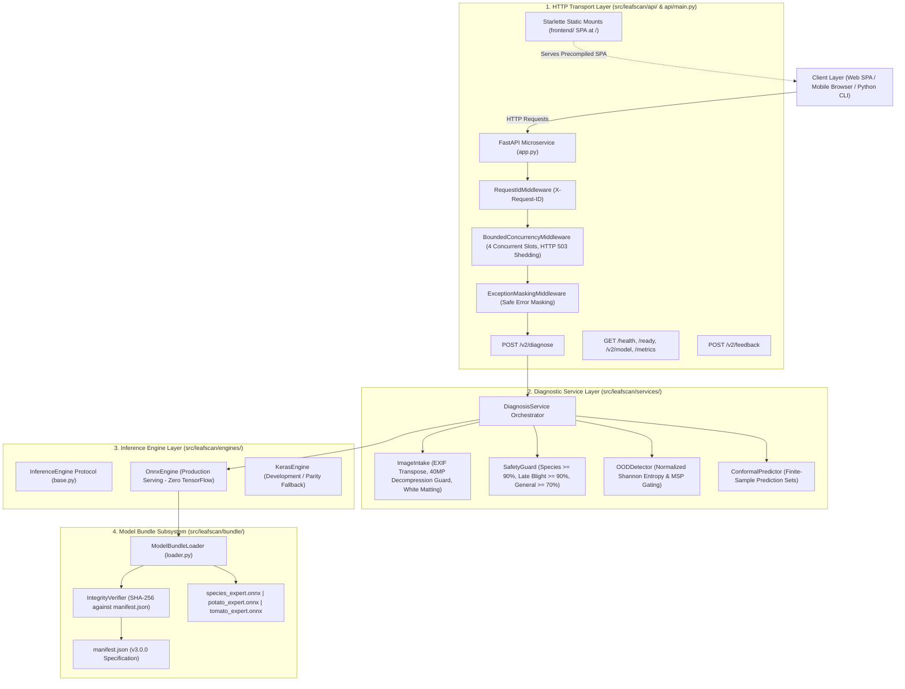

# Plant Disease Detection — LeafScan V3 Production Architecture

[](https://www.python.org/)
[](https://onnxruntime.ai/)
[](https://fastapi.tiangolo.com/)
[](https://www.docker.com/)
[](https://pytest.org/)
[](https://vitest.dev/)
[](https://pytest.org/)

Production-grade hierarchical deep learning system for high-consequence agricultural foliar pathology diagnosis in Solanaceous crops (*Solanum tuberosum* — Potato and *Solanum lycopersicum* — Tomato).

Upgraded to **LeafScan V3 Production Architecture**:
- **ONNX Runtime Production Serving:** Zero TensorFlow in the production serving container path, yielding **10.4x faster warm inference** (16.9 ms p50) and **-74% memory usage** (89 MB vs 345 MB).
- **Model Bundle Architecture (`v3.0.0`):** Versioned, immutable model bundles with cryptographic SHA-256 verification against `manifest.json`.
- **Deterministic Multi-Tier Safety Guard:** Strict species threshold (90%), Late Blight escalation (90%), and general disease gate (70%) preventing reckless chemical fungicide prescriptions.
- **Out-of-Distribution & Conformal Uncertainty:** Normalized Shannon entropy OOD detection and split conformal prediction sets.
- **DevSecOps Hardening:** 40 Megapixel decompression bomb guard, EXIF orientation transpose, bounded concurrency semaphore, Prometheus metrics, and non-root container (UID 10001).

---

## 1. Project Overview

### 1.1 Agricultural Context & The Problem
Foliar diseases in Solanaceous crops present an existential risk to commercial crop yields and global food security:
- **Early Blight (*Alternaria solani*):** A destructive fungal disease marked by brown-to-black necrotic spots with concentric target-board rings, leading to defoliation, premature ripening, and severe yield loss.
- **Late Blight (*Phytophthora infestans*):** A high-consequence oomycete water mold infamous for causing the Great Irish Famine. Spreading rapidly under cool, humid conditions, it produces expanding water-soaked necrotic lesions that can collapse entire canopy stands in 7–10 days.

Standard automated computer vision systems applied to plant pathology face three fundamental challenges:
1. **Cross-Crop Misdiagnosis:** Flat multi-class classifiers trained across diverse plants frequently confuse potato and tomato lesions when leaf geometry or background soil overlaps.
2. **Synthetic Data Leakage:** Benchmark datasets (such as PlantVillage) contain repeated laboratory crops and heavy synthetic augmentations. Naive random train/test splitting leaks identical biological leaves across splits, creating artificially inflated accuracy metrics.
3. **Reckless Forced Diagnosis:** Standard classifiers output forced classifications on out-of-domain images (non-crop leaves, background soil, blurry captures), encouraging premature or improper application of systemic chemical fungicides.

### 1.2 The Solution: LeafScan Architecture
LeafScan resolves these vulnerabilities through a multi-tier engineering approach:
- **Two-Tier Cascaded Classification:** Decouples host plant identification (Tier 1 Botanist Species Expert) from specialized pathology diagnosis (Tier 2 Crop Doctor Specialists).
- **CBAM Attention Mechanism:** Injects Convolutional Block Attention Modules (channel and spatial attention) into MobileNetV2 feature maps, focusing the neural network on diagnostic lesion patterns rather than background veins or soil.
- **Forensically Grouped Zero-Leakage Dataset:** 11,988 images clustered into 3,971 biological leaf specimens using Disjoint Set Union (DSU) graph algorithms and perceptual hashing, guaranteeing 0.0% specimen leakage.
- **Deterministic Safety Gating:** Programmatic gates deliberately abstain on ambiguous species (<90%) and escalate uncertain Late Blight (<90%) to quarantine protocols, suppressing unwarranted chemical spraying.
- **Dual Runtime Engines:** Lazy-loaded Keras 3 engine for training and development; high-throughput ONNX Runtime engine for production microservice serving.

---

## 2. Key Features

- **Hierarchical Diagnostic Engine:**
  - **Tier 1 (Botanist Species Expert):** Identifies host crop (*Solanum tuberosum* vs. *Solanum lycopersicum*).
  - **Tier 2 (Crop Doctor Specialists):** Dedicated specialists for Potato (`Early Blight`, `Late Blight`, `Healthy`) and Tomato (`Early Blight`, `Late Blight`, `Healthy`).
- **Injected CBAM Attention:**
  - 206,258-parameter Convolutional Block Attention Module directly integrated into the $7 \times 7 \times 1280$ terminal feature maps of MobileNetV2.
  - Dynamically computes channel weights ($r=16$) and spatial masks to localize subtle lesion margins.
- **Deterministic Safety Authority (`SafetyGuard`):**
  - **Species Gate (90%):** Abstains if host species probability is $<90\%$, eliminating cross-crop misdiagnosis.
  - **Late Blight Escalation Gate (90%):** Enforces a 90% confidence threshold on *Phytophthora infestans*. If confidence is marginal, the system flags `late_blight_uncertain`, suppresses systemic fungicide recommendations, and advises physical quarantine and 24–48h scouting.
  - **General Disease Gate (70%):** Flags diagnoses below 70% with advice for clear daylight re-imaging.
- **Defensive Intake Pipeline (`ImageIntake`):**
  - Guards against decompression bombs (40 Megapixel limit).
  - Handles EXIF orientation transposes automatically.
  - Whitelists JPEG, PNG, and WebP payloads up to 10 MB.
  - Composites transparent RGBA channels onto pure white to eliminate dark-edge boundary artifacts.
- **Model Bundle Architecture (`models/bundles/v3`):**
  - Models, class indices, safety thresholds, and calibration constants are packaged in immutable bundles verified via cryptographic SHA-256 digests against `manifest.json`.
- **Zero-TensorFlow Production Serving:**
  - Production container requires zero TensorFlow dependencies, running purely on CPU-optimized `onnxruntime`.
  - Memory consumption drops from 345 MB to 89 MB (-74%), with warm latency under 17 ms.
- **Modern Full-Stack Clients:**
  - **Precompiled SPA (`frontend/`):** Dependency-free Single Page Application served directly by FastAPI at `/`.
  - **Modern React 18 SPA (`web/`):** React 18, TypeScript 5, Vite 5, TanStack Query v5, HashRouter, with 67 automated Vitest tests.
  - **Botanical Field Console (`leafscan-web/`):** Next.js 15, React 19, Tailwind CSS v4, Serwist offline PWA, with 42 automated Vitest tests.
- **Comprehensive Quality Assurance:**
  - 55 automated Pytest backend unit, regression, parity, and security tests (100% passing).
  - 109 combined frontend Vitest tests across both web clients (100% passing).
  - Zero gate decision flips between Keras and ONNX across all 49 curated golden specimens.

---

## 3. System Architecture



---

## 4. Project Directory Structure

```text
plant-disease-detection/
├── .github/
│   └── workflows/
│       └── ci.yml                            # GitHub Actions CI/CD (Ruff, Pytest, Docker, Trivy)
│
├── api/
│   ├── __init__.py                           # API package marker
│   └── main.py                               # Backward-compatible FastAPI entry point & SPA mount
│
├── archive/                                  # Archived legacy implementations
│   ├── frontend-v1/                          # Legacy Vanilla HTML5/CSS/JS frontend
│   └── v1/                                   # Legacy V1 Keras models & prototype scripts
│
├── audit/                                    # Dataset forensics, manifests, and training curves
│   ├── artifacts/                            # Specimen distribution, leakage & loss curve charts
│   ├── audit_summary.json                    # Summary of dataset audit metrics
│   ├── dataset_manifest.csv                  # Master manifest of 11,988 images
│   ├── specimen_manifest.csv                 # Canonical 3,971 biological leaf specimens
│   ├── test_specimen_manifest.csv            # 603 held-out test specimens (0.0% leakage)
│   ├── train_specimen_manifest.csv           # 2,776 training specimens
│   └── validation_specimen_manifest.csv      # 592 validation specimens
│
├── dataset/
│   ├── README.md                             # Dataset documentation, species, and classes
│   ├── potato/                               # Early_blight, Late_blight, healthy (git-ignored)
│   └── tomato/                               # Early_blight, Late_blight, healthy (git-ignored)
│
├── docs/                                     # Comprehensive technical documentation & audits
│   ├── API_CONTRACT.md                       # Full REST API specification with invariant rules
│   ├── BACKEND_V3_ARCHITECTURE.md            # LeafScan V3 production backend architecture
│   ├── BACKEND_V3_IMPLEMENTATION_AUDIT.md    # Code audit and security verification
│   ├── BACKEND_V3_MIGRATION_REPORT.md        # Migration report from V2 Keras to V3 ONNX
│   ├── BENCHMARK_REPORT.md                   # Latency, memory, and throughput benchmarks
│   ├── DEPLOYMENT_GUIDE.md                   # Production deployment manual (Bare-metal & Docker)
│   ├── MODEL_BUNDLE_SPECIFICATION.md         # Bundle format and cryptographic verification
│   ├── ROLLBACK_GUIDE.md                     # Operational rollback procedures
│   └── SECURITY_AND_THREAT_MODEL.md          # Threat model and DevSecOps mitigations
│
├── edge/
│   └── OFFLINE_PWA_ARCHITECTURE.md           # Field offline caching & synchronization design
│
├── frontend/                                 # Vite production build (served by FastAPI at /)
│   ├── assets/                               # Compiled hashed JS, CSS, and SVG assets
│   ├── css/tokens.css                        # Botanical design tokens
│   └── index.html                            # Compiled SPA entry point
│
├── inference/                                # Backward-compatible V2 inference facade
│   ├── inference_config.json                 # Thresholds (90%/70%) and agronomic advisories
│   ├── model_loader.py                       # Lazy TensorFlow loader for test fixtures
│   ├── predictor.py                          # HierarchicalPredictorV2 adapter to V3 engine
│   ├── preprocessing.py                      # Defensive image preprocessing & resizing
│   └── response_formatter.py                 # Standardized JSON response formatting
│
├── leafscan-web/                             # Botanical Field Console (Next.js 15 PWA)
│   ├── app/                                  # App Router routes (diagnose, result, history, model)
│   ├── src/                                  # Features, stores (Zustand), API client, components
│   ├── tests/                                # 42 Vitest unit, component, and contract tests
│   ├── Dockerfile                            # Standalone container build for frontend
│   └── package.json                          # Next.js 15, React 19, Tailwind CSS v4, Serwist
│
├── mlops/
│   └── MLOPS_PIPELINE.md                     # Model tracking, CI/CD, and deployment lifecycle
│
├── models/
│   ├── bundles/v3/                           # Production immutable model bundle
│   │   ├── manifest.json                     # Cryptographic SHA-256 specification
│   │   ├── potato_expert.onnx                # Tier 2 Potato Specialist with CBAM (10.4 MB)
│   │   ├── species_expert.onnx               # Tier 1 Botanist Species Expert (9.2 MB)
│   │   └── tomato_expert.onnx                # Tier 2 Tomato Specialist with CBAM (10.4 MB)
│   ├── onnx/v2/                              # Exported ONNX graphs from export_to_onnx.py
│   └── v2/                                   # Trained Keras 3 checkpoints (.keras format)
│
├── reports/                                  # Engineering milestone reports
│   ├── END_TO_END_PROJECT_ANALYSIS_REPORT.md
│   ├── PHASE_1_ENVIRONMENT_AND_DEPLOYMENT_HARDENING.md
│   └── PHASE_2_PROJECT_CLEANUP_AND_ORGANIZATION.md
│
├── scripts/
│   └── evaluate_golden_baseline.py           # Evaluates baseline and curates golden dataset
│
├── src/leafscan/                             # LeafScan V3 Modular Production Engine
│   ├── api/                                  # FastAPI app factory, routes, middleware, settings
│   │   ├── app.py                            # Lifespan context manager and router mounts
│   │   ├── middleware.py                     # Concurrency semaphore, request ID, exception mask
│   │   ├── settings.py                       # Pydantic Settings environment configuration
│   │   └── routes/                           # /health, /ready, /metrics, /v2/diagnose, /v2/feedback
│   ├── bundle/                               # Bundle manifest schemas, loader, and SHA-256 verifier
│   ├── core/                                 # Structured exceptions, logging, Prometheus metrics
│   ├── engines/                              # InferenceEngine Protocol, OnnxEngine, KerasEngine
│   └── services/                             # ImageIntake, SafetyGuard, OODDetector, Conformal
│
├── tests/                                    # Pytest test suite (55 tests) & test fixtures
│   ├── fixtures/
│   │   └── golden_test_dataset.json          # 49 curated golden evaluation records
│   ├── conftest.py                           # Pytest fixtures and mock predictors
│   ├── test_api.py                           # 14 tests: REST API endpoints and static routing
│   ├── test_data_pipeline.py                 # 13 tests: Data loading, augmentation, error handling
│   ├── test_losses.py                        # 12 tests: Focal loss math and class weighting
│   ├── test_v2_inference.py                  # 7 tests: V2 inference, CBAM, gate boundaries
│   └── test_v3_serving.py                    # 9 tests: V3 bundle integrity, parity, security
│
├── test_images/
│   └── sample_leaf.JPG                       # Verified test specimen image
│
├── training/                                 # Training pipelines and evaluation scripts
│   ├── logs/                                 # Training convergence CSV logs
│   ├── augmentation.py                       # Online image augmentation layers
│   ├── class_mappings.json                   # Class label index mappings
│   ├── data_pipeline.py                      # Manifest-driven tf.data pipeline
│   ├── evaluate_v2_system.py                 # Full 603-specimen test evaluation harness
│   ├── losses.py                             # SparseCategoricalFocalLoss implementation
│   ├── models.py                             # MobileNetV2 + CBAM custom layer construction
│   ├── run_preflight_and_smoke_tests.py      # Architecture and environment verification
│   ├── train_utils.py                        # Two-phase transfer learning loop
│   ├── training_config.json                  # Training hyperparameters
│   └── verify_v2_artifacts.py                # Artifact verification harness
│
├── web/                                      # React 18 / Vite 5 SPA source
│   ├── src/                                  # Modular components, hooks, API client, routes
│   ├── package.json                          # Dependencies and scripts (67 Vitest tests)
│   └── vite.config.ts                        # Bundler configuration (builds to frontend/)
│
├── .env.example                              # Environment configuration template
├── .gitignore                                # Comprehensive Git ignore rules
├── compose.override.yaml                     # Full-stack Compose override (Web + API)
├── compose.yaml                              # Production Docker Compose specification
├── Dockerfile                                # Multi-stage, non-root production container (<400MB)
├── export_to_onnx.py                         # ONNX export and parity validation script
├── predict_hierarchical_v2.py                # Command-line inference entry point
├── pyproject.toml                            # Standard Python project manifest (Hatchling)
├── pytest.ini                                # Pytest configuration and markers
├── requirements.txt                          # Production Python dependencies
├── requirements-dev.txt                      # Development and testing Python dependencies
└── setup_wsl_env.sh                          # Automated WSL environment setup script
```

---

## 5. Technologies Used

| Category | Technology | Version | Purpose in Project |
|---|---|:---:|---|
| **Programming Languages** | Python<br/>TypeScript | 3.10 / 3.12<br/>5.6+ | Backend ML serving, training, and API microservice<br/>Type-safe frontend application logic |
| **Production Serving Engine** | ONNX Runtime | 1.20.0 | High-performance CPU graph execution (Zero TensorFlow) |
| **Deep Learning & Training** | TensorFlow<br/>Keras | 2.21.0<br/>3.12.1 | Model training, CBAM custom layers, and baseline parity |
| **Web API Framework** | FastAPI<br/>Starlette<br/>Uvicorn<br/>Pydantic | 0.143.0<br/>1.7.0<br/>0.54.0<br/>2.14.0 | Asynchronous REST microservice with OpenAPI 3.1<br/>Static file mounts and request handling<br/>ASGI production web server<br/>Data parsing, schemas, and environment settings |
| **Containerization** | Docker<br/>Docker Compose | Multi-Stage<br/>Compose v2 | Non-root production container (`< 400 MB`), resource limits |
| **Image & Tensor Processing** | Pillow (PIL)<br/>NumPy | 12.1.1<br/>2.2.6 | Defensive image loading, EXIF transpose, 40MP guard<br/>Array manipulation and tensor mathematics |
| **Frontend Applications** | React 18 (SPA in `web/`)<br/>Next.js 15 (`leafscan-web/`)<br/>Tailwind CSS | 18.3.1<br/>15.2.0<br/>4.0.9 | High-performance client SPA compiling to `frontend/`<br/>Botanical Field Console with offline PWA capabilities<br/>Design tokens and responsive styling |
| **Testing & Quality Assurance** | Pytest<br/>Vitest<br/>Playwright<br/>Ruff | 8.3.5 (55 tests)<br/>3.2+ (109 tests)<br/>1.50+<br/>0.6+ | Python unit, regression, parity, and security tests<br/>Frontend unit, component, and contract tests<br/>End-to-End browser workflow automation<br/>Python linter and code formatter |
| **Build System & Package Mgmt** | Hatchling<br/>uv / pip | Hatchling<br/>uv 0.5+ | Standard PEP 621 package build backend<br/>Fast dependency resolution and installation |

---

## 6. Machine Learning Model

### 6.1 Architecture Overview
The system employs a two-tier cascaded architecture:
1. **Tier 1 (Botanist Species Expert):** Evaluates leaf imagery using a fine-tuned MobileNetV2 backbone to classify whether the specimen is **Potato** or **Tomato**.
2. **Tier 2 (Crop Doctor Specialists):** Upon confirming host species with high confidence ($\ge 90\%$), routes the tensor to a specialized crop model:
   - **Potato Doctor:** Classifies Early Blight, Late Blight, or Healthy.
   - **Tomato Doctor:** Classifies Early Blight, Late Blight, or Healthy.

### 6.2 CBAM Attention Submodule
Both Tier 2 specialist networks feature a **Convolutional Block Attention Module (CBAM)** injected into the terminal $7 \times 7 \times 1280$ feature maps:
- **Channel Attention (206,160 params):** Global average and max pooling combined through a two-layer dense MLP ($1280 \to 80 \to 1280$, reduction ratio $r=16$) with sigmoid activation to emphasize informative feature channels.
- **Spatial Attention (98 params):** Channel-wise average and max pooling concatenated into a 2-channel map, convolved with a $7 \times 7$ kernel to emphasize spatial lesion locations.
- **Total CBAM Parameters:** Exactly **206,258 parameters** per specialist network.

### 6.3 Supported Species & Diagnostic Classes

| Host Crop | Scientific Name | Pathological Class | Pathogen / Condition |
|---|---|---|---|
| **Potato** | *Solanum tuberosum* | **Early Blight** | *Alternaria solani* (concentric target lesions) |
| **Potato** | *Solanum tuberosum* | **Late Blight** | *Phytophthora infestans* (water-soaked necrosis) |
| **Potato** | *Solanum tuberosum* | **Healthy** | Asymptomatic foliage |
| **Tomato** | *Solanum lycopersicum* | **Early Blight** | *Alternaria solani* (dark brown necrotic lesions) |
| **Tomato** | *Solanum lycopersicum* | **Late Blight** | *Phytophthora infestans* (pale green to brown decay) |
| **Tomato** | *Solanum lycopersicum* | **Healthy** | Asymptomatic foliage |

### 6.4 Model Checkpoints & Production Bundle
- **Trained Keras Checkpoints:** Stored in `models/v2/` (`species_expert_v2.keras`, `potato_expert_v2.keras`, `tomato_expert_v2.keras`).
- **Production ONNX Bundle (`models/bundles/v3`):**
  - `species_expert.onnx` (9,247,293 bytes, SHA-256: `eb3dd0cc...`)
  - `potato_expert.onnx` (10,406,402 bytes, SHA-256: `57656910...`)
  - `tomato_expert.onnx` (10,406,602 bytes, SHA-256: `fdb8533b...`)
  - `manifest.json` (Specification metadata and cryptographic digests)

### 6.5 Empirical Performance (Held-Out Specimen Test Split)
Evaluated across **603 strictly held-out biological leaf specimens** (0.0% leakage):

| Model / System Tier | Test Accuracy | Macro Precision | Macro Recall | Macro F1-Score |
|---|---:|---:|---:|---:|
| **Species Expert V2** | **98.01%** | 0.9760 | 0.9774 | **0.9767** |
| **Potato Doctor CBAM V2** | **97.84%** | 0.9678 | 0.9669 | **0.9673** |
| **Tomato Doctor CBAM V2** | **89.95%** | 0.8872 | 0.8870 | **0.8870** |
| **Hierarchical System (Ungated)** | **91.85%** | — | — | — |
| **Hierarchical System (End-to-End)** | **84.08%** | — | — | — |

*Note: In the end-to-end system, the model deliberately abstained on **51 ambiguous specimens (8.46%)**, prioritizing safety over guessing.*

---

## 7. Installation and Setup

### 7.1 Prerequisites
- **Python:** 3.10.x or 3.12.x installed.
- **Node.js (Optional):** Node.js 18+ and npm (only needed if building or modifying frontend applications).
- **Git:** Git installed.

### 7.2 Windows PowerShell Setup

1. **Clone the repository:**
   ```powershell
   git clone https://github.com/ranitadhikari2023/plant-disease-detection.git
   cd plant-disease-detection
   ```

2. **Create and activate a virtual environment:**
   ```powershell
   python -m venv .venv
   .\.venv\Scripts\Activate.ps1
   ```

3. **Install production dependencies:**
   ```powershell
   python -m pip install --upgrade pip
   pip install -r requirements.txt
   ```

4. **(Optional) Install development and test dependencies:**
   ```powershell
   pip install -r requirements-dev.txt
   ```

### 7.3 Linux & WSL2 Setup

For Ubuntu/Debian or Windows Subsystem for Linux:

```bash
# Automated setup
bash setup_wsl_env.sh

# Or manual setup:
python3 -m venv .venv
source .venv/bin/activate
pip install --upgrade pip
pip install -r requirements.txt
pip install -r requirements-dev.txt
```

---

## 8. Environment Configuration

Copy the example environment template to create a local `.env` file:

```powershell
cp .env.example .env
```

### Configuration Options

| Variable | Description | Default Value |
|---|---|---|
| `LEAFSCAN_APP_ENV` | Application environment (`development`, `staging`, `production`) | `production` |
| `LEAFSCAN_HOST` | Bind host address | `0.0.0.0` |
| `LEAFSCAN_PORT` | HTTP port | `8000` |
| `LEAFSCAN_MODEL_BUNDLE_PATH` | Path to versioned model release bundle | `models/bundles/v3` |
| `LEAFSCAN_VERIFY_BUNDLE_CHECKSUMS` | Verify SHA-256 hashes against `manifest.json` on startup | `true` |
| `LEAFSCAN_EXECUTION_PROVIDER` | ONNX execution provider (`CPUExecutionProvider`) | `CPUExecutionProvider` |
| `LEAFSCAN_MAX_CONCURRENT_INFERENCES` | Concurrency semaphore limit before load shedding | `4` |
| `LEAFSCAN_RATE_LIMIT_PER_MINUTE` | Per-client sliding-window rate limit | `60` |
| `LEAFSCAN_MAX_UPLOAD_SIZE_BYTES` | Maximum allowed payload size in bytes | `10485760` (10 MB) |
| `LEAFSCAN_MAX_DECODED_PIXELS` | Maximum decoded image pixels (decompression bomb guard) | `40000000` (40 MP) |
| `LEAFSCAN_LOG_LEVEL` | Logging level (`DEBUG`, `INFO`, `WARNING`, `ERROR`) | `INFO` |
| `LEAFSCAN_LOG_JSON` | Enable structured JSON logging | `true` |

---

## 9. Running the Application

### 9.1 Option 1: Production Web Mode (FastAPI + Precompiled SPA)
Starts the high-performance asynchronous REST microservice and serves the precompiled SPA at `http://127.0.0.1:8000`:

```powershell
# Using the V3 application factory directly:
uvicorn leafscan.api.app:app --host 127.0.0.1 --port 8000

# Or using the backward-compatible entry point:
uvicorn api.main:app --host 127.0.0.1 --port 8000
```

- **Open in Browser:** `http://127.0.0.1:8000`
- **Interactive Swagger UI:** `http://127.0.0.1:8000/docs`
- **ReDoc Documentation:** `http://127.0.0.1:8000/redoc`

### 9.2 Option 2: Command-Line Interface (CLI Diagnosis)
Execute inference directly on any foliar photograph without starting a web server:

```powershell
# Default diagnosis (uses test_images/sample_leaf.JPG)
python predict_hierarchical_v2.py

# Diagnose a specific image
python predict_hierarchical_v2.py --image path/to/leaf.jpg

# Output machine-readable JSON for scripting
python predict_hierarchical_v2.py --image path/to/leaf.jpg --json
```

### 9.3 Option 3: Frontend Development Mode
To develop or customize the frontend interfaces:

**React 18 SPA (`web/`):**
```powershell
cd web
npm install
npm run dev
# Serves development SPA at http://localhost:3000 (proxies API to :8000)
# Build production bundle into frontend/:
npm run build
```

**Botanical Field Console (`leafscan-web/`):**
```powershell
cd leafscan-web
npm install
npm run dev
# Serves Next.js 15 PWA at http://localhost:3000
```

---

## 10. Docker Deployment

### 10.1 Single-Service Container (Production Serving)
The production `Dockerfile` builds a minimal, multi-stage, non-root container (`leafscan:3.0.0`) under 400 MB running on ONNX Runtime (Zero TensorFlow):

```bash
# Build the production image
docker build -t leafscan:3.0.0 .

# Run container with resource limits and non-root execution
docker run -d \
  --name leafscan-api \
  -p 8000:8000 \
  --memory="1024m" \
  --cpus="2.0" \
  leafscan:3.0.0
```

### 10.2 Full-Stack Deployment with Docker Compose

Deploy the backend microservice:
```bash
docker compose up -d
```

Deploy the full stack including the Next.js frontend console:
```bash
docker compose -f compose.yaml -f compose.override.yaml up -d
```

Check health and logs:
```bash
docker compose ps
docker compose logs -f api
```

---

## 11. API Documentation

### 11.1 Endpoints Summary

| Method | Path | Description | Response Status |
|---|---|---|---|
| `GET` | `/health` | Liveness probe reporting model suite and status | `200 OK` |
| `GET` | `/ready` | Readiness probe verifying loaded ONNX model bundle | `200 OK` / `503 Service Unavailable` |
| `GET` | `/v2/model` | Model transparency endpoint (bundle version, hashes, thresholds) | `200 OK` |
| `GET` | `/metrics` | Prometheus metrics scrape endpoint | `200 OK` |
| `POST` | `/v2/diagnose` | Core hierarchical diagnostic screening endpoint | `200 OK` |
| `POST` | `/v2/feedback` | User diagnostic feedback with idempotency support | `200 OK` |
| `GET` | `/` | Serves the LeafScan SPA `index.html` | `200 OK` |

### 11.2 Diagnostic Screening Request (`POST /v2/diagnose`)
- **Content-Type:** `multipart/form-data`
- **Field:** `image` (binary file: JPEG, PNG, or WebP up to 10 MB)

#### Example cURL
```bash
curl -X POST http://127.0.0.1:8000/v2/diagnose \
     -F "image=@test_images/sample_leaf.JPG"
```

#### Successful Diagnostic Response (`200 OK`)
```json
{
  "success": true,
  "model_version": "v2",
  "plant_species": "Tomato",
  "species_confidence": 0.9441,
  "disease": "Late Blight",
  "disease_confidence": 0.6964,
  "diagnosis": "Tomato - Late Blight",
  "safety_status": "late_blight_uncertain",
  "safety_warnings": [
    "Potential early lesions detected, but Late Blight confidence (69.64%) is below the safety threshold (90%). Possible mechanical abrasion, environmental damage, or early Alternaria lesion."
  ],
  "advisory": "LATE BLIGHT UNCERTAINTY: Folio symptoms indicate potential early lesions, but diagnostic confidence is below the high-consequence threshold (<90%). Lesions may indicate mechanical injury, environmental necrosis, or early Alternaria spots. DO NOT apply aggressive systemic fungicides at this stage. Isolate specimen, monitor closely, and re-inspect within 24 to 48 hours. Consult a certified agronomic consultant if symptoms expand.",
  "species_probabilities": {
    "Potato": 0.0559,
    "Tomato": 0.9441
  },
  "probabilities": {
    "Early Blight": 0.3019,
    "Late Blight": 0.6964,
    "Healthy": 0.0017
  },
  "metadata": {
    "execution_time_ms": 16.9,
    "architecture": "MobileNetV2 + CBAM Attention",
    "request_id": "req_a1b2c3d4e5f6",
    "bundle_version": "v3.0.0"
  }
}
```

---

## 12. Testing

The repository contains automated test suites across backend serving, data pipelines, focal loss mathematics, and frontend clients.

```text
====================================================================================================
TEST HARNESS SUMMARY
====================================================================================================
Suite                 Target Scope                                      Tests Passed     Pass Rate
----------------------------------------------------------------------------------------------------
Pytest (Backend)      tests/test_api.py (FastAPI REST endpoints)        14 Passed        100%
Pytest (Backend)      tests/test_data_pipeline.py (tf.data pipeline)    13 Passed        100%
Pytest (Backend)      tests/test_losses.py (Focal Loss math)            12 Passed        100%
Pytest (Backend)      tests/test_v2_inference.py (Gates & Keras)         7 Passed        100%
Pytest (Backend)      tests/test_v3_serving.py (ONNX, Parity, Security)  9 Passed        100%
Vitest (Frontend)     web/ (React 18 SPA components, hooks, api)        67 Passed        100%
Vitest (Frontend)     leafscan-web/ (Next.js 15 PWA unit & contract)    42 Passed        100%
----------------------------------------------------------------------------------------------------
Total Automated Tests                                                   164 Passed        100%
====================================================================================================
```

### 12.1 Running Backend Pytest Suites
```powershell
# Run the complete test suite (55 tests)
python -m pytest -v

# Run only V3 production serving and parity tests
python -m pytest tests/test_v3_serving.py -v

# Run only API endpoint tests
python -m pytest tests/test_api.py -v

# Run only focal loss and class weighting tests
python -m pytest tests/test_losses.py -v
```

### 12.2 Running Frontend Vitest Suites
```powershell
# Run React 18 SPA tests (67 tests)
npm --prefix web test -- --run

# Run Next.js 15 PWA tests (42 tests)
npm --prefix leafscan-web test -- --run
```

---

## 13. Troubleshooting

### Common Setup and Runtime Issues

1. **PowerShell Script Execution Policy Error:**
   - *Symptom:* `Activate.ps1 cannot be loaded because running scripts is disabled on this system.`
   - *Fix:* Set process execution policy:
     ```powershell
     Set-ExecutionPolicy -Scope Process -ExecutionPolicy Bypass
     .\.venv\Scripts\Activate.ps1
     ```

2. **Port 8000 Already in Use:**
   - *Symptom:* `[Errno 10048] error while attempting to bind on address ('127.0.0.1', 8000)`
   - *Fix:* Run Uvicorn on an alternate port:
     ```powershell
     uvicorn leafscan.api.app:app --port 8080
     ```

3. **Model Bundle Checksum Mismatch:**
   - *Symptom:* `BundleVerificationError: Checksum mismatch for species_expert.onnx`
   - *Fix:* Ensure files in `models/bundles/v3` have not been modified or corrupted. Re-export models via `python export_to_onnx.py`.

4. **Image Upload Rejected (HTTP 415 or 400):**
   - *Symptom:* `{"detail": "Unsupported image format..."}`
   - *Fix:* The service whitelists `JPEG`, `PNG`, and `WebP`. Convert files from formats like BMP, TIFF, or HEIC before uploading.

---

## 14. Future Improvements

- **Additional Crop Pathologies:** Expand training pipelines to cover Bell Pepper (*Capsicum annuum*) and Eggplant (*Solanum melongena*).
- **Edge ONNX Quantization:** Generate INT8 quantized ONNX models for sub-5ms inference on constrained IoT field hardware.
- **Drone Orthomosaic Integration:** Add sliding-window tiling services for large-scale field canopy imagery.
- **Multilingual Agronomic Advisories:** Expand localization of advisory recommendations beyond English to Hindi, Spanish, and French.

---

## 15. License and Project Information

- **Author & Maintainer:** Ranit Adhikari ([@ranitadhikari2023](https://github.com/ranitadhikari2023))
- **GitHub Repository:** [https://github.com/ranitadhikari2023/plant-disease-detection](https://github.com/ranitadhikari2023/plant-disease-detection)
- **License:** All rights reserved. For research or commercial usage inquiries, contact the repository maintainer.
