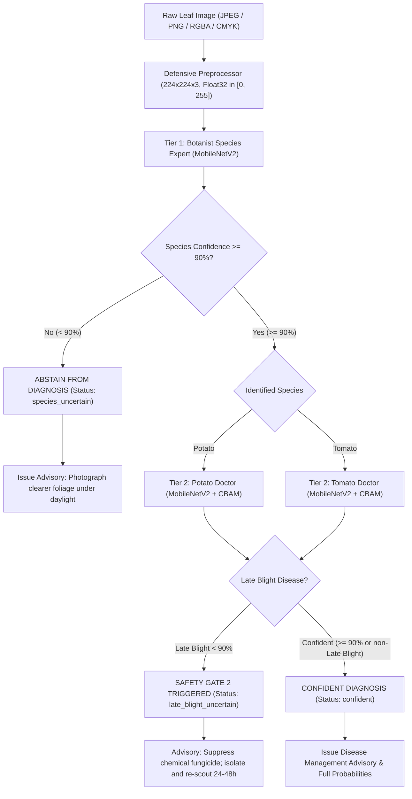

# Plant Disease Detection — Hierarchical Deep Learning System (V2)

[](https://www.python.org/)
[](https://www.tensorflow.org/)
[](https://keras.io/)
[](https://onnxruntime.ai/)
[](https://pytest.org/)

Production-grade hierarchical deep learning system for high-consequence agricultural foliar pathology in Solanaceous crops (*Solanum tuberosum* and *Solanum lycopersicum*). Built with **MobileNetV2**, **Convolutional Block Attention Module (CBAM)**, **Dual Confidence Safety Gates**, and **ONNX Runtime** deployment graphs.

---

## 1. Key Features

- **Two-Tier Cascaded Architecture:** Decouples crop identification (Botanist Species Expert) from specialized pathology diagnosis (Crop Doctors) to eliminate cross-crop misclassification.
- **CBAM Attention Mechanism:** 206,258-parameter spatial and channel attention submodule injected into MobileNetV2 terminal feature maps to capture fine-grained necrotic lesion rings.
- **Zero-Leakage Specimen Splitting:** Graph-based Disjoint Set Union (DSU) clustering with perceptual hashing resolves 66.88% synthetic dataset redundancy, guaranteeing 0.0% biological leakage between train, validation, and test splits.
- **Dual Confidence Safety Gates:**
  - *Species Gate (90%):* Deliberately abstains from disease diagnosis if botanical species confidence is marginal (<90%).
  - *Late Blight Escalation Gate (90%):* Flags uncertain *Phytophthora infestans* predictions, suppressing reckless fungicide application and recommending isolation and 24–48h re-scouting.
- **Defensive Preprocessing:** Handles RGB, RGBA (alpha-composited onto pure white to eliminate dark edge artifacts), CMYK, Grayscale, and NumPy array formats.
- **Dual Runtime Deployment:** Supports native Keras 3 inference and headless, microsecond-latency ONNX Runtime CPU graphs.
- **Enterprise Testing Infrastructure:** 32 automated Pytest unit and regression tests covering inference safety, data pipelines, and focal loss functions.

---

## 2. Technology Stack

| Component | Verified Specification | Role / Function |
|---|---|---|
| **Programming Language** | Python 3.10.0 (Windows `.venv`) / Python 3.12.3 (WSL) | Core runtime environment |
| **Deep Learning Framework** | TensorFlow 2.21.0 / Keras 3.12.1 | Model training, serialization, and native inference |
| **Numerical Computing** | NumPy 2.2.6 | Array manipulation and tensor transformations |
| **Image Processing** | Pillow (PIL) 12.1.1 | Image loading, format conversion, and bilinear resizing |
| **Model Deployment** | ONNX 1.23.2 / ONNX Runtime 1.20.0 / tf2onnx 1.17.0 | High-performance CPU graph execution and validation |
| **Testing & Quality** | Pytest 8.3.5 / Iniconfig 2.3.1 / Pluggy 1.7.0 | Automated unit testing and regression verification |

---

## 3. System Architecture

The V2 production pipeline routes raw leaf imagery through two hierarchical tiers with strict confidence boundaries:



---

## 4. Model Architecture & Specifications

All production checkpoints reside in `models/v2/` with corresponding ONNX graphs in `models/onnx/v2/`:

| Model Designation | File Path | Total Parameters | Trainable | Non-Trainable | CBAM Attention | Target Classes |
|---|---|---:|---:|---:|:---:|---|
| **Species Expert V2** | `models/v2/species_expert_v2.keras` | 2,340,098 | 1,745,474 | 594,624 | None (Standard) | 2 (`Potato`, `Tomato`) |
| **Potato Doctor CBAM V2** | `models/v2/potato_expert_v2.keras` | 2,628,597 | 2,033,973 | 594,624 | **206,258** | 3 (`Early Blight`, `Late Blight`, `Healthy`) |
| **Tomato Doctor CBAM V2** | `models/v2/tomato_expert_v2.keras` | 2,628,597 | 2,033,973 | 594,624 | **206,258** | 3 (`Early Blight`, `Late Blight`, `Healthy`) |

### Class Index Mappings (`training/class_mappings.json`)
- **Species Classifier:** `0: Potato`, `1: Tomato`
- **Crop Specialists (Potato & Tomato):** `0: Early Blight`, `1: Late Blight`, `2: Healthy`

### CBAM Attention Submodule Anatomy
Injected directly at the terminal $7 \times 7 \times 1280$ feature maps of MobileNetV2:
- **Channel Attention (206,160 parameters):** Shared two-layer MLP with reduction ratio $r=16$ ($1280 \to 80 \to 1280$) operating over spatial average-pooled and max-pooled vectors.
- **Spatial Attention (98 parameters):** $7 \times 7 \times 2 \times 1$ convolution (without bias) over concatenated channel-average and channel-max pooled feature slices followed by sigmoid activation.

---

## 5. Dataset Overview & Zero-Leakage Split

The raw dataset comprises **11,988 JPEG images** evenly divided across 6 classes (1,998 images per class). 

### Forensic Redundancy Discovery
Forensic hashing (SHA-256 and perceptual dHash/aHash) revealed that **66.88% (8,017 images)** of the dataset are synthetic augmentations (`_ccrp_` center crops, `_gblr_` blurs, `_rrot_` rotations) or exact duplicates. Most critically, `potato/healthy` contained only **90 unique biological leaves** duplicated into 1,998 files.

### Leakage-Free Specimen Grouping
To eliminate data leakage where augmented variations of the same leaf appear in both training and test sets, a **Disjoint Set Union (DSU)** graph clustering algorithm isolated **3,971 true biological specimens**:

| Split Manifest | Unique Specimens | Raw Image Equivalent | Biological Overlap |
|---|---:|---:|:---:|
| **Train Specimen Manifest** (`audit/train_specimen_manifest.csv`) | 2,776 | 8,256 | **0.0%** |
| **Validation Specimen Manifest** (`audit/validation_specimen_manifest.csv`) | 592 | 1,860 | **0.0%** |
| **Held-Out Test Specimen Manifest** (`audit/test_specimen_manifest.csv`) | 603 | 1,872 | **0.0%** |

---

## 6. Empirical Evaluation Results

Evaluated across **603 strictly held-out biological leaf specimens** with zero data leakage:

### Individual Model Performance

| Model | Test Accuracy | Macro Precision | Macro Recall | Macro F1-Score |
|---|---:|---:|---:|---:|
| **Species Expert V2** | **98.01%** | 0.9760 | 0.9774 | **0.9767** |
| **Potato Doctor CBAM V2** | **97.84%** | 0.9678 | 0.9669 | **0.9673** |
| **Tomato Doctor CBAM V2** | **89.95%** | 0.8872 | 0.8870 | **0.8870** |

### End-to-End Hierarchical System Performance

| Metric | Result | Description |
|---|---:|---|
| **Diagnostic Accuracy (Ungated)** | **91.85%** | Correct condition on leaves that passed the 90% species gate |
| **End-to-End System Accuracy** | **84.08%** | Overall correct diagnosis across all test specimens including abstentions |
| **Safety Gate Abstention Rate** | **8.46%** | Deliberately abstained on 51 ambiguous leaflets (<90% confidence) |
| **Botanist Routing Errors** | **3 specimens** | Only 3 out of 603 leaves were routed to the wrong specialist |

---

## 7. Repository Structure

```text
D:\plant-disease-detection\
│
├── archive/                                 # Preserved legacy implementations
│   └── v1/
│       ├── README.md                        # Historical provenance documentation
│       ├── predict_hierarchical.py          # Deprecated V1 inference script
│       └── models/                          # Legacy V1 checkpoints (10-11 MB each)
│           ├── species_expert.keras
│           ├── potato_expert.keras
│           └── tomato_expert.keras
│
├── audit/                                   # Data leakage audit manifests and charts
│   ├── artifacts/                           # Quantitative evaluation charts & metrics
│   ├── dataset_manifest.csv                 # Master manifest of 11,988 raw images
│   ├── specimen_manifest.csv                # Canonical 3,971 biological specimens
│   ├── test_specimen_manifest.csv           # 603 held-out test specimens
│   ├── train_specimen_manifest.csv          # 2,776 training specimens
│   └── validation_specimen_manifest.csv     # 592 validation specimens
│
├── dataset/                                 # Raw image repository (excluded from git)
│   ├── potato/                              # Early_blight, Late_blight, healthy
│   └── tomato/                              # Early_blight, Late_blight, healthy
│
├── docs/                                    # Architectural specifications and audit reports
├── inference/                               # Production V2 inference engine
│   ├── __init__.py
│   ├── model_loader.py                      # Thread-safe model cache with safe_mode=True
│   ├── predictor.py                         # HierarchicalPredictorV2 & predict_v2()
│   ├── preprocessing.py                     # Defensive image loader & RGBA alpha blending
│   ├── response_formatter.py                # Schema-validated JSON response formatter
│   └── inference_config.json                # Runtime thresholds and gate configurations
│
├── models/
│   ├── v2/                                  # Production V2 trained Keras models
│   │   ├── species_expert_v2.keras          # 23.9 MB
│   │   ├── potato_expert_v2.keras           # 27.4 MB
│   │   └── tomato_expert_v2.keras           # 27.4 MB
│   └── onnx/
│       └── v2/                              # Compiled ONNX Runtime deployment graphs
│           ├── species_expert_v2.onnx       # 8.82 MB (Opset 17)
│           ├── potato_expert_v2.onnx        # 9.92 MB (Opset 17)
│           └── tomato_expert_v2.onnx        # 9.92 MB (Opset 17)
│
├── reports/                                 # Formal phase completion and audit reports
│   ├── END_TO_END_PROJECT_ANALYSIS_REPORT.md
│   ├── PHASE_1_ENVIRONMENT_AND_DEPLOYMENT_HARDENING.md
│   └── PHASE_2_PROJECT_CLEANUP_AND_ORGANIZATION.md
│
├── tests/                                   # Modern Pytest testing infrastructure
│   ├── conftest.py                          # Shared Pytest fixtures & synthetic data factories
│   ├── test_data_pipeline.py                # Unit tests for tf.data pipeline & batching
│   ├── test_losses.py                       # Unit tests for focal loss & class weighting
│   └── test_v2_inference.py                 # 7 regression suites for V2 inference & safety
│
├── training/                                # Training, loss, and evaluation utilities
│   ├── augmentation.py                      # Online data augmentation layers
│   ├── class_mappings.json                  # Canonical index-to-label mappings
│   ├── data_pipeline.py                     # Manifest-driven tf.data dataset builder
│   ├── evaluate_v2_system.py                # Full evaluation harness on held-out test split
│   ├── losses.py                            # SparseCategoricalFocalLoss & class weighting
│   ├── models.py                            # MobileNetV2 + CBAM model construction
│   ├── run_preflight_and_smoke_tests.py     # Hardware audit and architecture smoke tests
│   └── verify_v2_artifacts.py               # Deep artifact inspection and hash validator
│
├── export_to_onnx.py                        # Production ONNX export engine with parity checks
├── predict_hierarchical_v2.py               # Production CLI entry point for V2 inference
├── pytest.ini                               # Pytest configuration and marker registration
├── requirements.txt                         # Pinned production runtime dependencies
├── requirements-dev.txt                     # Pinned development and testing dependencies
├── setup_wsl_env.sh                         # Turnkey automated WSL environment setup script
├── train_species.py                         # Root entry point: Train Botanist Species Expert
├── train_potato_doctor.py                   # Root entry point: Train Potato Doctor CBAM
└── train_tomato_doctor.py                   # Root entry point: Train Tomato Doctor CBAM
```

---

## 8. Environment Setup

### 8.1 Windows PowerShell Setup (Python 3.10)

Create and activate the virtual environment:

```powershell
# Create virtual environment using Python 3.10
py -3.10 -m venv .venv

# Activate virtual environment
.\.venv\Scripts\Activate.ps1

# Upgrade pip to latest release
python -m pip install --upgrade pip

# Install pinned production dependencies
pip install -r requirements.txt
```

### 8.2 Development & Testing Dependencies

To run the automated Pytest test suite, install the development dependencies:

```powershell
pip install -r requirements-dev.txt
```

Verify dependency resolution:

```powershell
python -m pip check
```

### 8.3 WSL Environment Setup (Linux Ext4)

For Linux and WSL deployments, an automated isolation script is provided:

```bash
bash setup_wsl_env.sh
```

> [!NOTE]
> **WSL Virtualization Requirement:**  
> If WSL2 reports `HCS_E_SERVICE_NOT_AVAILABLE`, ensure that **Virtual Machine Platform** is enabled in Windows Features (`dism.exe /online /enable-feature /featurename:VirtualMachinePlatform /all /norestart`) and hardware virtualization (VT-x/AMD-V) is enabled in your system BIOS.

---

## 9. Running Inference

### 9.1 Interactive CLI Diagnosis

Execute inference on any leaf image using the production V2 entry point:

```bash
python predict_hierarchical_v2.py --image test_images/sample_leaf.JPG
```

### 9.2 Machine-Readable JSON Output

Pass the `--json` flag for microservice integration:

```bash
python predict_hierarchical_v2.py --image test_images/sample_leaf.JPG --json
```

**Sample Diagnostic Output:**

```json
{
  "success": true,
  "model_version": "v2",
  "plant_species": "Tomato",
  "species_confidence": 0.9441,
  "disease": "Late Blight",
  "disease_confidence": 0.6964,
  "diagnosis": "Tomato - Late Blight",
  "safety_status": "late_blight_uncertain",
  "safety_warnings": [
    "Potential early lesions detected, but Late Blight confidence (69.64%) is below the safety threshold (90%). Possible mechanical abrasion, environmental damage, or early Alternaria lesion."
  ],
  "advisory": "LATE BLIGHT UNCERTAINTY: Folio symptoms indicate potential early lesions, but diagnostic confidence is below the high-consequence threshold (<90%). Lesions may indicate mechanical injury, environmental necrosis, or early Alternaria spots. DO NOT apply aggressive systemic fungicides at this stage. Isolate specimen, monitor closely, and re-inspect within 24 to 48 hours. Consult a certified agronomic consultant if symptoms expand.",
  "species_probabilities": {
    "Potato": 0.0559,
    "Tomato": 0.9441
  },
  "probabilities": {
    "Early Blight": 0.3019,
    "Late Blight": 0.6964,
    "Healthy": 0.0017
  },
  "metadata": {
    "execution_time_ms": 1285.02,
    "architecture": "MobileNetV2 + CBAM Attention"
  }
}
```

---

## 10. ONNX Export Engine

Convert the production V2 models into optimized ONNX computation graphs with automated validation and parity checking:

```bash
python export_to_onnx.py
```

### Available CLI Arguments
- `--models-dir`: Source directory containing `.keras` models (default: `models/v2`).
- `--output-dir`: Destination directory for `.onnx` models (default: `models/onnx/v2`).
- `--model-path`: Export a single specific model checkpoint.
- `--output-path`: Custom output destination when exporting a single model.
- `--opset`: Target ONNX operator set version (default: `17`).
- `--tolerance`: Maximum allowable absolute prediction difference against Keras (default: `1e-4`).
- `--no-verify`: Skip ONNX Runtime session verification.
- `--no-parity`: Skip empirical numerical parity checking.

### Measured Parity Precision

| Exported ONNX Graph | File Size | Max Abs Parity Difference vs Keras | Argmax Agreement |
|---|---:|---:|:---:|
| `models/onnx/v2/species_expert_v2.onnx` | 8.82 MB | **$7.75 \times 10^{-7}$** | 100% |
| `models/onnx/v2/potato_expert_v2.onnx` | 9.92 MB | **$1.73 \times 10^{-6}$** | 100% |
| `models/onnx/v2/tomato_expert_v2.onnx` | 9.92 MB | **$3.46 \times 10^{-6}$** | 100% |

---

## 11. Model Training & Evaluation

> [!IMPORTANT]
> The repository includes fully trained production checkpoints in `models/v2/`. Retraining is **not required** to perform inference, export ONNX graphs, or run tests.

### 11.1 Training Entry Points
If you wish to retrain models from scratch using the leak-free biological specimen manifests:

```bash
# 1. Train Botanist Species Expert V2
python train_species.py

# 2. Train Potato Doctor CBAM V2
python train_potato_doctor.py

# 3. Train Tomato Doctor CBAM V2
python train_tomato_doctor.py
```

Training uses a two-phase transfer learning schedule:
- **Phase A (Warmup):** Frozen MobileNetV2 backbone, training CBAM and classification head at $\text{LR} = 10^{-4}$ (3 epochs).
- **Phase B (Fine-tuning):** Unfreezing top 40 layers of MobileNetV2 (with frozen `BatchNormalization`) at $\text{LR} = 10^{-5}$ (2 epochs).

### 11.2 Comprehensive System Evaluation
To re-evaluate the full hierarchical decision tree across the 603 held-out biological specimens:

```bash
python training/evaluate_v2_system.py
```

---

## 12. Running Tests

The test suite is powered by **Pytest** with 32 automated unit and regression tests.

### 12.1 Run Full Test Suite

```bash
python -m pytest -v
```

### 12.2 Quiet Test Run

```bash
python -m pytest -q
```

### 12.3 Run Specific Test Suites by Marker

```bash
# Run only core inference and safety regression tests
python -m pytest -m regression -v

# Run only tf.data pipeline unit tests
python -m pytest -m pipeline -v

# Run only loss function & class weighting unit tests
python -m pytest -m losses -v
```

### 12.4 Preflight Hardware Audit & Model Artifact Verification

```bash
# Run preflight hardware inspection and smoke tests
python training/run_preflight_and_smoke_tests.py

# Run deep artifact SHA-256 and parameter reconciliation
python training/verify_v2_artifacts.py
```

---

## 13. Safety, Disclaimers, and Limitations

1. **Educational & Decision-Support Tool:** This software is designed strictly as an educational diagnostic aid and agronomic screening tool. It does **not** replace laboratory microbiological assaying, PCR confirmation, or the expert on-site judgment of certified agricultural extension personnel.
2. **Chemical Prescription Prohibition:** Under no circumstances does this system automatically recommend or prescribe restricted chemical pesticides or systemic fungicides. Ambiguous or low-confidence specimens explicitly trigger advisory warnings directing farmers to scout, isolate, and consult local extension services.
3. **Current Interface Scope:** The system currently operates via Python library and CLI interfaces. REST API microservices (FastAPI), web interfaces (Streamlit), and containerized deployments (Docker) are scheduled for subsequent technical roadmap phases.

---

## 14. Project Roadmap

- [x] **Phase 1 — Environment and Deployment Hardening**
  - Dependency pinning in `requirements.txt`.
  - ONNX exporter remediation and graph compilation for all 3 V2 models.
  - Zero-defect numerical prediction parity ($\le 3.46 \times 10^{-6}$).
  - Isolated WSL environment setup automation.
- [x] **Phase 2 — Project Cleanup and Organization**
  - Archival of deprecated V1 models and scripts to `archive/v1/`.
  - Professional developer documentation and architecture guide.
  - Migration of regression testing suite to Pytest (`32/32 tests passing`).
  - Dedicated unit test coverage for `training/data_pipeline.py` and `training/losses.py`.
  - Development dependencies isolated in `requirements-dev.txt`.
- [ ] **Phase 3 — Microservice API & Cloud Deployment**
  - Production FastAPI REST API microservice with health checks and OpenAPI docs.
  - Interactive Streamlit web interface for visual diagnosis and leaf upload.
  - Multi-stage Docker containerization with ONNX Runtime CPU execution.
  - GitHub Actions CI/CD workflow for automated test execution on pull requests.
