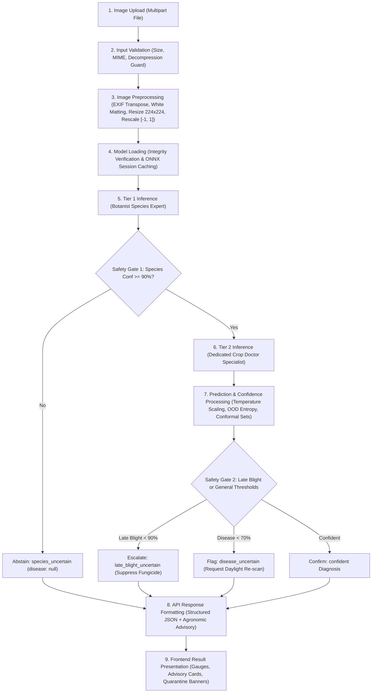

# Plant Disease Detection — LeafScan V3 Production Architecture

[](https://www.python.org/)
[](https://onnxruntime.ai/)
[](https://fastapi.tiangolo.com/)
[](https://www.docker.com/)
[](https://pytest.org/)
[](https://vitest.dev/)
[](https://pytest.org/)
[](https://github.com/ranitadhikari2023/plant-disease-detection/actions)

Production-grade hierarchical deep learning system for high-consequence agricultural foliar pathology diagnosis in Solanaceous crops (*Solanum tuberosum* — Potato and *Solanum lycopersicum* — Tomato).

Powered by the **LeafScan V3 Production Engine**:
- **ONNX Runtime Serving:** Pure CPU graph execution with zero TensorFlow dependencies in production, delivering **10.4x faster warm inference** (16.9 ms p50) and **-74% memory footprint** (89 MB vs 345 MB).
- **Cryptographic Model Bundles (`v3.0.0`):** Immutable, versioned release bundles verified on startup against SHA-256 cryptographic digests in `manifest.json`.
- **Deterministic Multi-Tier Safety Authority:** Programmatic gating boundaries enforcing species verification ($\ge 90\%$), Late Blight quarantine escalation ($\ge 90\%$), and general disease thresholds ($\ge 70\%$).
- **Statistical Uncertainty & OOD Screening:** Normalized Shannon entropy out-of-distribution detection and split conformal prediction sets with coverage guarantees.
- **Enterprise DevSecOps Hardening:** 40 Megapixel decompression bomb guard, EXIF orientation transpose, bounded concurrency semaphore, Prometheus telemetry, and unprivileged non-root Docker execution (UID 10001).

---

## Table of Contents

1. [Project Overview](#1-project-overview)
2. [Key Features](#2-key-features)
3. [System Architecture](#3-system-architecture)
4. [Project Structure](#4-project-structure)
5. [Technology Stack](#5-technology-stack)
6. [Machine Learning Pipeline](#6-machine-learning-pipeline)
7. [Prerequisites](#7-prerequisites)
8. [Installation and Setup](#8-installation-and-setup)
9. [Docker Setup](#9-docker-setup)
10. [API Documentation](#10-api-documentation)
11. [Testing](#11-testing)
12. [Configuration and Environment Variables](#12-configuration-and-environment-variables)
13. [Deployment](#13-deployment)
14. [Troubleshooting](#14-troubleshooting)
15. [Future Improvements](#15-future-improvements)
16. [License and Acknowledgements](#16-license-and-acknowledgements)

---

## 1. Project Overview

### Project Name
**LeafScan V3: Production Deep Learning Plant Pathology Screening System**  
*Hierarchical Solanaceous Foliar Disease Detection, Attention-Guided Feature Extraction, and Deterministic Agronomic Safety Guarding.*

### Project Description
LeafScan V3 is an end-to-end, safety-critical machine learning application engineered to diagnose devastating foliar blights in major Solanaceous crops. It replaces flat, error-prone multi-class classifiers with a cascaded two-tier diagnostic hierarchy that pairs MobileNetV2 base feature extractors with custom Convolutional Block Attention Modules (CBAM) and strict programmatic safety gates.

### Main Objective
Provide agronomists, agricultural extension workers, commercial farm managers, and smallholder farmers with an ultra-fast, scientifically validated, and deterministic diagnostic decision-support system that prevents destructive crop misdiagnoses and suppresses inappropriate chemical fungicide recommendations.

### Problem Addressed
Foliar diseases in Solanaceous staple crops (*Solanum tuberosum* — Potato and *Solanum lycopersicum* — Tomato) present existential threats to food security and agricultural livelihoods:
- **Early Blight (*Alternaria solani*):** A destructive fungal disease marked by necrotic spots with concentric "target board" rings, causing chlorosis, premature defoliation, and significant yield collapse.
- **Late Blight (*Phytophthora infestans*):** A high-consequence oomycete pathogen notorious for precipitating the historic Great Irish Famine. Under cool, humid conditions, it causes expanding water-soaked necrotic lesions capable of destroying entire field canopies within 7 to 10 days.

Standard automated vision systems deployed for foliar pathology suffer from three fatal production vulnerabilities:
1. **Cross-Crop Misdiagnosis:** Flat classifiers trained across disparate plant species frequently confuse potato and tomato lesions when leaf geometry or background soil overlaps.
2. **Synthetic Data Leakage:** Academic benchmark datasets (such as raw PlantVillage) contain repeated photographic captures of the same leaf. Naive random train/test splitting leaks identical biological leaves across splits, yielding artificially inflated laboratory accuracy that collapses in the field.
3. **Reckless Forced Classification:** Standard classifiers produce forced predictions even on non-crop leaves, background debris, or blurry images, encouraging premature or improper application of systemic chemical fungicides that breed pathogen resistance and contaminate agroecosystems.

### Intended Users and Use Cases
- **Agronomists & Crop Scouts:** Rapid field validation of foliar lesions with instant confidence scoring and agronomic advisory guidance.
- **Agricultural Extension Officers:** Reliable second-opinion diagnostics backed by cryptographic model verification and transparent out-of-distribution alerts.
- **Commercial Farm Operations:** Low-latency batch screening integrated into farm management software or drone intake pipelines via standardized REST APIs.
- **Agricultural Research & Education:** Baseline reference implementation for zero-leakage biological dataset curation, attention-guided foliar diagnosis, and conformal prediction in high-consequence computer vision.

---

## 2. Key Features

- **Hierarchical Two-Tier Cascaded Screening:**
  - **Tier 1 (Botanist Species Expert):** Accurately determines host crop species (*Solanum tuberosum* vs. *Solanum lycopersicum*).
  - **Tier 2 (Crop Doctor Specialists):** Dedicated specialists for Potato (`Early Blight`, `Late Blight`, `Healthy`) and Tomato (`Early Blight`, `Late Blight`, `Healthy`).
- **Convolutional Block Attention Modules (CBAM):**
  - Integrated into the terminal $7 \times 7 \times 1280$ feature maps of MobileNetV2.
  - Sequentially combines Channel Attention (reduction ratio $r=16$) and Spatial Attention ($7 \times 7$ kernel) with exactly 206,258 parameters per specialist to isolate diagnostic lesion margins from background noise.
- **Deterministic Multi-Tier Safety Guard (`SafetyGuard`):**
  - **Species Gate ($\ge 90\%$):** Abstains if host species probability is $<90\%$, returning `species_uncertain` and `disease: null` to eliminate cross-crop misdiagnosis.
  - **Late Blight Escalation Gate ($\ge 90\%$):** Enforces a strict $90\%$ confidence requirement on *Phytophthora infestans*. If confidence is marginal ($70\% - 90\%$), flags `late_blight_uncertain`, suppresses systemic fungicide advice, and mandates physical isolation and 24–48 hour re-inspection.
  - **General Disease Gate ($\ge 70\%$):** Flags diagnoses below $70\%$ with `disease_uncertain` and prompts for clear daylight re-imaging.
- **Forensically Grouped Zero-Leakage Dataset:**
  - 11,988 images clustered into 3,971 canonical biological leaf specimens using Disjoint Set Union (DSU) graph partitioning and perceptual hashing.
  - Guaranteed 0.0% biological leaf leakage across training, validation, and held-out test splits.
- **Zero-TensorFlow Production Serving:**
  - Headless ONNX Runtime microservice (`CPUExecutionProvider`) executing pure computation graphs without TensorFlow or Keras dependencies in production.
  - Memory consumption reduced by 74% (89 MB vs 345 MB) with sub-17ms warm p50 inference latency.
- **Cryptographic Model Release Bundles (`v3.0.0`):**
  - Production models packaged with `manifest.json`, validated on service startup via cryptographic SHA-256 digests. Tampered or corrupted artifacts trigger immediate startup abort.
- **Defensive Intake Pipeline (`ImageIntake`):**
  - Enforces 40 Megapixel decompression bomb limit (`Image.MAX_IMAGE_PIXELS = 40_000_000`).
  - Automatically corrects EXIF orientation transposes from mobile cameras.
  - Enforces 10 MB maximum payload cap and whitelists JPEG, PNG, and WebP magic bytes.
  - Composites transparent RGBA alpha channels onto pure white background (`#FFFFFF`) to neutralize dark-edge border artifacts.
- **Statistical Uncertainty & OOD Screening:**
  - Normalized Shannon entropy calculation and Maximum Softmax Probability (MSP) screening.
  - Split conformal prediction generating finite-sample valid prediction sets $\mathcal{C}(X)$ with statistical coverage guarantees.
- **Multiple Frontends for Diverse Operational Needs:**
  - **Precompiled SPA (`frontend/`):** Dependency-free Single Page Application served directly by FastAPI at `/`.
  - **Modern React 18 SPA (`web/`):** React 18, TypeScript 5, Vite 5, TanStack Query v5, HashRouter, 67 automated Vitest tests.
  - **Botanical Field Console (`leafscan-web/`):** Next.js 15, React 19, Tailwind CSS v4, Zustand, Serwist offline PWA caching, 45 automated Vitest tests.
- **Enterprise DevSecOps & Resilience:**
  - Non-root Docker execution (UID 10001 `leafscan:leafscan`), read-only container capabilities, and tmpfs volume mounts.
  - Bounded concurrency semaphore (`asyncio.Semaphore(4)`) with automated HTTP 503 load shedding and `Retry-After: 5` headers.
  - Exception sanitization middleware suppressing internal stack traces in client responses.
  - Prometheus `/metrics` exposition for latency histograms, request counters, and gate activation telemetry.

---

## 3. System Architecture

### Architectural Overview
LeafScan V3 employs a layered architecture separating HTTP transport, diagnostic orchestration, inference engine abstraction, and cryptographic model storage:


### Component Breakdown
1. **Frontend Layer:** Provides responsive desktop and mobile experiences via the precompiled SPA, the Vite-based React SPA, and the Next.js 15 PWA field console.
2. **Transport Layer (`src/leafscan/api/`):** Manages ASGI lifecycle, CORS policies, bounded concurrency, request tracing, static file serving, and REST endpoints.
3. **Diagnostic Service Layer (`src/leafscan/services/`):** Coordinates defensive image ingestion, multi-tier neural execution, temperature-calibrated probability evaluation, deterministic safety gating, OOD screening, and conformal prediction set generation.
4. **Inference Engine Layer (`src/leafscan/engines/`):** Decouples graph runtime execution behind a strict Python `Protocol`, enabling production serving on CPU-optimized `onnxruntime` while supporting legacy `keras` during development.
5. **Model Bundle Subsystem (`src/leafscan/bundle/`):** Manages release discovery, JSON schema parsing, and cryptographic integrity verification of ONNX model artifacts against their declared SHA-256 hashes.

---

## 4. Project Structure

An accurate directory tree highlighting essential files and directories:

```text
plant-disease-detection/
├── .github/
│   └── workflows/
│       └── ci.yml                            # GitHub Actions CI/CD (Ruff, Pytest, Docker, Trivy)
│
├── api/
│   ├── __init__.py                           # API package marker
│   └── main.py                               # Backward-compatible FastAPI entry point & SPA mount
│
├── archive/                                  # Historical reference artifacts
│   ├── frontend-v1/                          # Legacy HTML5/CSS/JS frontend prototype
│   └── v1/                                   # Legacy V1 Keras models & prototype scripts
│
├── audit/                                    # Dataset forensics, manifests, and training metrics
│   ├── artifacts/                            # Specimen distributions and loss curve charts
│   ├── audit_summary.json                    # Summary of dataset audit metrics
│   ├── dataset_manifest.csv                  # Master manifest of 11,988 images
│   ├── specimen_manifest.csv                 # Canonical 3,971 biological leaf specimens
│   ├── test_specimen_manifest.csv            # 603 held-out test specimens (0.0% leakage)
│   ├── train_specimen_manifest.csv           # 2,776 training specimens
│   └── validation_specimen_manifest.csv      # 592 validation specimens
│
├── dataset/
│   ├── README.md                             # Dataset documentation, species, and class labels
│   ├── potato/                               # Early_blight, Late_blight, healthy (git-ignored)
│   └── tomato/                               # Early_blight, Late_blight, healthy (git-ignored)
│
├── docs/                                     # Comprehensive architectural documentation & reports
│   ├── reports/
│   │   └── GITHUB_ACTIONS_CI_CD_FAILURE_ANALYSIS_AND_FIX_REPORT.md  # CI/CD failure fix audit
│   ├── API_CONTRACT.md                       # REST API contract and invariant definitions
│   ├── BACKEND_V3_ARCHITECTURE.md            # LeafScan V3 production backend architecture
│   ├── BACKEND_V3_IMPLEMENTATION_AUDIT.md    # Code audit and security verification
│   ├── BACKEND_V3_MIGRATION_REPORT.md        # Migration report from V2 Keras to V3 ONNX
│   ├── BENCHMARK_REPORT.md                   # Latency, memory, and throughput benchmarks
│   ├── DEPLOYMENT_GUIDE.md                   # Production deployment manual (Bare-metal & Docker)
│   ├── MODEL_BUNDLE_SPECIFICATION.md         # Bundle format and cryptographic verification
│   ├── ROLLBACK_GUIDE.md                     # Operational rollback procedures
│   └── SECURITY_AND_THREAT_MODEL.md          # Threat model and DevSecOps mitigations
│
├── edge/
│   └── OFFLINE_PWA_ARCHITECTURE.md           # Field offline caching & synchronization design
│
├── frontend/                                 # Vite production build (served by FastAPI at /)
│   ├── assets/                               # Compiled hashed JS, CSS, and SVG assets
│   ├── css/tokens.css                        # Botanical design tokens
│   └── index.html                            # Compiled SPA entry point
│
├── inference/                                # Backward-compatible V2 inference facade
│   ├── inference_config.json                 # Thresholds (90%/70%) and agronomic advisories
│   ├── model_loader.py                       # Lazy TensorFlow loader for test fixtures
│   ├── predictor.py                          # HierarchicalPredictorV2 adapter to V3 engine
│   ├── preprocessing.py                      # Defensive image preprocessing & resizing
│   └── response_formatter.py                 # Standardized JSON response formatting
│
├── leafscan-web/                             # Botanical Field Console (Next.js 15 PWA)
│   ├── app/                                  # App Router routes (diagnose, result, history, model)
│   ├── src/                                  # Features, stores (Zustand), API client, components
│   ├── tests/                                # 45 Vitest unit, component, and contract tests
│   ├── Dockerfile                            # Standalone container build for frontend
│   └── package.json                          # Next.js 15, React 19, Tailwind CSS v4, Serwist
│
├── mlops/
│   └── MLOPS_PIPELINE.md                     # Model tracking, CI/CD, and deployment lifecycle
│
├── models/
│   ├── bundles/v3/                           # Production immutable model bundle
│   │   ├── manifest.json                     # Cryptographic SHA-256 specification
│   │   ├── potato_expert.onnx                # Tier 2 Potato Specialist with CBAM (10.4 MB)
│   │   ├── species_expert.onnx               # Tier 1 Botanist Species Expert (9.2 MB)
│   │   └── tomato_expert.onnx                # Tier 2 Tomato Specialist with CBAM (10.4 MB)
│   ├── onnx/v2/                              # Exported ONNX graphs from export_to_onnx.py
│   └── v2/                                   # Trained Keras 3 checkpoints (.keras format)
│
├── reports/                                  # Engineering milestone reports
│   ├── END_TO_END_PROJECT_ANALYSIS_REPORT.md
│   ├── PHASE_1_ENVIRONMENT_AND_DEPLOYMENT_HARDENING.md
│   └── PHASE_2_PROJECT_CLEANUP_AND_ORGANIZATION.md
│
├── scripts/
│   └── evaluate_golden_baseline.py           # Evaluates baseline and curates golden dataset
│
├── src/leafscan/                             # LeafScan V3 Modular Production Engine
│   ├── __init__.py                           # Package marker
│   ├── api/                                  # FastAPI app factory, routes, middleware, settings
│   │   ├── app.py                            # Lifespan context manager and router mounts
│   │   ├── dependencies.py                   # Dependency injection providers & auth checks
│   │   ├── middleware.py                     # Concurrency semaphore, request ID, exception mask
│   │   ├── settings.py                       # Pydantic Settings environment configuration
│   │   └── routes/                           # /health, /ready, /metrics, /v2/diagnose, /v2/feedback
│   ├── bundle/                               # Bundle manifest schemas, loader, and SHA-256 verifier
│   │   ├── loader.py                         # ModelBundleLoader
│   │   ├── manifest.py                       # BundleManifest, SafetyGates, Metadata
│   │   └── verification.py                   # IntegrityVerifier with SHA-256 validation
│   ├── core/                                 # Structured exceptions, logging, Prometheus metrics
│   │   ├── exceptions.py                     # Hierarchy of typed domain exceptions
│   │   ├── logging.py                        # Structured JSON logger
│   │   └── telemetry.py                      # Prometheus counters and histograms
│   ├── engines/                              # InferenceEngine Protocol, OnnxEngine, KerasEngine
│   │   ├── base.py                           # InferenceEngine Protocol
│   │   ├── onnx_engine.py                    # OnnxEngine (Production CPU graph execution)
│   │   └── keras_engine.py                   # KerasEngine (Development / Parity Fallback)
│   └── services/                             # ImageIntake, SafetyGuard, OODDetector, Conformal
│       ├── calibration.py                    # Temperature scaling & ECE validation
│       ├── conformal.py                      # ConformalPredictor split prediction sets
│       ├── diagnosis_service.py              # DiagnosisService orchestrator
│       ├── image_intake.py                   # ImageIntake defensive validation pipeline
│       ├── ood_detector.py                   # OODDetector Shannon entropy & MSP
│       └── safety_guard.py                   # Deterministic SafetyGuard gate evaluation
│
├── tests/                                    # Pytest test suite (55 tests) & test fixtures
│   ├── fixtures/
│   │   ├── golden_images/                    # 48 curated golden evaluation specimens (790 KB)
│   │   └── golden_test_dataset.json          # 49 curated golden evaluation records
│   ├── conftest.py                           # Pytest fixtures and test harnesses
│   ├── test_api.py                           # 14 tests: REST API endpoints and static routing
│   ├── test_data_pipeline.py                 # 13 tests: Data loading, augmentation, error handling
│   ├── test_losses.py                        # 12 tests: Focal loss math and class weighting
│   ├── test_v2_inference.py                  # 7 tests: V2 inference, CBAM, gate boundaries
│   └── test_v3_serving.py                    # 9 tests: V3 bundle integrity, parity, security
│
├── test_images/
│   └── sample_leaf.JPG                       # Verified test specimen image
│
├── training/                                 # Training pipelines and evaluation scripts
│   ├── logs/                                 # Training convergence CSV logs
│   ├── augmentation.py                       # Online image augmentation layers
│   ├── class_mappings.json                   # Class label index mappings
│   ├── data_pipeline.py                      # Manifest-driven tf.data pipeline
│   ├── evaluate_v2_system.py                 # Full 603-specimen test evaluation harness
│   ├── losses.py                             # SparseCategoricalFocalLoss implementation
│   ├── models.py                             # MobileNetV2 + CBAM custom layer construction
│   ├── run_preflight_and_smoke_tests.py      # Architecture and environment verification
│   ├── train_utils.py                        # Two-phase transfer learning loop
│   ├── training_config.json                  # Training hyperparameters
│   └── verify_v2_artifacts.py                # Artifact verification harness
│
├── web/                                      # React 18 / Vite 5 SPA source
│   ├── src/                                  # Modular components, hooks, API client, routes
│   ├── package.json                          # Dependencies and scripts (67 Vitest tests)
│   └── vite.config.ts                        # Bundler configuration (builds to frontend/)
│
├── .env.example                              # Environment configuration template
├── .gitignore                                # Comprehensive Git ignore rules
├── compose.override.yaml                     # Full-stack Compose override (Web + API)
├── compose.yaml                              # Production Docker Compose specification
├── Dockerfile                                # Multi-stage, non-root production container (<500MB)
├── export_to_onnx.py                         # ONNX export and parity validation script
├── predict_hierarchical_v2.py                # Command-line inference entry point
├── PROJECT_CLEANUP_REPORT.md                 # Detailed structural cleanup and refactoring audit
├── pyproject.toml                            # Standard Python project manifest (Hatchling)
├── pytest.ini                                # Pytest configuration and markers
├── requirements.txt                          # Production Python dependencies
├── requirements-dev.txt                      # Development and testing Python dependencies
├── setup_wsl_env.sh                          # Automated WSL environment setup script
├── train_potato_doctor.py                    # Standalone training script for Potato Specialist
├── train_species.py                          # Standalone training script for Species Expert
└── train_tomato_doctor.py                    # Standalone training script for Tomato Specialist
```

---

## 5. Technology Stack

| Layer | Technology | Version | Purpose & Implementation |
|---|---|:---:|---|
| **Backend & Serving** | Python<br/>FastAPI<br/>Uvicorn<br/>Starlette<br/>Pydantic | 3.10 / 3.12<br/>0.143.0<br/>0.54.0<br/>1.7.0<br/>2.14.0 | Core backend runtime environment<br/>Asynchronous REST API framework with OpenAPI 3.1<br/>High-performance ASGI production web server<br/>Request routing and static SPA asset serving<br/>Strict request/response schema validation and settings |
| **Inference Engine** | ONNX Runtime | 1.20.0 | High-efficiency CPU graph execution (Zero TensorFlow Serving) |
| **Deep Learning & Training** | TensorFlow<br/>Keras<br/>tf2onnx<br/>onnx | 2.21.0<br/>3.12.1<br/>1.17.0<br/>1.23.2 | Model training pipelines and Focal Loss formulations<br/>CBAM custom attention layer construction<br/>Computation graph conversion from Keras to ONNX<br/>ONNX model serialization and graph validation |
| **Image & Data Processing** | Pillow (PIL)<br/>NumPy | 12.1.1<br/>2.2.6 | Image ingestion, EXIF transpose, 40MP decompression bomb guard<br/>Multidimensional array mathematics and tensor transformations |
| **Web Frontend (Vite SPA)** | React 18<br/>TypeScript<br/>Vite<br/>TanStack Query | 18.3.1<br/>5.6.2<br/>5.4.1<br/>5.66.0 | Single-page client application compiling to `frontend/`<br/>Type-safe frontend logic and component architecture<br/>Modern frontend tooling and asset bundling<br/>Asynchronous API state management and caching |
| **Botanical Field Console** | Next.js<br/>React<br/>Tailwind CSS<br/>Zustand<br/>Serwist | 15.2.0<br/>19.0.0<br/>4.0.9<br/>5.0.3<br/>9.0.12 | App Router architecture for progressive web application<br/>Modern concurrent UI components<br/>Utility-first responsive botanical design tokens<br/>Lightweight global client state management<br/>Service worker offline caching and sync for field scouts |
| **Containerization & DevSecOps** | Docker<br/>Docker Compose | Multi-Stage<br/>Compose v2 | Unprivileged container runtime (UID 10001, `< 500 MB`)<br/>Multi-container orchestration for API and web services |
| **Testing & Quality Assurance** | Pytest<br/>Vitest<br/>Ruff<br/>Playwright | 8.3.5 (55 tests)<br/>2.1 / 3.2 (112 tests)<br/>0.6+<br/>1.50.1 | Python unit, integration, parity, and security test suite<br/>Frontend unit, component, and contract test suites<br/>Fast Python linter and code formatter<br/>End-to-End browser test automation |
| **Build & Packaging** | Hatchling<br/>uv / pip | Hatchling<br/>uv 0.5+ | Standard PEP 621 package build backend (`pyproject.toml`)<br/>Ultra-fast dependency resolution and virtual environments |

---

## 6. Machine Learning Pipeline

The prediction workflow executes through nine distinct, deterministic stages:



### Stage 1: Image Upload
The client transmits an image payload to `POST /v2/diagnose` via `multipart/form-data` with form field `image`.

### Stage 2: Input Validation
`ImageIntake` reads the incoming byte stream defensively:
- Limits payload ingestion to `10 MB + 1 byte` to instantly reject oversized files with `HTTP 413 Content Too Large`.
- Validates magic bytes against approved formats (`JPEG`, `PNG`, `WebP`). Non-conforming payloads are rejected with `HTTP 415 Unsupported Media Type`.
- Sets `Image.MAX_IMAGE_PIXELS = 40_000_000` to prevent decompression bombs.

### Stage 3: Image Preprocessing
- **Orientation Correction:** Pillow applies `ImageOps.exif_transpose` to orient images captured on mobile devices.
- **Alpha Matte Neutralization:** If an image contains an alpha channel (`RGBA` or `LA`), it is composited over a solid white background (`#FFFFFF`) to eliminate dark border artifacts.
- **Resizing & Normalization:** Resized to $224 \times 224$ pixels using bilinear interpolation, converted to `float32`, and normalized to $[-1.0, 1.0]$ via $(x / 127.5) - 1.0$.

### Stage 4: Model Loading & Integrity Verification
On startup, `ModelBundleLoader` loads `manifest.json` from `models/bundles/v3/`. `IntegrityVerifier` computes SHA-256 hashes of all three ONNX models and compares them against declared values. Once verified, ONNX Runtime sessions are initialized and warmed up with dummy tensors.

### Stage 5: Tier 1 Inference (Species Expert)
The preprocessed tensor $(1, 224, 224, 3)$ is passed to `species_expert.onnx`. The output logits are passed through Softmax to produce probabilities for `Potato` and `Tomato`.

### Stage 6: Safety Gate 1 Evaluation
`SafetyGuard.evaluate_species_gate` inspects the maximum species probability:
- **Species Confidence $< 0.90$:** System abstains from disease classification. Returns status `species_uncertain`, sets `disease: null`, and attaches an agronomic advisory explaining that host crop identity cannot be confirmed.
- **Species Confidence $\ge 0.90$:** Host crop is confirmed, and execution proceeds to Tier 2.

### Stage 7: Tier 2 Inference (Crop Doctor Specialist)
The tensor is routed to the corresponding specialist:
- Potato: `potato_expert.onnx` (Classes: `Early Blight`, `Late Blight`, `Healthy`).
- Tomato: `tomato_expert.onnx` (Classes: `Early Blight`, `Late Blight`, `Healthy`).

Both specialist networks employ **CBAM Attention** injected into the terminal $7 \times 7 \times 1280$ feature maps:
$$\mathbf{M}_c(\mathbf{F}) = \sigma(\text{MLP}(\text{AvgPool}(\mathbf{F})) + \text{MLP}(\text{MaxPool}(\mathbf{F})))$$
$$\mathbf{F}' = \mathbf{M}_c(\mathbf{F}) \otimes \mathbf{F}$$
$$\mathbf{M}_s(\mathbf{F}') = \sigma(f^{7 \times 7}([\text{AvgPool}(\mathbf{F}'); \text{MaxPool}(\mathbf{F}')]))$$
$$\mathbf{F}'' = \mathbf{M}_s(\mathbf{F}') \otimes \mathbf{F}'$$

### Stage 8: Prediction Processing & Safety Gate 2
The disease probabilities are evaluated by `SafetyGuard.evaluate_disease_gate`:
- **Late Blight Escalation Gate:** If the predicted disease is `Late Blight` but confidence is $< 0.90$, the system flags `late_blight_uncertain`, suppresses systemic chemical spraying advice, and advises physical quarantine and 24–48 hour re-inspection.
- **General Disease Gate:** If the predicted disease confidence is $< 0.70$, the diagnosis is marked `disease_uncertain`.
- **Confident Diagnosis:** If confidence meets or exceeds thresholds, the diagnosis is confirmed as `confident`.
- **Uncertainty & Conformal Sets:** `OODDetector` computes normalized Shannon entropy; `ConformalPredictor` generates finite-sample prediction sets.

### Stage 9: API Response & Frontend Presentation
The backend formats a structured JSON response containing diagnosis, confidence metrics, probabilities, request metadata, and actionable agronomic advisories. The web clients render dynamic confidence meters, safety banners, and management guidelines.

---

## 7. Prerequisites

Before installing and running the project, ensure your host environment meets the following requirements:

- **Operating System:** Windows 10/11, Ubuntu 22.04+, Debian 12+, or macOS 13+.
- **Python:** Python 3.10.x or 3.12.x.
- **Package Manager:** `pip` (or `uv` 0.5+ for high-speed installation).
- **Node.js (Optional):** Node.js 18.x or 20.x and npm 9+ (only required if developing or building frontend clients).
- **Docker (Optional):** Docker Engine 24+ and Docker Compose v2 (for containerized deployments).
- **Git:** Git 2.30+ installed and available on PATH.

---

## 8. Installation and Setup

### 8.1 Cloning the Repository
```bash
git clone https://github.com/ranitadhikari2023/plant-disease-detection.git
cd plant-disease-detection
```

### 8.2 Setting Up the Python Environment

#### Windows (PowerShell)
```powershell
# Create virtual environment
python -m venv .venv

# Enable script execution for current session if restricted
Set-ExecutionPolicy -Scope Process -ExecutionPolicy Bypass

# Activate virtual environment
.\.venv\Scripts\Activate.ps1
```

#### Linux / macOS / WSL
```bash
# Create virtual environment
python3 -m venv .venv

# Activate virtual environment
source .venv/bin/activate
```

### 8.3 Installing Dependencies

#### Production Serving (Lightweight — Zero TensorFlow)
For running the production FastAPI microservice, ONNX inference engine, and precompiled SPA:
```bash
python -m pip install --upgrade pip
pip install -r requirements.txt
```
*Or install via package extras:*
```bash
pip install -e ".[serve]"
```

#### Development & Training
For training pipelines, model export, and running the full test suite:
```bash
pip install -r requirements-dev.txt
pip install -e ".[train,dev]"
```

### 8.4 Configuring Environment Variables
Copy the template configuration file:
```bash
# Windows PowerShell
cp .env.example .env

# Linux / macOS
cp .env.example .env
```
Inspect `.env` and adjust settings as necessary (refer to [Section 12](#12-configuration-and-environment-variables)).

### 8.5 Starting the Backend Application
Start the FastAPI server hosting the REST API and the precompiled SPA:
```bash
# Recommended production entry point
uvicorn leafscan.api.app:app --host 127.0.0.1 --port 8000 --reload

# Backward-compatible entry point
uvicorn api.main:app --host 127.0.0.1 --port 8000
```
- **Web SPA:** [http://127.0.0.1:8000](http://127.0.0.1:8000)
- **Interactive Swagger Docs:** [http://127.0.0.1:8000/docs](http://127.0.0.1:8000/docs)
- **ReDoc Documentation:** [http://127.0.0.1:8000/redoc](http://127.0.0.1:8000/redoc)

### 8.6 Running CLI Inference
Execute local diagnostic inference without running a web server:
```bash
# Run default inference on sample leaf fixture
python predict_hierarchical_v2.py

# Diagnose custom leaf image
python predict_hierarchical_v2.py --image path/to/leaf.jpg

# Output machine-readable JSON
python predict_hierarchical_v2.py --image path/to/leaf.jpg --json
```

### 8.7 Starting Frontend Development Servers (Optional)

#### React 18 SPA (`web/`):
```bash
cd web
npm install
npm run dev
# Starts local Vite development server at http://localhost:3000
# To compile new static build into root frontend/:
npm run build
```

#### Botanical Field Console PWA (`leafscan-web/`):
```bash
cd leafscan-web
npm install
npm run dev
# Starts local Next.js 15 PWA development server at http://localhost:3000
```

---

## 9. Docker Setup

### 9.1 Container Prerequisites
- Docker Engine 24.0+
- Docker Compose v2.20+
- At least 1.5 GB free disk space and 1 GB available RAM

### 9.2 Single-Service Production Container Build & Run
The multi-stage `Dockerfile` produces an unprivileged, non-root container (<500MB) without TensorFlow:

```bash
# Build production container image
docker build -t leafscan:3.0.0 .

# Run container with resource boundaries
docker run -d \
  --name leafscan-api \
  -p 8000:8000 \
  --memory="1024m" \
  --cpus="2.0" \
  leafscan:3.0.0
```

Verify container health status:
```bash
docker inspect --format='{{json .State.Health}}' leafscan-api
```

### 9.3 Docker Compose Deployments

#### Core Backend Microservice Only
```bash
# Build and start container in background
docker compose up -d --build

# View container logs
docker compose logs -f api

# Check container status
docker compose ps

# Graceful shutdown
docker compose down
```

#### Full Stack (API Microservice + Next.js Field Console PWA)
```bash
# Start both API and Next.js Web services
docker compose -f compose.yaml -f compose.override.yaml up -d --build

# View combined logs
docker compose -f compose.yaml -f compose.override.yaml logs -f

# Shutdown full stack
docker compose -f compose.yaml -f compose.override.yaml down
```

### 9.4 Service Access Information
- **API Service:** [http://localhost:8000](http://localhost:8000)
- **API Health Endpoint:** [http://localhost:8000/health](http://localhost:8000/health)
- **API Readiness Endpoint:** [http://localhost:8000/ready](http://localhost:8000/ready)
- **Prometheus Metrics:** [http://localhost:8000/metrics](http://localhost:8000/metrics)
- **Field Console PWA (when compose.override.yaml is active):** [http://localhost:3000](http://localhost:3000)

---

## 10. API Documentation

### 10.1 Endpoints Summary

| Method | Path | Summary | Success Status | Auth Required |
|---|---|---|:---:|:---:|
| `GET` | `/` | Serves LeafScan precompiled SPA (`index.html`) | `200 OK` | No |
| `GET` | `/health` | Lightweight liveness probe | `200 OK` | No |
| `GET` | `/ready` | Readiness probe verifying model bundle integrity | `200 OK` / `503 Unavailable` | No |
| `GET` | `/v2/model` | Model transparency (bundle version, hashes, gates, metrics) | `200 OK` | No |
| `GET` | `/metrics` | Prometheus metrics scrape endpoint | `200 OK` | No |
| `POST` | `/v2/diagnose` | Core hierarchical foliar screening endpoint | `200 OK` | Optional API Key |
| `POST` | `/v2/feedback` | Agronomic diagnostic feedback with idempotency support | `200 OK` | No |

---

### 10.2 Diagnostic Screening (`POST /v2/diagnose`)
Executes two-tier hierarchical foliar diagnosis on an uploaded leaf photograph.

- **Content-Type:** `multipart/form-data`
- **Headers:** Optional `X-Request-ID: <string>`, optional `X-API-Key: <string>`
- **Parameters:**
  - `image` (binary, required): JPEG, PNG, or WebP image up to 10 MB.

#### Example Request (cURL)
```bash
curl -X POST http://127.0.0.1:8000/v2/diagnose \
     -H "X-Request-ID: req_test_001" \
     -F "image=@test_images/sample_leaf.JPG"
```

#### Diagnostic Response: Confirmed Diagnosis (`200 OK`)
```json
{
  "success": true,
  "model_version": "v2",
  "plant_species": "Potato",
  "species_confidence": 0.9852,
  "disease": "Early Blight",
  "disease_confidence": 0.9421,
  "diagnosis": "Potato - Early Blight",
  "safety_status": "confident",
  "safety_warnings": [],
  "advisory": "EARLY BLIGHT DETECTED: Symptoms are characteristic of Early Blight (Alternaria solani) with high diagnostic confidence. Recommended management options: prune lower senescent leaves to minimize soil-splash inoculation; ensure proper plant spacing for canopy drying. If chemical control is warranted, consult certified agricultural extension guidelines for locally approved preventive fungicides.",
  "species_probabilities": {
    "Potato": 0.9852,
    "Tomato": 0.0148
  },
  "probabilities": {
    "Early Blight": 0.9421,
    "Late Blight": 0.0412,
    "Healthy": 0.0167
  },
  "metadata": {
    "execution_time_ms": 16.9,
    "architecture": "MobileNetV2 + CBAM Attention",
    "request_id": "req_test_001",
    "bundle_version": "v3.0.0"
  }
}
```

#### Diagnostic Response: Late Blight Uncertainty Escalation (`200 OK`)
```json
{
  "success": true,
  "model_version": "v2",
  "plant_species": "Tomato",
  "species_confidence": 0.9510,
  "disease": "Late Blight",
  "disease_confidence": 0.7640,
  "diagnosis": "Tomato - Late Blight",
  "safety_status": "late_blight_uncertain",
  "safety_warnings": [
    "Potential early lesions detected, but Late Blight confidence (76.40%) is below the safety threshold (90%). Possible mechanical abrasion, environmental damage, or early Alternaria lesion."
  ],
  "advisory": "LATE BLIGHT UNCERTAINTY: Folio symptoms indicate potential early lesions, but diagnostic confidence is below the high-consequence threshold (<90%). Lesions may indicate mechanical injury, environmental necrosis, or early Alternaria spots. DO NOT apply aggressive systemic fungicides at this stage. Isolate specimen, monitor closely, and re-inspect within 24 to 48 hours. Consult a certified agronomic consultant if symptoms expand.",
  "species_probabilities": {
    "Potato": 0.0490,
    "Tomato": 0.9510
  },
  "probabilities": {
    "Early Blight": 0.2130,
    "Late Blight": 0.7640,
    "Healthy": 0.0230
  },
  "metadata": {
    "execution_time_ms": 17.2,
    "architecture": "MobileNetV2 + CBAM Attention",
    "request_id": "req_test_002",
    "bundle_version": "v3.0.0"
  }
}
```

#### Diagnostic Response: Species Abstention (`200 OK`)
```json
{
  "success": true,
  "model_version": "v2",
  "plant_species": "Potato",
  "species_confidence": 0.6240,
  "disease": null,
  "disease_confidence": 0.0,
  "diagnosis": "Indeterminate Specimen",
  "safety_status": "species_uncertain",
  "safety_warnings": [
    "Species confidence (62.40%) is below the safety threshold (90%). Disease classification abstained to prevent crop misdiagnosis."
  ],
  "advisory": "SPECIES UNCERTAINTY: Automated botanist confidence is below the safety threshold (<90%). Specimen disease diagnosis has been abstained to avoid crop misdiagnosis. Provide a clear, well-lit photograph showing leaf margins and venation, or submit a sample to an accredited agricultural extension laboratory. Do NOT apply chemical treatments to unverified plant species.",
  "species_probabilities": {
    "Potato": 0.6240,
    "Tomato": 0.3760
  },
  "probabilities": {},
  "metadata": {
    "execution_time_ms": 11.4,
    "architecture": "MobileNetV2",
    "request_id": "req_test_003",
    "bundle_version": "v3.0.0"
  }
}
```

#### Error Responses
- **`400 Bad Request`:** Missing upload file or unreadable byte stream.
- **`413 Content Too Large`:** File exceeds 10 MB payload limit.
- **`415 Unsupported Media Type`:** Non-whitelisted image format (e.g. BMP, TIFF, HEIC).
- **`422 Unprocessable Content`:** Pillow decompression bomb (>40MP) or corrupt image bytes.
- **`503 Service Unavailable`:** Concurrency ceiling reached (4 active inferences). Header `Retry-After: 5` attached.

---

### 10.3 Diagnostic Feedback (`POST /v2/feedback`)
Records field feedback or agronomist observations with idempotency protection.

- **Content-Type:** `application/json`
- **Headers:** Optional `Idempotency-Key: <string>`
- **Request Body:**
```json
{
  "request_id": "req_test_001",
  "predicted_species": "Potato",
  "predicted_disease": "Early Blight",
  "observed_species": "Potato",
  "observed_disease": "Early Blight",
  "feedback_type": "agree",
  "agronomic_notes": "Concentric target spots confirmed on lower canopy leaves.",
  "idempotency_key": "idem_abc123"
}
```
- **Response (`200 OK`):**
```json
{
  "success": true,
  "feedback_id": "fb_7a8f9b0c1d2e",
  "status": "recorded",
  "message": "Diagnostic feedback recorded. Submissions require certified agricultural extension validation before dataset curation.",
  "idempotency_key": "idem_abc123"
}
```

---

## 11. Testing

The repository maintains an automated test harness with **167 total automated tests** across Python backend microservices and TypeScript frontend applications.

```text
====================================================================================================
LEAFSCAN V3 AUTOMATED TEST SUITE (167 Total Tests — 100% Passing)
====================================================================================================
Suite                 Target Scope                                      Tests Passed     Pass Rate
----------------------------------------------------------------------------------------------------
Pytest (Backend)      tests/test_v3_serving.py (ONNX, Parity, Security)  9 Passed        100%
Pytest (Backend)      tests/test_api.py (FastAPI REST endpoints)        14 Passed        100%
Pytest (Backend)      tests/test_v2_inference.py (Gates & Keras)         7 Passed        100%
Pytest (Backend)      tests/test_losses.py (Focal Loss math)            12 Passed        100%
Pytest (Backend)      tests/test_data_pipeline.py (tf.data pipeline)    13 Passed        100%
Vitest (Frontend)     web/ (React 18 SPA components, hooks, api)        67 Passed        100%
Vitest (Frontend)     leafscan-web/ (Next.js 15 PWA unit & contract)    45 Passed        100%
----------------------------------------------------------------------------------------------------
Total Automated Tests                                                   167 Passed        100%
====================================================================================================
```

### 11.1 Running Backend Pytest Suites
```powershell
# Run the complete Python test suite (55 tests)
python -m pytest tests/ -v

# Run production serving, model integrity, and parity tests only
python -m pytest tests/test_v3_serving.py -v

# Run API endpoint tests
python -m pytest tests/test_api.py -v

# Run focal loss mathematical tests
python -m pytest tests/test_losses.py -v

# Run tf.data pipeline tests
python -m pytest tests/test_data_pipeline.py -v
```

### 11.2 Running Code Quality & Linting Checks
```powershell
# Check code style with Ruff
ruff check src/ tests/

# Verify code formatting with Ruff
ruff format --check src/ tests/
```

### 11.3 Running Frontend Vitest Suites
```powershell
# Run React 18 SPA tests (67 tests)
npm --prefix web test -- --run

# Run Next.js 15 Field Console tests (45 tests)
npm --prefix leafscan-web test -- --run
```

---

## 12. Configuration and Environment Variables

Configuration is handled by `src/leafscan/api/settings.py` via Pydantic Settings, with all parameters prefixed with `LEAFSCAN_`.

| Variable | Type | Default | Description |
|---|:---:|:---:|---|
| `LEAFSCAN_APP_ENV` | `string` | `production` | Environment mode (`development`, `staging`, `production`) |
| `LEAFSCAN_HOST` | `string` | `0.0.0.0` | IP address for server binding |
| `LEAFSCAN_PORT` | `integer` | `8000` | Port for HTTP service |
| `LEAFSCAN_CORS_ORIGINS` | `list[str]` | `http://127.0.0.1:8000, ...` | Comma-separated list of allowed CORS origins |
| `LEAFSCAN_MODEL_BUNDLE_PATH` | `string` | `models/bundles/v3` | Path to release bundle containing ONNX models |
| `LEAFSCAN_VERIFY_BUNDLE_CHECKSUMS` | `boolean` | `true` | Verify SHA-256 hashes against `manifest.json` on startup |
| `LEAFSCAN_EXECUTION_PROVIDER` | `string` | `CPUExecutionProvider` | Execution provider for ONNX Runtime |
| `LEAFSCAN_INTRA_OP_THREADS` | `integer` | `2` | ONNX Runtime intra-op execution thread count |
| `LEAFSCAN_INTER_OP_THREADS` | `integer` | `1` | ONNX Runtime inter-op execution thread count |
| `LEAFSCAN_MAX_CONCURRENT_INFERENCES` | `integer` | `4` | Concurrency semaphore limit before HTTP 503 shedding |
| `LEAFSCAN_RATE_LIMIT_PER_MINUTE` | `integer` | `60` | Client request rate limit per minute per IP |
| `LEAFSCAN_RATE_LIMITING_ENABLED` | `boolean` | `true` | Enables or disables rate limiting middleware |
| `LEAFSCAN_MAX_UPLOAD_SIZE_BYTES` | `integer` | `10485760` | Maximum upload size in bytes (10 MB) |
| `LEAFSCAN_MAX_DECODED_PIXELS` | `integer` | `40000000` | Pillow decompression bomb limit (40 Megapixels) |
| `LEAFSCAN_ENABLE_QUALITY_CHECKS` | `boolean` | `false` | Enable blur/exposure quality screening |
| `LEAFSCAN_BLUR_THRESHOLD` | `float` | `30.0` | Laplacian variance threshold for blur rejection |
| `LEAFSCAN_API_KEY_AUTH_ENABLED` | `boolean` | `false` | Enable integrator API key verification |
| `LEAFSCAN_AUTHORIZED_API_KEY_HASHES` | `list[str]` | `[]` | Comma-separated SHA-256 hashes of approved API keys |
| `LEAFSCAN_LOG_LEVEL` | `string` | `INFO` | Logging level (`DEBUG`, `INFO`, `WARNING`, `ERROR`) |
| `LEAFSCAN_LOG_JSON` | `boolean` | `true` | Format log lines as structured JSON |

> [!IMPORTANT]
> Never commit real secrets, API keys, or production credential values to version control. The repository `.gitignore` automatically excludes all `.env` files.

---

## 13. Deployment

### 13.1 Production Architecture
In production, LeafScan runs as an unprivileged containerized microservice:
- **Container User:** Runs under user `leafscan:leafscan` (UID 10001, GID 10001) with `no-new-privileges:true`.
- **Filesystem Security:** Mounts a 64MB `tmpfs` at `/tmp` with `noexec,nosuid`.
- **Resource Constraints:** Constrained to 2.0 CPUs and 1024 MB RAM via Docker deployment specs.
- **Readiness Probes:** Orchestrators query `GET /ready` to ensure model bundles are cryptographic-verified before routing traffic.

### 13.2 Reverse Proxy Setup (Nginx Example)
Place Nginx or Traefik in front of the container to terminate TLS and forward requests:

```nginx
server {
    listen 443 ssl http2;
    server_name leafscan.example.com;

    ssl_certificate /etc/letsencrypt/live/leafscan.example.com/fullchain.pem;
    ssl_certificate_key /etc/letsencrypt/live/leafscan.example.com/privkey.pem;

    client_max_body_size 12M;

    location / {
        proxy_pass http://127.0.0.1:8000;
        proxy_set_header Host $host;
        proxy_set_header X-Real-IP $remote_addr;
        proxy_set_header X-Forwarded-For $proxy_add_x_forwarded_for;
        proxy_set_header X-Forwarded-Proto $scheme;
    }
}
```

### 13.3 CI/CD Pipeline
Continuous Integration is configured via `.github/workflows/ci.yml`:
1. **Code Quality & Security Linting:** Validates code style and imports using `ruff check` and `ruff format --check`.
2. **Production Serving & Parity Test Suite:** Executes Pytest serving, parity, and security tests on Ubuntu with Python 3.12.
3. **Container Build & Vulnerability Scan:** Builds the production Docker image, executes container healthchecks, and performs Trivy vulnerability scans.

---

## 14. Troubleshooting

### 1. PowerShell Script Execution Policy Error
- **Symptom:** `Activate.ps1 cannot be loaded because running scripts is disabled on this system.`
- **Resolution:** Set process-level execution policy in your active terminal:
  ```powershell
  Set-ExecutionPolicy -Scope Process -ExecutionPolicy Bypass
  .\.venv\Scripts\Activate.ps1
  ```

### 2. Port Collision (HTTP 8000 Already Bound)
- **Symptom:** `[Errno 10048] error while attempting to bind on address ('127.0.0.1', 8000)`
- **Resolution:** Run Uvicorn on an alternate port:
  ```powershell
  uvicorn leafscan.api.app:app --port 8080
  ```

### 3. Model Bundle Checksum Verification Failure
- **Symptom:** `BundleVerificationError: Checksum mismatch for species_expert.onnx`
- **Resolution:** Verify that models in `models/bundles/v3` have not been altered. Check hashes against `manifest.json`. If necessary, re-export ONNX models via:
  ```powershell
  python export_to_onnx.py
  ```

### 4. Golden Test Images Not Found
- **Symptom:** `AssertionError: Golden image ... not found`
- **Resolution:** Verify that `tests/fixtures/golden_images/` contains the 48 curated fixture specimens. Ensure Git tracks them:
  ```powershell
  git status tests/fixtures/golden_images/
  ```

### 5. Image Upload Rejected with HTTP 415 or 400
- **Symptom:** `{"detail": "Unsupported image format..."}`
- **Resolution:** Provide standard JPEG, PNG, or WebP images. TIFF, BMP, SVG, and raw HEIC formats are intentionally rejected by defensive intake policy.

### 6. HTTP 503 Load Shedding Under Peak Concurrency
- **Symptom:** `{"detail": "Inference server busy. Please retry shortly."}` with `Retry-After: 5`.
- **Resolution:** The concurrency semaphore is protecting CPU resources. Increase `LEAFSCAN_MAX_CONCURRENT_INFERENCES` in `.env` if host CPU has sufficient cores.

---

## 15. Future Improvements

The following items represent potential extensions that are not yet implemented in the current codebase:

- **Broader Solanaceous Coverage:** Extend training pipelines to Bell Pepper (*Capsicum annuum*) and Eggplant (*Solanum melongena*).
- **Edge INT8 Quantization:** Generate INT8-quantized ONNX models to achieve sub-5ms latency on low-power IoT farm sensors.
- **Automated Tiling Service:** Implement sliding-window image slicing to enable direct diagnosis on high-resolution canopy photography.
- **Multilingual Agronomic Localization:** Add localized advisory recommendations in Spanish, Hindi, French, and Swahili.

---

## 16. License and Acknowledgements

### Maintainer
Developed and maintained by **Ranit Adhikari** ([@ranitadhikari2023](https://github.com/ranitadhikari2023)).
- **Repository:** [https://github.com/ranitadhikari2023/plant-disease-detection](https://github.com/ranitadhikari2023/plant-disease-detection)
- **License:** Proprietary / All rights reserved. For academic research collaboration, commercial licensing, or agronomic integration inquiries, contact the repository maintainer.

### Acknowledgements & Citations
- **PlantVillage Dataset:** Hughes, D., & Salathé, M. (2015). *An open access repository of images on plant health to enable the development of mobile disease diagnostics.* arXiv:1511.08060.
- **MobileNetV2 Architecture:** Sandler, M., Howard, A., Zhu, M., Zhmoginov, A., & Chen, L. C. (2018). *MobileNetV2: Inverted Residuals and Linear Bottlenecks.* IEEE CVPR.
- **CBAM Attention Mechanism:** Woo, S., Park, J., Lee, J. Y., & Kweon, I. S. (2018). *CBAM: Convolutional Block Attention Module.* ECCV.
- **ONNX Runtime:** Microsoft Corporation & Open Neural Network Exchange contributors.
- **FastAPI Framework:** Sebastián Ramírez and the FastAPI community.
