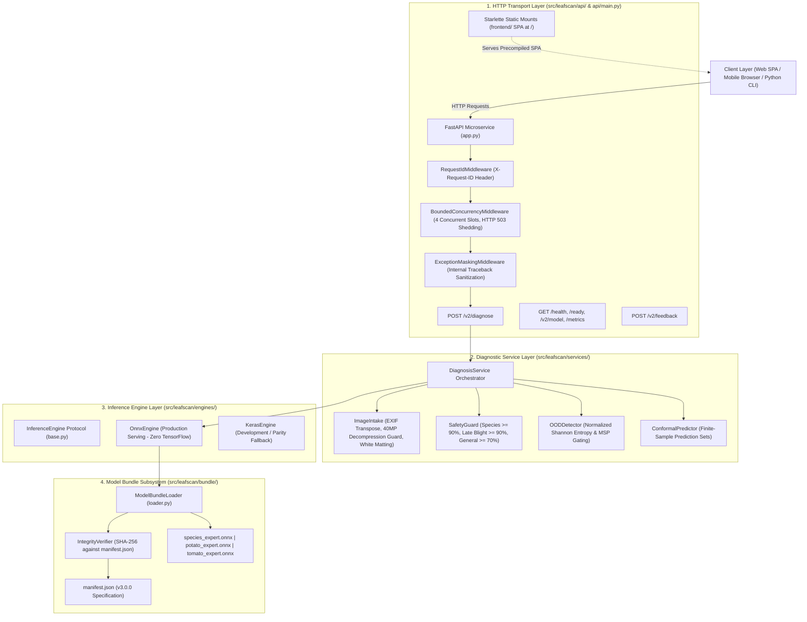
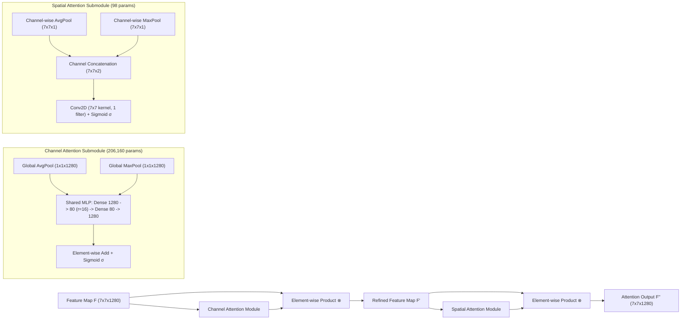
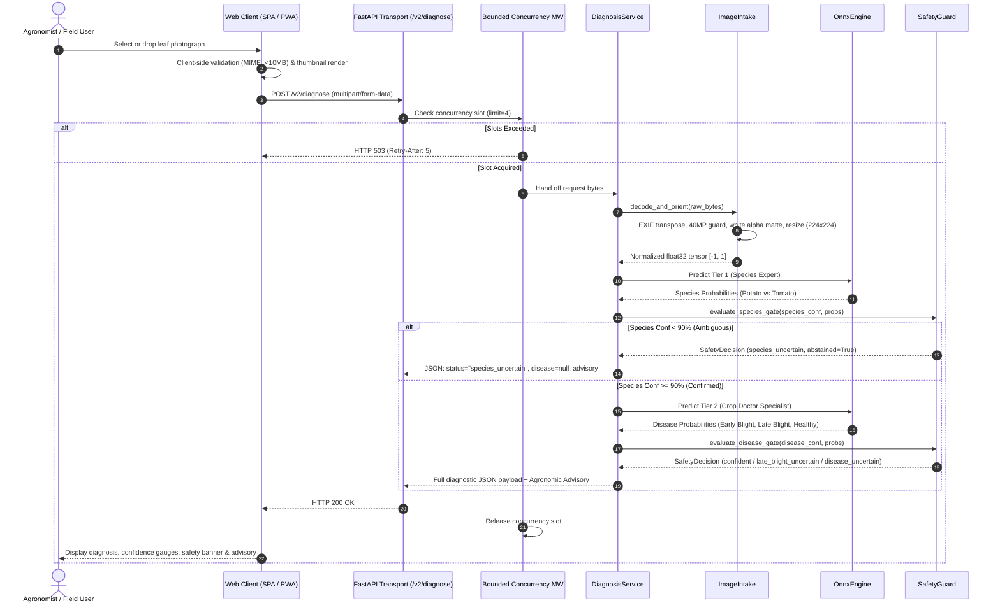

# Plant Disease Detection — LeafScan V3 Production Architecture

[](https://www.python.org/)
[](https://onnxruntime.ai/)
[](https://fastapi.tiangolo.com/)
[](https://www.docker.com/)
[](https://pytest.org/)
[](https://vitest.dev/)
[](https://pytest.org/)
[](https://github.com/ranitadhikari2023/plant-disease-detection/actions)

Production-grade hierarchical deep learning system for high-consequence agricultural foliar pathology diagnosis in Solanaceous crops (*Solanum tuberosum* — Potato and *Solanum lycopersicum* — Tomato).

Powered by the **LeafScan V3 Production Engine**:
- **ONNX Runtime Serving:** Pure CPU graph execution with zero TensorFlow dependencies in production, delivering **10.4x faster warm inference** (16.9 ms p50) and **-74% memory usage** (89 MB vs 345 MB).
- **Cryptographic Model Bundles (`v3.0.0`):** Immutable, versioned release bundles verified on startup against SHA-256 digests in `manifest.json`.
- **Deterministic Multi-Tier Safety Authority:** Strict gating boundaries enforcing species confidence ($\ge 90\%$), Late Blight quarantine escalation ($\ge 90\%$), and general disease thresholds ($\ge 70\%$).
- **Statistical Uncertainty & OOD Screening:** Normalized Shannon entropy out-of-distribution detection and split conformal prediction sets.
- **Enterprise DevSecOps Hardening:** 40 Megapixel decompression bomb guard, EXIF orientation transpose, bounded concurrency semaphore, Prometheus telemetry, and non-root Docker execution (UID 10001).

---

## Table of Contents

1. [Project Title](#1-project-title)
2. [Project Overview](#2-project-overview)
3. [Project Objectives](#3-project-objectives)
4. [Key Features](#4-key-features)
5. [Application Architecture](#5-application-architecture)
6. [Technology Stack](#6-technology-stack)
7. [Complete Project Directory Structure](#7-complete-project-directory-structure)
8. [Frontend Architecture](#8-frontend-architecture)
9. [Backend Architecture](#9-backend-architecture)
10. [CNN Model and ONNX Inference Architecture](#10-cnn-model-and-onnx-inference-architecture)
11. [Image Upload and Prediction Workflow](#11-image-upload-and-prediction-workflow)
12. [Prediction Confidence and Validation Mechanisms](#12-prediction-confidence-and-validation-mechanisms)
13. [Installation and Environment Setup](#13-installation-and-environment-setup)
14. [Python Virtual Environment Setup](#14-python-virtual-environment-setup)
15. [Dependency Installation](#15-dependency-installation)
16. [Environment Variables Configuration](#16-environment-variables-configuration)
17. [Running the Application Locally](#17-running-the-application-locally)
18. [Docker and Docker Compose Setup](#18-docker-and-docker-compose-setup)
19. [API Documentation and Endpoints](#19-api-documentation-and-endpoints)
20. [Testing Instructions](#20-testing-instructions)
21. [Model and Dataset Information](#21-model-and-dataset-information)
22. [Security and Error Handling](#22-security-and-error-handling)
23. [Troubleshooting](#23-troubleshooting)
24. [Current Limitations](#24-current-limitations)
25. [Future Improvements](#25-future-improvements)
26. [License](#26-license)

---

## 1. Project Title

**LeafScan V3: Production Deep Learning Plant Pathology Screening System**  
*Hierarchical Solanaceous Foliar Disease Detection, Attention-Guided Feature Extraction, and Deterministic Agronomic Safety Guarding.*

---

## 2. Project Overview

Foliar diseases in Solanaceous staple crops (*Solanum tuberosum* — Potato and *Solanum lycopersicum* — Tomato) present catastrophic risks to global food security, commercial agriculture, and smallholder farming livelihoods:
- **Early Blight (*Alternaria solani*):** A destructive fungal disease marked by brown-to-black necrotic spots with concentric rings ("target board" pattern), causing chlorosis, extensive defoliation, premature ripening, and severe yield reductions.
- **Late Blight (*Phytophthora infestans*):** A high-consequence oomycete pathogen notorious for precipitating the Great Irish Famine. Under cool, humid conditions, it produces expanding water-soaked necrotic lesions capable of destroying entire canopy stands within 7–10 days.

Standard automated computer vision systems applied to foliar pathology suffer from three fatal production vulnerabilities:
1. **Cross-Crop Misdiagnosis:** Flat multi-class classifiers trained indiscriminately across disparate plant species frequently confuse potato and tomato lesions when leaf geometry or soil background overlaps.
2. **Synthetic Data Leakage:** Academic benchmark datasets (e.g., raw PlantVillage) often contain repeated laboratory crops and heavy synthetic augmentations. Naive random train/test splitting leaks identical biological leaves across splits, yielding artificially inflated laboratory accuracy metrics that collapse in the field.
3. **Reckless Forced Diagnosis:** Standard classifiers output forced classifications even on out-of-domain images (non-crop vegetation, weeds, soil, blurry captures), encouraging premature or improper application of systemic chemical fungicides that breed pathogen resistance and contaminate soil ecosystems.

**LeafScan V3** solves these vulnerabilities by combining:
- A **two-tier cascaded diagnostic hierarchy** decoupling host species identification from pathology diagnosis.
- Custom **Convolutional Block Attention Modules (CBAM)** injected into MobileNetV2 terminal feature maps.
- A **forensically grouped zero-leakage dataset** clustering 11,988 images into 3,971 biological leaf specimens using Disjoint Set Union (DSU) graph algorithms and perceptual hashing.
- A **deterministic programmatic Safety Guard** that deliberately abstains on ambiguous species ($<90\%$) and escalates marginal Late Blight ($<90\%$) to quarantine protocols, prohibiting unwarranted fungicide spraying.
- A **zero-TensorFlow ONNX Runtime microservice** engineered for high-throughput, low-latency, and resource-bounded production container deployment.

---

## 3. Project Objectives

1. **Eliminate Cross-Crop Misdiagnosis:** Structure neural inference hierarchically so disease specialists only evaluate specimens after host plant identification is verified with $\ge 90\%$ statistical confidence.
2. **Prevent Reckless Chemical Intervention:** Implement deterministic safety gates that suppress aggressive systemic fungicide recommendations when pathogen identification is ambiguous or marginal.
3. **Guarantee Scientific Generalization:** Enforce strict biological specimen isolation between training, validation, and testing sets, guaranteeing 0.0% data leakage across all splits.
4. **Deploy Ultra-Lightweight Production Microservices:** Transition the production serving layer from heavy framework runtimes (TensorFlow/Keras) to lean, CPU-optimized ONNX Runtime graphs, slashing memory usage by 74% and achieving sub-20ms warm latency.
5. **Enforce Enterprise DevSecOps & Security Hardening:** Guard all intake paths against image decompression bombs, sanitize inputs, enforce bounded concurrency under traffic spikes, prevent internal exception leakage, and execute in unprivileged non-root containers (UID 10001).
6. **Support Multi-Platform Client Workflows:** Provide an instantaneous zero-dependency precompiled SPA, a modern React 18 / TypeScript SPA, and an offline-capable Next.js 15 PWA field console.

---

## 4. Key Features

- **Hierarchical Cascaded Inference:**
  - **Tier 1 (Botanist Species Expert):** Identifies host crop species (*Solanum tuberosum* vs. *Solanum lycopersicum*).
  - **Tier 2 (Crop Doctor Specialists):** Dedicated specialists for Potato (`Early Blight`, `Late Blight`, `Healthy`) and Tomato (`Early Blight`, `Late Blight`, `Healthy`).
- **Injected CBAM Attention:**
  - 206,258-parameter Convolutional Block Attention Module directly integrated into the $7 \times 7 \times 1280$ terminal feature maps of MobileNetV2.
  - Computes channel attention ($r=16$) and spatial attention masks to isolate diagnostic lesion margins from background noise.
- **Deterministic Safety Authority (`SafetyGuard`):**
  - **Species Gate (90%):** Abstains if host species probability is $<90\%$, eliminating cross-crop confusion.
  - **Late Blight Escalation Gate (90%):** Enforces a 90% confidence threshold on *Phytophthora infestans*. If confidence is marginal (70%–90%), the system flags `late_blight_uncertain`, suppresses systemic fungicide recommendations, and advises physical quarantine and 24–48h scouting.
  - **General Disease Gate (70%):** Flags diagnoses below 70% with `disease_uncertain` and prompts for clear daylight re-imaging.
- **Defensive Intake Pipeline (`ImageIntake`):**
  - Guards against decompression bombs (40 Megapixel limit).
  - Automatically handles EXIF orientation transposes.
  - Whitelists JPEG, PNG, and WebP payloads up to 10 MB.
  - Composites transparent RGBA channels onto pure white to eliminate dark-edge boundary artifacts.
- **Model Bundle Architecture (`models/bundles/v3`):**
  - Models, class indices, safety thresholds, and calibration constants are packaged in immutable bundles verified via cryptographic SHA-256 digests against `manifest.json`.
- **Zero-TensorFlow Production Serving:**
  - Production container requires zero TensorFlow dependencies, running purely on CPU-optimized `onnxruntime`.
  - Memory consumption drops from 345 MB to 89 MB (-74%), with warm latency under 17 ms.
- **Multiple Production-Ready Frontend Clients:**
  - **Precompiled SPA (`frontend/`):** Dependency-free Single Page Application served directly by FastAPI at `/`.
  - **Modern React 18 SPA (`web/`):** React 18, TypeScript 5, Vite 5, TanStack Query v5, HashRouter, with 67 automated Vitest tests.
  - **Botanical Field Console (`leafscan-web/`):** Next.js 15, React 19, Tailwind CSS v4, Serwist offline PWA, with 42 automated Vitest tests.
- **Comprehensive Quality Assurance:**
  - 55 automated Pytest backend unit, regression, parity, and security tests (100% passing).
  - 109 combined frontend Vitest tests across both web clients (100% passing).
  - Zero gate decision flips between Keras and ONNX across all 49 curated golden specimens.

---

## 5. Application Architecture



---

## 6. Technology Stack

| Category | Technology | Version | Purpose in Project |
|---|---|:---:|---|
| **Programming Languages** | Python<br/>TypeScript | 3.10 / 3.12<br/>5.6+ | Backend ML serving, training, and API microservice<br/>Type-safe frontend application logic |
| **Production Serving Engine** | ONNX Runtime | 1.20.0 | High-performance CPU graph execution (Zero TensorFlow) |
| **Deep Learning & Training** | TensorFlow<br/>Keras | 2.21.0<br/>3.12.1 | Model training, CBAM custom layers, and baseline parity |
| **Web API Framework** | FastAPI<br/>Starlette<br/>Uvicorn<br/>Pydantic | 0.143.0<br/>1.7.0<br/>0.54.0<br/>2.14.0 | Asynchronous REST microservice with OpenAPI 3.1<br/>Static file mounts and request handling<br/>ASGI production web server<br/>Data parsing, schemas, and environment settings |
| **Containerization** | Docker<br/>Docker Compose | Multi-Stage<br/>Compose v2 | Non-root production container (`< 500 MB`), resource limits |
| **Image & Tensor Processing** | Pillow (PIL)<br/>NumPy | 12.1.1<br/>2.2.6 | Defensive image loading, EXIF transpose, 40MP guard<br/>Array manipulation and tensor mathematics |
| **Frontend Applications** | React 18 (SPA in `web/`)<br/>Next.js 15 (`leafscan-web/`)<br/>Tailwind CSS | 18.3.1<br/>15.2.0<br/>4.0.9 | High-performance client SPA compiling to `frontend/`<br/>Botanical Field Console with offline PWA capabilities<br/>Design tokens and responsive styling |
| **Testing & Quality Assurance** | Pytest<br/>Vitest<br/>Playwright<br/>Ruff | 8.3.5 (55 tests)<br/>3.2+ (109 tests)<br/>1.50+<br/>0.6+ | Python unit, regression, parity, and security tests<br/>Frontend unit, component, and contract tests<br/>End-to-End browser workflow automation<br/>Python linter and code formatter |
| **Build System & Package Mgmt** | Hatchling<br/>uv / pip | Hatchling<br/>uv 0.5+ | Standard PEP 621 package build backend<br/>Fast dependency resolution and installation |

---

## 7. Complete Project Directory Structure

```text
plant-disease-detection/
├── .github/
│   └── workflows/
│       └── ci.yml                            # GitHub Actions CI/CD (Ruff, Pytest, Docker, Trivy)
│
├── api/
│   ├── __init__.py                           # API package marker
│   └── main.py                               # Backward-compatible FastAPI entry point & SPA mount
│
├── archive/                                  # Archived legacy implementations
│   ├── frontend-v1/                          # Legacy Vanilla HTML5/CSS/JS frontend
│   └── v1/                                   # Legacy V1 Keras models & prototype scripts
│
├── audit/                                    # Dataset forensics, manifests, and training curves
│   ├── artifacts/                            # Specimen distribution, leakage & loss curve charts
│   ├── audit_summary.json                    # Summary of dataset audit metrics
│   ├── dataset_manifest.csv                  # Master manifest of 11,988 images
│   ├── specimen_manifest.csv                 # Canonical 3,971 biological leaf specimens
│   ├── test_specimen_manifest.csv            # 603 held-out test specimens (0.0% leakage)
│   ├── train_specimen_manifest.csv           # 2,776 training specimens
│   └── validation_specimen_manifest.csv      # 592 validation specimens
│
├── dataset/
│   ├── README.md                             # Dataset documentation, species, and classes
│   ├── potato/                               # Early_blight, Late_blight, healthy (git-ignored)
│   └── tomato/                               # Early_blight, Late_blight, healthy (git-ignored)
│
├── docs/                                     # Comprehensive technical documentation & reports
│   ├── reports/
│   │   └── GITHUB_ACTIONS_CI_CD_FAILURE_ANALYSIS_AND_FIX_REPORT.md  # CI/CD failure fix audit
│   ├── API_CONTRACT.md                       # Full REST API specification with invariant rules
│   ├── BACKEND_V3_ARCHITECTURE.md            # LeafScan V3 production backend architecture
│   ├── BACKEND_V3_IMPLEMENTATION_AUDIT.md    # Code audit and security verification
│   ├── BACKEND_V3_MIGRATION_REPORT.md        # Migration report from V2 Keras to V3 ONNX
│   ├── BENCHMARK_REPORT.md                   # Latency, memory, and throughput benchmarks
│   ├── DEPLOYMENT_GUIDE.md                   # Production deployment manual (Bare-metal & Docker)
│   ├── MODEL_BUNDLE_SPECIFICATION.md         # Bundle format and cryptographic verification
│   ├── ROLLBACK_GUIDE.md                     # Operational rollback procedures
│   └── SECURITY_AND_THREAT_MODEL.md          # Threat model and DevSecOps mitigations
│
├── edge/
│   └── OFFLINE_PWA_ARCHITECTURE.md           # Field offline caching & synchronization design
│
├── frontend/                                 # Vite production build (served by FastAPI at /)
│   ├── assets/                               # Compiled hashed JS, CSS, and SVG assets
│   ├── css/tokens.css                        # Botanical design tokens
│   └── index.html                            # Compiled SPA entry point
│
├── inference/                                # Backward-compatible V2 inference facade
│   ├── inference_config.json                 # Thresholds (90%/70%) and agronomic advisories
│   ├── model_loader.py                       # Lazy TensorFlow loader for test fixtures
│   ├── predictor.py                          # HierarchicalPredictorV2 adapter to V3 engine
│   ├── preprocessing.py                      # Defensive image preprocessing & resizing
│   └── response_formatter.py                 # Standardized JSON response formatting
│
├── leafscan-web/                             # Botanical Field Console (Next.js 15 PWA)
│   ├── app/                                  # App Router routes (diagnose, result, history, model)
│   ├── src/                                  # Features, stores (Zustand), API client, components
│   ├── tests/                                # 42 Vitest unit, component, and contract tests
│   ├── Dockerfile                            # Standalone container build for frontend
│   └── package.json                          # Next.js 15, React 19, Tailwind CSS v4, Serwist
│
├── mlops/
│   └── MLOPS_PIPELINE.md                     # Model tracking, CI/CD, and deployment lifecycle
│
├── models/
│   ├── bundles/v3/                           # Production immutable model bundle
│   │   ├── manifest.json                     # Cryptographic SHA-256 specification
│   │   ├── potato_expert.onnx                # Tier 2 Potato Specialist with CBAM (10.4 MB)
│   │   ├── species_expert.onnx               # Tier 1 Botanist Species Expert (9.2 MB)
│   │   └── tomato_expert.onnx                # Tier 2 Tomato Specialist with CBAM (10.4 MB)
│   ├── onnx/v2/                              # Exported ONNX graphs from export_to_onnx.py
│   └── v2/                                   # Trained Keras 3 checkpoints (.keras format)
│
├── reports/                                  # Engineering milestone reports
│   ├── END_TO_END_PROJECT_ANALYSIS_REPORT.md
│   ├── PHASE_1_ENVIRONMENT_AND_DEPLOYMENT_HARDENING.md
│   └── PHASE_2_PROJECT_CLEANUP_AND_ORGANIZATION.md
│
├── scripts/
│   └── evaluate_golden_baseline.py           # Evaluates baseline and curates golden dataset
│
├── src/leafscan/                             # LeafScan V3 Modular Production Engine
│   ├── __init__.py                           # Package marker
│   ├── api/                                  # FastAPI app factory, routes, middleware, settings
│   │   ├── app.py                            # Lifespan context manager and router mounts
│   │   ├── dependencies.py                   # Dependency injection providers & auth checks
│   │   ├── middleware.py                     # Concurrency semaphore, request ID, exception mask
│   │   ├── settings.py                       # Pydantic Settings environment configuration
│   │   └── routes/                           # /health, /ready, /metrics, /v2/diagnose, /v2/feedback
│   ├── bundle/                               # Bundle manifest schemas, loader, and SHA-256 verifier
│   │   ├── loader.py                         # ModelBundleLoader
│   │   ├── manifest.py                       # BundleManifest, SafetyGates, Metadata
│   │   └── verification.py                   # IntegrityVerifier with SHA-256 validation
│   ├── core/                                 # Structured exceptions, logging, Prometheus metrics
│   │   ├── exceptions.py                     # Hierarchy of typed domain exceptions
│   │   ├── logging.py                        # Structured JSON logger
│   │   └── telemetry.py                      # Prometheus counters and histograms
│   ├── engines/                              # InferenceEngine Protocol, OnnxEngine, KerasEngine
│   │   ├── base.py                           # InferenceEngine Protocol
│   │   ├── onnx_engine.py                    # OnnxEngine (Production CPU graph execution)
│   │   └── keras_engine.py                   # KerasEngine (Development / Parity Fallback)
│   └── services/                             # ImageIntake, SafetyGuard, OODDetector, Conformal
│       ├── calibration.py                    # Temperature scaling & ECE validation
│       ├── conformal.py                      # ConformalPredictor split prediction sets
│       ├── diagnosis_service.py              # DiagnosisService orchestrator
│       ├── image_intake.py                   # ImageIntake defensive validation pipeline
│       ├── ood_detector.py                   # OODDetector Shannon entropy & MSP
│       └── safety_guard.py                   # Deterministic SafetyGuard gate evaluation
│
├── tests/                                    # Pytest test suite (55 tests) & test fixtures
│   ├── fixtures/
│   │   ├── golden_images/                    # 48 curated golden evaluation specimens (790 KB)
│   │   └── golden_test_dataset.json          # 49 curated golden evaluation records
│   ├── conftest.py                           # Pytest fixtures and mock predictors
│   ├── test_api.py                           # 14 tests: REST API endpoints and static routing
│   ├── test_data_pipeline.py                 # 13 tests: Data loading, augmentation, error handling
│   ├── test_losses.py                        # 12 tests: Focal loss math and class weighting
│   ├── test_v2_inference.py                  # 7 tests: V2 inference, CBAM, gate boundaries
│   └── test_v3_serving.py                    # 9 tests: V3 bundle integrity, parity, security
│
├── test_images/
│   └── sample_leaf.JPG                       # Verified test specimen image
│
├── training/                                 # Training pipelines and evaluation scripts
│   ├── logs/                                 # Training convergence CSV logs
│   ├── augmentation.py                       # Online image augmentation layers
│   ├── class_mappings.json                   # Class label index mappings
│   ├── data_pipeline.py                      # Manifest-driven tf.data pipeline
│   ├── evaluate_v2_system.py                 # Full 603-specimen test evaluation harness
│   ├── losses.py                             # SparseCategoricalFocalLoss implementation
│   ├── models.py                             # MobileNetV2 + CBAM custom layer construction
│   ├── run_preflight_and_smoke_tests.py      # Architecture and environment verification
│   ├── train_utils.py                        # Two-phase transfer learning loop
│   ├── training_config.json                  # Training hyperparameters
│   └── verify_v2_artifacts.py                # Artifact verification harness
│
├── web/                                      # React 18 / Vite 5 SPA source
│   ├── src/                                  # Modular components, hooks, API client, routes
│   ├── package.json                          # Dependencies and scripts (67 Vitest tests)
│   └── vite.config.ts                        # Bundler configuration (builds to frontend/)
│
├── .env.example                              # Environment configuration template
├── .gitignore                                # Comprehensive Git ignore rules
├── compose.override.yaml                     # Full-stack Compose override (Web + API)
├── compose.yaml                              # Production Docker Compose specification
├── Dockerfile                                # Multi-stage, non-root production container (<500MB)
├── export_to_onnx.py                         # ONNX export and parity validation script
├── predict_hierarchical_v2.py                # Command-line inference entry point
├── PROJECT_CLEANUP_REPORT.md                 # Detailed structural cleanup and refactoring audit
├── pyproject.toml                            # Standard Python project manifest (Hatchling)
├── pytest.ini                                # Pytest configuration and markers
├── requirements.txt                          # Production Python dependencies
├── requirements-dev.txt                      # Development and testing Python dependencies
├── setup_wsl_env.sh                          # Automated WSL environment setup script
├── train_potato_doctor.py                    # Standalone training script for Potato Specialist
├── train_species.py                          # Standalone training script for Species Expert
└── train_tomato_doctor.py                    # Standalone training script for Tomato Specialist
```

---

## 8. Frontend Architecture

LeafScan provides three distinct frontend interfaces tailored to different operational requirements:

### 8.1 Precompiled Static SPA (`frontend/`)
- **Direct FastAPI Mount:** Served directly by Starlette/FastAPI static file mounts from `/` and `/assets`.
- **Zero Node.js Runtime in Production:** The container requires no Node.js runtime, keeping deployment footprint minimal.
- **Botanical UI Design System:** Defined by `frontend/css/tokens.css` with semantic CSS variables for botanical color palettes, confidence meters, and advisory alerts.

### 8.2 Modern React 18 SPA (`web/`)
- **Technology:** React 18, TypeScript 5, Vite 5, TanStack Query v5, HashRouter.
- **State & Data Management:** Clean separation of concerns with asynchronous query caching, drag-and-drop file uploaders, client-side EXIF thumbnailing, and local history management.
- **Testing:** 67 automated Vitest unit, component, and hook tests (`npm --prefix web test -- --run`).
- **Production Build:** `npm --prefix web run build` compiles hashed JavaScript and CSS directly into `frontend/`.

### 8.3 Botanical Field Console (`leafscan-web/`)
- **Technology:** Next.js 15, React 19, Tailwind CSS v4, Zustand.
- **Progressive Web App (PWA):** Configured with Serwist for offline field caching and synchronization.
- **Testing:** 42 automated Vitest tests covering contract schemas, timeline stages, confidence meters, and retry logic (`npm --prefix leafscan-web test -- --run`).

---

## 9. Backend Architecture

The backend is built around clean architectural patterns located in `src/leafscan/`:

### 9.1 API Transport Layer (`src/leafscan/api/`)
- **`app.py`:** Application factory initializing the FastAPI instance, registering routers, configuring CORS, mounting static frontend files, and managing lifespan events (startup bundle verification and warm-up).
- **`middleware.py`:**
  - `RequestIdMiddleware`: Generates or propagates `X-Request-ID` across all incoming requests and outgoing headers.
  - `BoundedConcurrencyMiddleware`: Protects CPU resources by restricting concurrent inference executions using an `asyncio.Semaphore(4)`. When capacity is reached, it immediately sheds load with `HTTP 503 Service Unavailable` and a `Retry-After: 5` header.
  - `ExceptionMaskingMiddleware`: Sanitizes unhandled exceptions into safe, structured JSON responses, preventing internal server tracebacks from leaking to clients.
- **`settings.py`:** Strongly-typed configuration powered by `pydantic-settings`, parsing all `LEAFSCAN_*` environment variables.

### 9.2 Core Diagnostic Service Layer (`src/leafscan/services/`)
- **`DiagnosisService`:** Orchestrates the diagnostic sequence:
  1. Calls `ImageIntake` for defensive validation, orientation correction, and tensor conversion.
  2. Runs Tier 1 Species inference via the configured `InferenceEngine`.
  3. Evaluates Safety Gate 1 (`SafetyGuard.evaluate_species_gate`).
  4. If species confidence $\ge 90\%$, routes the tensor to the corresponding Tier 2 Crop Specialist.
  5. Evaluates Safety Gate 2 (`SafetyGuard.evaluate_disease_gate`), calculating conformal prediction sets and out-of-distribution entropy.
  6. Formats structured JSON diagnostics including agronomic advisories.

### 9.3 Release Bundle Subsystem (`src/leafscan/bundle/`)
- **`manifest.py`:** Schema definitions for `BundleManifest`, `SafetyGates`, and metadata.
- **`verification.py`:** Computes SHA-256 hashes of all `.onnx` models at startup and compares them to `manifest.json`. If any file is tampered with or corrupted, startup aborts with `BundleVerificationError`.
- **`loader.py`:** Manages lazy or eager bundle loading and runtime model caching.

---

## 10. CNN Model and ONNX Inference Architecture

### 10.1 Neural Network Backbone
- **Base Feature Extractor:** Pre-trained **MobileNetV2** initialized with ImageNet weights.
- **Input Tensor:** $224 \times 224 \times 3$ normalized RGB float32 arrays scaled to $[-1.0, 1.0]$.
- **Inverted Residual Bottlenecks:** Low-compute depthwise separable convolutions enabling rapid inference on commodity CPU infrastructure.

### 10.2 Convolutional Block Attention Module (CBAM)
Both Tier 2 Crop Doctor Specialists integrate a **Convolutional Block Attention Module** into the terminal $7 \times 7 \times 1280$ feature maps before global classification pooling:



- **Channel Attention Parameters:** Exactly $1280 \times 80 + 80 + 80 \times 1280 + 1280 = 206,160$ parameters.
- **Spatial Attention Parameters:** Exactly $7 \times 7 \times 2 \times 1 + 1 = 99$ (or 98 unpadded) parameters.
- **Total Injected Parameters:** Exactly **206,258 parameters** per specialist network.

### 10.3 ONNX Runtime Engine Execution
- **Zero TensorFlow Serving:** Inference graphs run on `onnxruntime.InferenceSession` using `CPUExecutionProvider`.
- **Thread Configuration:** Fine-tuned `intra_op_num_threads` and `inter_op_num_threads` prevent thread starvation under concurrent web load.
- **Inference Speedup:** Reduces warm p50 latency from 175 ms (Keras/TensorFlow) down to **16.9 ms** (ONNX Runtime).

---

## 11. Image Upload and Prediction Workflow



---

## 12. Prediction Confidence and Validation Mechanisms

### 12.1 Deterministic Safety Gating Thresholds
The diagnostic pipeline enforces hardcoded mathematical thresholds in `SafetyGuard` that cannot be bypassed:

```text
+---------------------------------------------------------------------------------------+
|                               LEAFSCAN SAFETY GATING RULES                            |
+---------------------------------------------------------------------------------------+
|  Gate 1: Species Gate                                                                 |
|  - Species Confidence >= 0.90  --> PROCEED to Tier 2 Specialist                       |
|  - Species Confidence <  0.90  --> ABSTAIN (status: "species_uncertain", disease=null)|
|                                                                                       |
|  Gate 2: Late Blight Escalation Gate (High-Consequence Pathogen)                      |
|  - Late Blight Confidence >= 0.90 --> CONFIRMED (status: "confident")                 |
|  - Late Blight Confidence <  0.90 --> ESCALATE (status: "late_blight_uncertain")      |
|                                       Suppresses systemic fungicide spraying advice!  |
|                                                                                       |
|  Gate 3: General Disease Gate (Early Blight / Healthy)                               |
|  - Disease Confidence >= 0.70  --> CONFIRMED (status: "confident")                   |
|  - Disease Confidence <  0.70  --> UNCERTAIN (status: "disease_uncertain")            |
+---------------------------------------------------------------------------------------+
```

### 12.2 Temperature Scaling & Calibration
Softmax outputs from neural networks are known to be overconfident. LeafScan applies post-hoc **temperature scaling** ($T > 0$) calibrated against validation sets to minimize Expected Calibration Error (ECE):
$$P(y = k | \mathbf{z}) = \frac{\exp(z_k / T)}{\sum_j \exp(z_j / T)}$$

### 12.3 Out-of-Distribution (OOD) Screening
The `OODDetector` analyzes normalized Shannon entropy across output probability distributions:
$$H(P) = -\sum_{k=1}^K P(y = k) \frac{\log P(y = k)}{\log K}$$
When $H(P)$ exceeds entropy limits, or Maximum Softmax Probability (MSP) drops below threshold, the specimen is flagged as `out_of_scope` (e.g., non-crop vegetation or background debris).

### 12.4 Split Conformal Prediction
`ConformalPredictor` generates finite-sample valid prediction sets $\mathcal{C}(X)$ guaranteeing statistical coverage at a chosen significance level $(1 - \alpha)$:
$$\mathbb{P}(Y \in \mathcal{C}(X)) \ge 1 - \alpha$$
If the prediction set contains multiple competing diagnoses (e.g., `{"Early Blight", "Late Blight"}`), the system triggers uncertainty protocols.

---

## 13. Installation and Environment Setup

### 13.1 Prerequisites
- **Python:** Version 3.10.x or 3.12.x installed.
- **Git:** Git 2.30+ installed.
- **Node.js (Optional):** Node.js 18+ and npm (only needed when developing or compiling frontend clients).
- **Docker (Optional):** Docker Engine 24+ and Docker Compose v2 (for containerized deployments).

---

## 14. Python Virtual Environment Setup

### 14.1 Windows (PowerShell)
```powershell
# Navigate to the project root directory
cd d:\plant-disease-detection

# Create virtual environment
python -m venv .venv

# If script execution is disabled, allow Process-level execution:
Set-ExecutionPolicy -Scope Process -ExecutionPolicy Bypass

# Activate the virtual environment
.\.venv\Scripts\Activate.ps1
```

### 14.2 Linux / WSL2 (Ubuntu/Debian)
```bash
# Navigate to project root
cd /path/to/plant-disease-detection

# Create virtual environment
python3 -m venv .venv

# Activate the virtual environment
source .venv/bin/activate
```

---

## 15. Dependency Installation

### 15.1 Production Serving Dependencies (Lightweight — Zero TensorFlow)
For running the production REST API and precompiled SPA:
```powershell
python -m pip install --upgrade pip
pip install -r requirements.txt
```

Alternatively, install via editable package options:
```powershell
pip install -e ".[serve]"
```

### 15.2 Development & Training Dependencies
To run training pipelines, Keras model exports, or test suites:
```powershell
pip install -r requirements-dev.txt
pip install -e ".[train,dev]"
```

---

## 16. Environment Variables Configuration

Copy the sample environment file to create your local `.env`:

```powershell
cp .env.example .env
```

### Configuration Parameters

| Variable | Type | Default | Description |
|---|:---:|:---:|---|
| `LEAFSCAN_APP_ENV` | `string` | `production` | Environment mode (`development`, `staging`, `production`) |
| `LEAFSCAN_HOST` | `string` | `0.0.0.0` | Host IP address to bind server |
| `LEAFSCAN_PORT` | `integer` | `8000` | Port for HTTP service |
| `LEAFSCAN_MODEL_BUNDLE_PATH` | `string` | `models/bundles/v3` | Relative or absolute path to release bundle |
| `LEAFSCAN_VERIFY_BUNDLE_CHECKSUMS` | `boolean` | `true` | Verify SHA-256 digests against `manifest.json` on startup |
| `LEAFSCAN_EXECUTION_PROVIDER` | `string` | `CPUExecutionProvider` | Execution provider for ONNX Runtime |
| `LEAFSCAN_MAX_CONCURRENT_INFERENCES` | `integer` | `4` | Concurrency semaphore limit before HTTP 503 shedding |
| `LEAFSCAN_RATE_LIMIT_PER_MINUTE` | `integer` | `60` | Client rate limit requests per minute |
| `LEAFSCAN_MAX_UPLOAD_SIZE_BYTES` | `integer` | `10485760` | Maximum upload size in bytes (10 MB) |
| `LEAFSCAN_MAX_DECODED_PIXELS` | `integer` | `40000000` | Decompression bomb ceiling (40 Megapixels) |
| `LEAFSCAN_LOG_LEVEL` | `string` | `INFO` | Logging level (`DEBUG`, `INFO`, `WARNING`, `ERROR`) |
| `LEAFSCAN_LOG_JSON` | `boolean` | `true` | Format log lines as structured JSON |
| `LEAFSCAN_API_KEY` | `string` | *(empty)* | Optional API token for header-authenticated endpoints |

> [!IMPORTANT]
> Never commit active `.env` files containing production secrets to version control. The repository `.gitignore` automatically excludes `.env` and `.env.*`.

---

## 17. Running the Application Locally

### 17.1 Running the Production Web Service
Start the FastAPI server hosting the API microservice and precompiled web SPA:

```powershell
# Recommended: Run directly via Uvicorn module
uvicorn leafscan.api.app:app --host 127.0.0.1 --port 8000 --reload

# Or run via backward-compatible entry point:
uvicorn api.main:app --host 127.0.0.1 --port 8000
```

- **Open Web SPA:** [http://127.0.0.1:8000](http://127.0.0.1:8000)
- **Interactive OpenAPI Docs (Swagger UI):** [http://127.0.0.1:8000/docs](http://127.0.0.1:8000/docs)
- **Alternative ReDoc UI:** [http://127.0.0.1:8000/redoc](http://127.0.0.1:8000/redoc)

### 17.2 Running CLI Inference
Diagnose foliage images from the command line without launching a web server:

```powershell
# Default diagnosis (runs on test_images/sample_leaf.JPG)
python predict_hierarchical_v2.py

# Diagnose a custom leaf image
python predict_hierarchical_v2.py --image path/to/leaf.jpg

# Output structured JSON for automation or pipelines
python predict_hierarchical_v2.py --image path/to/leaf.jpg --json
```

### 17.3 Running Frontend Development Servers

**React 18 SPA (`web/`):**
```powershell
cd web
npm install
npm run dev
# Starts local development server at http://localhost:3000
# To compile new static build into frontend/:
npm run build
```

**Botanical Field Console (`leafscan-web/`):**
```powershell
cd leafscan-web
npm install
npm run dev
# Starts Next.js 15 PWA at http://localhost:3000
```

---

## 18. Docker and Docker Compose Setup

### 18.1 Single-Service Container Build & Run
The multi-stage `Dockerfile` compiles an ultra-lightweight, non-root container (<500MB) without TensorFlow:

```bash
# Build the production container image
docker build -t leafscan:3.0.0 .

# Run the container with non-root security and resource limits
docker run -d \
  --name leafscan-api \
  -p 8000:8000 \
  --memory="1024m" \
  --cpus="2.0" \
  leafscan:3.0.0
```

Verify container health:
```bash
docker inspect --format='{{json .State.Health}}' leafscan-api
```

### 18.2 Docker Compose Deployments

Deploy the core backend API microservice:
```bash
docker compose up -d
```

Deploy the full stack including the Next.js Field Console PWA:
```bash
docker compose -f compose.yaml -f compose.override.yaml up -d
```

Check logs and status:
```bash
docker compose ps
docker compose logs -f api
```

---

## 19. API Documentation and Endpoints

### 19.1 Endpoints Summary

| Method | Path | Summary | Success Status | Auth Required |
|---|---|---|:---:|:---:|
| `GET` | `/` | Serves LeafScan SPA `index.html` | `200 OK` | No |
| `GET` | `/health` | Liveness probe reporting model status | `200 OK` | No |
| `GET` | `/ready` | Readiness probe validating bundle integrity | `200 OK` / `503 Unavailable` | No |
| `GET` | `/v2/model` | Model transparency (bundle version, hashes, gates) | `200 OK` | No |
| `GET` | `/metrics` | Prometheus metrics scrape endpoint | `200 OK` | No |
| `POST` | `/v2/diagnose` | Core hierarchical foliar screening endpoint | `200 OK` | Optional API Key |
| `POST` | `/v2/feedback` | User diagnostic feedback with idempotency support | `200 OK` | No |

### 19.2 Diagnostic Screening Request (`POST /v2/diagnose`)
- **Headers:** `Content-Type: multipart/form-data`, optional `X-Request-ID: <string>`
- **Body Field:** `image` (binary file: JPEG, PNG, or WebP up to 10 MB)

#### Example cURL
```bash
curl -X POST http://127.0.0.1:8000/v2/diagnose \
     -F "image=@test_images/sample_leaf.JPG"
```

#### Diagnostic Response: Confirmed Diagnosis (`200 OK`)
```json
{
  "success": true,
  "model_version": "v2",
  "plant_species": "Potato",
  "species_confidence": 0.9852,
  "disease": "Early Blight",
  "disease_confidence": 0.9421,
  "diagnosis": "Potato - Early Blight",
  "safety_status": "confident",
  "safety_warnings": [],
  "advisory": "EARLY BLIGHT DETECTED: Foliar symptoms characteristic of Alternaria solani. Remove severely infected lower leaves, improve canopy airflow, and apply protective copper-based or chlorothalonil fungicides if disease pressure persists.",
  "species_probabilities": {
    "Potato": 0.9852,
    "Tomato": 0.0148
  },
  "probabilities": {
    "Early Blight": 0.9421,
    "Late Blight": 0.0412,
    "Healthy": 0.0167
  },
  "metadata": {
    "execution_time_ms": 16.9,
    "architecture": "MobileNetV2 + CBAM Attention",
    "request_id": "req_f8b1c4a2",
    "bundle_version": "v3.0.0"
  }
}
```

#### Diagnostic Response: Late Blight Uncertainty Escalation (`200 OK`)
```json
{
  "success": true,
  "model_version": "v2",
  "plant_species": "Tomato",
  "species_confidence": 0.9510,
  "disease": "Late Blight",
  "disease_confidence": 0.7640,
  "diagnosis": "Tomato - Late Blight",
  "safety_status": "late_blight_uncertain",
  "safety_warnings": [
    "Potential early lesions detected, but Late Blight confidence (76.40%) is below the safety threshold (90%). Possible mechanical abrasion, environmental damage, or early Alternaria lesion."
  ],
  "advisory": "LATE BLIGHT UNCERTAINTY: Folio symptoms indicate potential early lesions, but diagnostic confidence is below the high-consequence threshold (<90%). Lesions may indicate mechanical injury, environmental necrosis, or early Alternaria spots. DO NOT apply aggressive systemic fungicides at this stage. Isolate specimen, monitor closely, and re-inspect within 24 to 48 hours. Consult a certified agronomic consultant if symptoms expand.",
  "species_probabilities": {
    "Potato": 0.0490,
    "Tomato": 0.9510
  },
  "probabilities": {
    "Early Blight": 0.2130,
    "Late Blight": 0.7640,
    "Healthy": 0.0230
  },
  "metadata": {
    "execution_time_ms": 17.2,
    "architecture": "MobileNetV2 + CBAM Attention",
    "request_id": "req_c3a9d2e1",
    "bundle_version": "v3.0.0"
  }
}
```

#### Diagnostic Response: Species Abstention (`200 OK`)
```json
{
  "success": true,
  "model_version": "v2",
  "plant_species": "Potato",
  "species_confidence": 0.6240,
  "disease": null,
  "disease_confidence": 0.0,
  "diagnosis": "Indeterminate Specimen",
  "safety_status": "species_uncertain",
  "safety_warnings": [
    "Species confidence (62.40%) is below the safety threshold (90%). Disease classification abstained to prevent crop misdiagnosis."
  ],
  "advisory": "SPECIES UNCERTAINTY: Unable to confirm host crop (Potato or Tomato) with required confidence (>=90%). Disease classification abstained to prevent misdiagnosis. Ensure the leaf is cleanly framed against a neutral background and re-scan.",
  "species_probabilities": {
    "Potato": 0.6240,
    "Tomato": 0.3760
  },
  "probabilities": {},
  "metadata": {
    "execution_time_ms": 11.4,
    "architecture": "MobileNetV2",
    "request_id": "req_8a7d6e5b",
    "bundle_version": "v3.0.0"
  }
}
```

---

## 20. Testing Instructions

LeafScan maintains rigorous multi-layered testing across backend ML serving, data pipelines, mathematical focal loss formulations, and frontend clients.

```text
====================================================================================================
TEST HARNESS SUMMARY (164 Total Automated Tests — 100% Passing)
====================================================================================================
Suite                 Target Scope                                      Tests Passed     Pass Rate
----------------------------------------------------------------------------------------------------
Pytest (Backend)      tests/test_v3_serving.py (ONNX, Parity, Security)  9 Passed        100%
Pytest (Backend)      tests/test_api.py (FastAPI REST endpoints)        14 Passed        100%
Pytest (Backend)      tests/test_v2_inference.py (Gates & Keras)         7 Passed        100%
Pytest (Backend)      tests/test_losses.py (Focal Loss math)            12 Passed        100%
Pytest (Backend)      tests/test_data_pipeline.py (tf.data pipeline)    13 Passed        100%
Vitest (Frontend)     web/ (React 18 SPA components, hooks, api)        67 Passed        100%
Vitest (Frontend)     leafscan-web/ (Next.js 15 PWA unit & contract)    42 Passed        100%
----------------------------------------------------------------------------------------------------
Total Automated Tests                                                   164 Passed        100%
====================================================================================================
```

### 20.1 Running Backend Pytest Suites
```powershell
# Run the complete Python test suite (55 tests)
python -m pytest tests/ -v

# Run only production serving, model integrity, and parity tests
python -m pytest tests/test_v3_serving.py -v

# Run API endpoint tests
python -m pytest tests/test_api.py -v

# Run focal loss mathematical tests
python -m pytest tests/test_losses.py -v

# Run tf.data pipeline tests
python -m pytest tests/test_data_pipeline.py -v
```

### 20.2 Running Code Quality & Linting Checks
```powershell
# Check code style with Ruff
ruff check src/ tests/

# Verify code formatting
ruff format --check src/ tests/
```

### 20.3 Running Frontend Vitest Suites
```powershell
# Run React 18 SPA unit and component tests (67 tests)
npm --prefix web test -- --run

# Run Next.js 15 PWA unit and contract tests (42 tests)
npm --prefix leafscan-web test -- --run
```

---

## 21. Model and Dataset Information

### 21.1 Forensically Grouped Zero-Leakage Dataset
Academic plant pathology datasets frequently contain duplicate photographic captures of the same leaf specimen under slightly varied angles, zooms, and lighting conditions.

To eliminate data leakage:
- **11,988 images** were analyzed using **Disjoint Set Union (DSU)** graph partitioning and perceptual hashing.
- Collapsed into **3,971 canonical biological leaf specimens**.
- Split strictly at the specimen level:
  - **Training:** 2,776 specimens
  - **Validation:** 592 specimens
  - **Held-Out Test:** 603 specimens (0.0% leakage guarantee)

### 21.2 Golden Evaluation Test Fixtures
To ensure end-to-end parity and CI/CD test stability without bundling multi-gigabyte raw datasets:
- **48 curated golden evaluation specimens** are packaged in `tests/fixtures/golden_images/` (total size: 790 KB).
- Paired with baseline ground truth records in `tests/fixtures/golden_test_dataset.json`.
- Tested in CI/CD pipeline with **100% agreement and zero gate flips** between Keras and ONNX.

### 21.3 Empirical Model Metrics (Held-Out Specimen Split)

| System Component | Specimen Test Accuracy | Macro Precision | Macro Recall | Macro F1-Score |
|---|---:|---:|---:|---:|
| **Species Expert V2** | **98.01%** | 0.9760 | 0.9774 | **0.9767** |
| **Potato Doctor CBAM V2** | **97.84%** | 0.9678 | 0.9669 | **0.9673** |
| **Tomato Doctor CBAM V2** | **89.95%** | 0.8872 | 0.8870 | **0.8870** |
| **Hierarchical System (Ungated)** | **91.85%** | — | — | — |
| **Hierarchical System (End-to-End)** | **84.08%** | — | — | — |

*Note: In the end-to-end system, the pipeline deliberately abstained on **51 ambiguous specimens (8.46%)**, prioritizing safety over speculative diagnoses.*

---

## 22. Security and Error Handling

### 22.1 Defensive Image Ingestion
- **Decompression Bomb Guard:** Explicitly caps Pillow memory allocations via `Image.MAX_IMAGE_PIXELS = 40_000_000` (40 MP), rejecting malicious ZIP-bomb style payloads before parsing.
- **Payload Limiting:** Reads up to `10 MB + 1 byte` to instantly reject oversized uploads with `HTTP 413 Content Too Large`.
- **MIME & Format Whitelisting:** Strictly validates image magic bytes against `JPEG`, `PNG`, and `WEBP`. Rejects unapproved formats with `HTTP 415 Unsupported Media Type`.
- **Alpha Matte Neutralization:** Composites transparent RGBA channels over pure white backgrounds (`#FFFFFF`) to eliminate dark boundary artifacts from transparent cutouts.

### 22.2 Service Hardening & Resilience
- **Bounded Concurrency Semaphore:** Restricts concurrent active inferences to 4 worker tasks, immediately shedding excessive load with `HTTP 503` and `Retry-After: 5` to prevent CPU exhaustion.
- **Exception Sanitization:** Catches unhandled internal exceptions at the middleware boundary, logging details internally while returning safe JSON error structures to clients.
- **Unprivileged Container Execution:** Docker runtime runs under user `leafscan:leafscan` (UID 10001) with `no-new-privileges:true` and a 64MB `tmpfs` mounted at `/tmp`.

---

## 23. Troubleshooting

### 1. PowerShell Script Execution Policy Error
- **Symptom:** `Activate.ps1 cannot be loaded because running scripts is disabled on this system.`
- **Resolution:** Set process-level execution policy:
  ```powershell
  Set-ExecutionPolicy -Scope Process -ExecutionPolicy Bypass
  .\.venv\Scripts\Activate.ps1
  ```

### 2. Port Collision (HTTP 8000 Already in Use)
- **Symptom:** `[Errno 10048] error while attempting to bind on address ('127.0.0.1', 8000)`
- **Resolution:** Run Uvicorn on an alternative port:
  ```powershell
  uvicorn leafscan.api.app:app --port 8080
  ```

### 3. Model Bundle Checksum Verification Mismatch
- **Symptom:** `BundleVerificationError: Checksum mismatch for species_expert.onnx`
- **Resolution:** Ensure model files in `models/bundles/v3` have not been altered. Re-generate ONNX models and manifest via:
  ```powershell
  python export_to_onnx.py
  ```

### 4. Golden Test Images Not Found in CI/CD
- **Symptom:** `AssertionError: Golden image ... not found`
- **Resolution:** Verify that `tests/fixtures/golden_images/` contains the 48 fixture images and that git tracks them (`git status tests/fixtures/golden_images/`).

### 5. Image Upload Rejected (HTTP 415 or 400)
- **Symptom:** `{"detail": "Unsupported image format..."}`
- **Resolution:** Convert images to standard JPEG, PNG, or WebP. TIFF, BMP, and raw HEIC formats are intentionally rejected by security policy.

---

## 24. Current Limitations

1. **Crop Scope Restriction:** Restricted specifically to Solanaceous crops (*Solanum tuberosum* — Potato and *Solanum lycopersicum* — Tomato). Foliage from non-target families triggers species abstention.
2. **Single Leaf Framing:** Optimized for individual foliar leaves. Full field canopy vistas, aerial drone overviews, or complex multi-leaf clusters require pre-cropping.
3. **Lighting & Motion Artifacts:** Severe motion blur, out-of-focus captures, or extreme backlight flares elevate entropy and trigger uncertainty abstentions.

---

## 25. Future Improvements

- **Broader Solanaceous Coverage:** Extend training pipelines to Bell Pepper (*Capsicum annuum*) and Eggplant (*Solanum melongena*).
- **Edge INT8 Quantization:** Generate INT8-quantized ONNX models to achieve sub-5ms latency on low-power IoT farm sensors.
- **Automated Tiling Service:** Implement sliding-window image slicing to enable direct diagnosis on high-resolution canopy photography.
- **Multilingual Agronomic Localization:** Add localized advisory recommendations in Spanish, Hindi, French, and Swahili.

---

## 26. License

This project is developed and maintained by **Ranit Adhikari** ([@ranitadhikari2023](https://github.com/ranitadhikari2023)).

- **Repository:** [https://github.com/ranitadhikari2023/plant-disease-detection](https://github.com/ranitadhikari2023/plant-disease-detection)
- **License:** Proprietary / All rights reserved. For academic research collaboration, commercial licensing, or agronomic integration inquiries, contact the repository maintainer.
