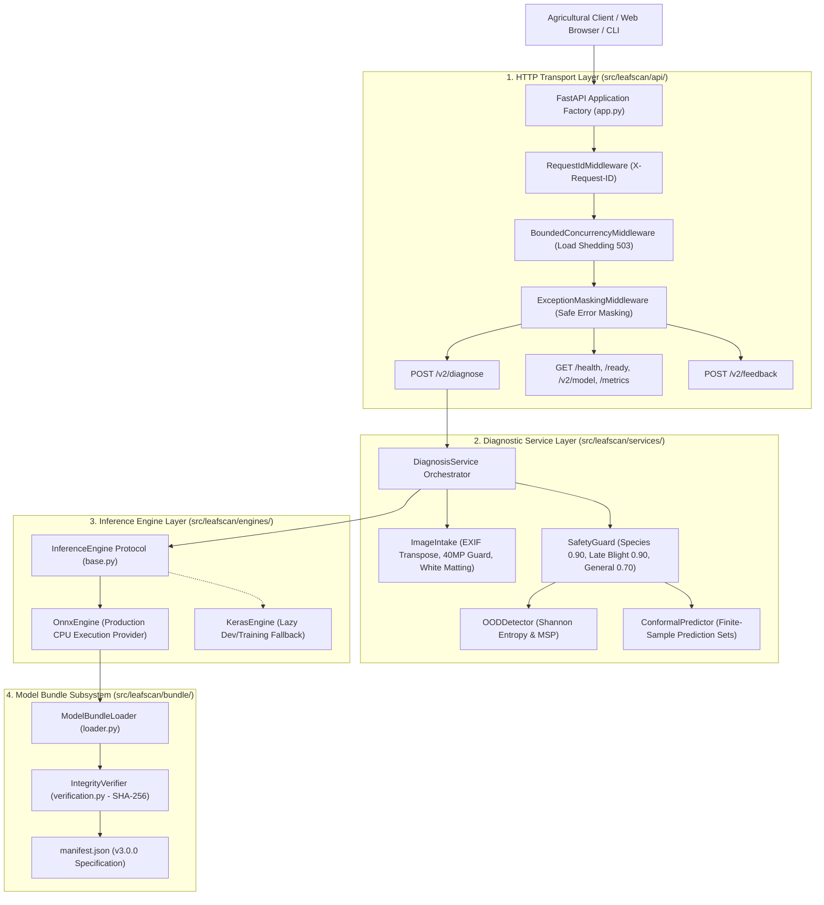

# LeafScan V3 — Backend Architecture Specification

**Project:** `plant-disease-detection`  
**System Architecture:** LeafScan V3  
**Status:** Implemented Production Architecture  
**Document Version:** 3.0.0  
**Authors:** Senior Backend Architect, ML Infrastructure Engineer & DevSecOps Specialist  

---

## 1. Architectural Vision & Core Principles

LeafScan V3 transforms an existing research-oriented Keras application into a modular, production-ready, security-hardened agricultural diagnostic microservice.

### Core Architecture Principles:
1. **Zero-TensorFlow Production Serving:** TensorFlow and Keras are completely eliminated from the production serving path and container images. Inference runs exclusively on `onnxruntime` using CPU-optimized execution sessions.
2. **Runtime-Independent Engine Abstraction:** Inference orchestration communicates exclusively through the `InferenceEngine` protocol (`src/leafscan/engines/base.py`), fully isolating the application from low-level execution providers.
3. **Immutable Cryptographic Model Bundles:** Models, class indices, safety thresholds, and calibration constants are packaged together in versioned model bundles (`models/bundles/v3`) verified against cryptographic SHA-256 digests.
4. **Deterministic Safety Authority:** Machine learning outputs never directly determine agricultural advisories. The deterministic `SafetyGuard` component retains final authority over all species thresholds, pathogen escalation rules, and chemical treatment warnings.
5. **Defensive Resource Bounding:** Strict intake verification guards against decompression bombs (40 MP limit), payload floods (10 MB limit), memory thrashing (bounded concurrency semaphore), and client flooding (sliding-window IP rate limiting).
6. **100% Backward Compatibility:** API response schemas, error envelopes, CLI flags, and frontend assets remain identical to ensure zero disruption to downstream clients.

---

## 2. Layered Architecture & Component Breakdown



---

## 3. Directory Layout

```text
plant-disease-detection/
├── src/
│   └── leafscan/
│       ├── __init__.py
│       ├── api/
│       │   ├── app.py                 # FastAPI application factory & lifespan
│       │   ├── dependencies.py        # Dependency injection providers
│       │   ├── middleware.py          # RequestID, Concurrency semaphore, Exception masking
│       │   ├── settings.py            # Pydantic environment configuration
│       │   └── routes/
│       │       ├── diagnose.py        # POST /v2/diagnose
│       │       ├── health.py          # GET /health, /ready, /v2/model, /metrics
│       │       └── feedback.py        # POST /v2/feedback
│       ├── services/
│       │   ├── diagnosis_service.py   # High-level diagnosis orchestration
│       │   ├── image_intake.py        # EXIF, 40MP limit, white-matting, quality checks
│       │   ├── safety_guard.py        # Deterministic safety gate authority
│       │   ├── conformal.py           # Split conformal prediction sets
│       │   ├── calibration.py         # Temperature scaling & ECE computation
│       │   └── ood_detector.py        # Entropy & MSP out-of-distribution detector
│       ├── engines/
│       │   ├── base.py                # InferenceEngine Protocol & typed output models
│       │   ├── onnx_engine.py         # Production ONNX Runtime engine (Zero TensorFlow)
│       │   └── keras_engine.py        # Dev/Parity Keras 3 engine with lazy TF import
│       ├── bundle/
│       │   ├── manifest.py            # Pydantic BundleManifest schema
│       │   ├── verification.py        # Cryptographic SHA-256 verification
│       │   └── loader.py              # ModelBundle loading & cache
│       └── core/
│           ├── exceptions.py          # Typed LeafScanException hierarchy
│           ├── logging.py             # Structured JSON logger
│           └── telemetry.py           # In-memory Prometheus metrics collector
├── models/
│   └── bundles/
│       └── v3/
│           ├── species_expert.onnx     # ONNX graph (2 classes: Potato, Tomato)
│           ├── potato_expert.onnx      # ONNX graph with CBAM (3 classes)
│           ├── tomato_expert.onnx      # ONNX graph with CBAM (3 classes)
│           └── manifest.json           # Versioned manifest with SHA-256 digests
├── api/
│   └── main.py                        # Backward-compatibility ASGI adapter
├── inference/
│   ├── predictor.py                   # Backward-compatibility HierarchicalPredictorV2 adapter
│   └── model_loader.py                # Lazy-import Keras cache for legacy test compatibility
├── tests/
│   ├── test_v3_serving.py             # V3 bundle, engine, parity, & security test suite
│   ├── test_api.py                    # API contract, mock, and boundary suite
│   ├── test_v2_inference.py           # Baseline regression suite
│   └── fixtures/
│       └── golden_test_dataset.json   # 49 curated golden evaluation cases
├── docs/                              # Comprehensive architectural deliverables
├── Dockerfile                         # Multi-stage non-root production container
├── compose.yaml                       # Docker Compose specification with resource limits
├── pyproject.toml                     # Modern dependency groups (serve, train, dev)
└── .env.example                       # Environment configuration template
```

---

## 4. Request Lifecycle & Sequential Execution Flow

1. **HTTP Ingestion:** Client submits `POST /v2/diagnose` with a multipart leaf photograph.
2. **Middleware Traversal:**
   - `RequestIdMiddleware` injects or generates `X-Request-ID`.
   - `BoundedConcurrencyMiddleware` acquires a slot from the inference semaphore (capacity: 4). If full, immediate `HTTP 503` with `Retry-After: 1` is returned.
3. **Defensive Image Intake:**
   - Validates upload length $\le 10\text{ MB}$.
   - Decodes image with Pillow, verifies format in `{"JPEG", "PNG", "WEBP"}`.
   - Enforces decoded dimension limit: `width * height <= 40_000_000` pixels.
   - Normalizes camera rotation using `ImageOps.exif_transpose`.
   - Alpha-composites RGBA over a solid white background `(255, 255, 255)`.
   - Resizes to $224 \times 224$ via bilinear interpolation.
   - Converts to float32 NumPy tensor `[1, 224, 224, 3]` in pixel range `[0.0, 255.0]`.
4. **Tier 1 — Botanist Species Classification:**
   - `OnnxEngine.predict("species_expert", tensor)` runs forward inference.
   - Extracts species confidence: $P(\text{Potato})$ and $P(\text{Tomato})$.
5. **Safety Gate 1 Evaluation:**
   - `OODDetector` screens species entropy and maximum probability.
   - `SafetyGuard.evaluate_species_gate`: checks species confidence against threshold $0.9000$.
   - **Abstention Decision:** If confidence $< 0.9000$, the specialist is never executed. `disease` is returned as `null`, `safety_status = "species_uncertain"`, and an agricultural extension advisory is returned.
6. **Tier 2 — Specialist Crop Doctor Routing:**
   - If species confidence $\ge 0.9000$, routes to `potato_expert` or `tomato_expert`.
   - Runs forward inference with CBAM attention.
   - Computes disease distribution: `Early Blight`, `Late Blight`, and `Healthy`.
7. **Safety Gate 2 Evaluation:**
   - Evaluates conformal prediction set $\mathcal{C}(x)$ generated at $90\%$ coverage.
   - If `Late Blight` is detected: strict $0.9000$ threshold enforced. If below $0.9000$ or conformal set contains multiple classes, diagnosis is flagged as `late_blight_uncertain` and chemical suppression advisory is bound.
   - If another disease: general $0.7000$ threshold enforced.
   - Otherwise, flags as `confident`.
8. **Response Serialization:**
   - Formats complete JSON response preserving all existing fields.
   - Emits structured operational log and increments Prometheus counters.
