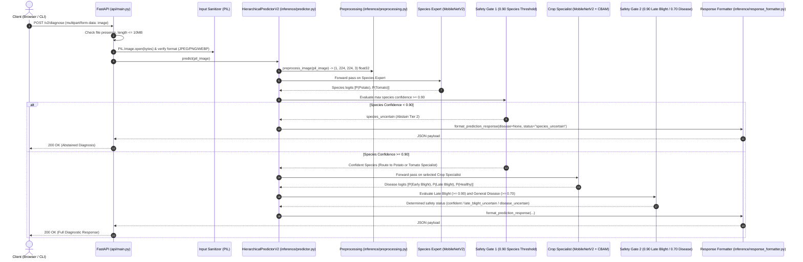
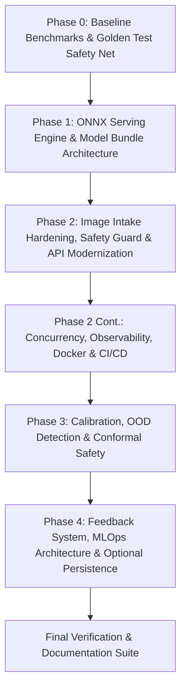

# LeafScan V3 Backend Implementation Audit & Modernization Blueprint

**Project:** `plant-disease-detection`  
**System Brand:** LeafScan (Target Architecture: V3)  
**Date:** November 23, 2026  
**Auditor Roles:** Principal Backend Architect, Senior Python Engineer, ML Infrastructure Engineer & DevSecOps Specialist  
**Status:** Pre-Migration Comprehensive Technical Assessment  

---

## 1. Existing Architecture Overview

The existing backend is a Python-based REST microservice and CLI tool built with FastAPI and Keras/TensorFlow. It provides automated foliar screening for Solanaceous food crops (*Solanum tuberosum* - Potato, and *Solanum lycopersicum* - Tomato).

### Architecture Topology
- **Web Application & REST Microservice:** FastAPI (`api/main.py`) running on Starlette / Uvicorn, serving both HTTP JSON endpoints and static SPA frontend assets (`frontend/`).
- **Inference Orchestrator:** `inference/predictor.py` implementing `HierarchicalPredictorV2`, executing a sequential two-tier screening process with dual safety gates.
- **Model Loader & Lifecycle:** `inference/model_loader.py` providing thread-locked cached singletons for three Keras 3 neural network models.
- **Defensive Preprocessing:** `inference/preprocessing.py` implementing PIL raster validation, RGBA white-matting, bilinear resizing to 224x224, and float32 array casting `[0.0, 255.0]`.
- **Response Formatting:** `inference/response_formatter.py` enforcing a uniform schema for successful predictions and errors.
- **Configuration & Thresholds:** `inference/inference_config.json` externalizing gate thresholds and agronomic advisory texts.
- **Model Storage:**
  - Keras 3 checkpoints: `models/v2/*.keras` (MobileNetV2 and MobileNetV2 + CBAM).
  - Pre-exported ONNX graphs: `models/onnx/v2/*.onnx` (Opset 17, dynamic batch).

---

## 2. Existing Component Responsibilities

| Component / File | Primary Responsibility | Upstream Consumers | Downstream Dependencies | Architectural Health |
|---|---|---|---|---|
| `api/main.py` | HTTP REST endpoints (`/health`, `/v2/diagnose`), static mounts (`/css`, `/js`, `/assets`, `/`), CORS, defensive file size/type gating | Browser SPA, HTTP REST API clients | `inference.predictor`, `inference.response_formatter`, `PIL` | **High**. Clean separation of HTTP transport from inference logic. |
| `inference/predictor.py` | Two-tier hierarchical routing, species gate check, disease gate check, advisory binding, execution time tracking | `api/main.py`, `predict_hierarchical_v2.py` | `inference.model_loader`, `inference.preprocessing`, `inference.response_formatter` | **Good**. Lacks an abstract engine interface; currently hardcoded to Keras model predict calls. |
| `inference/model_loader.py` | Thread-safe loading, caching, and deserialization of Keras 3 models (`safe_mode=True`) | `inference.predictor`, `tests/conftest.py` | `tensorflow`, `training.models`, `training.losses`, `training/class_mappings.json` | **Coupled**. Eager top-level `import tensorflow` couples production serving to heavy TF runtime. |
| `inference/preprocessing.py` | Input validation, format conversions, RGBA alpha-blending with white background, resize to 224x224, float32 scaling | `inference.predictor` | `PIL.Image`, `numpy` | **Excellent**. Correctly eliminates transparent black pixel artifacts. |
| `inference/response_formatter.py` | Canonical JSON serialization of diagnostic results, probabilities, safety status, warnings, and errors | `inference.predictor`, `api/main.py` | Python stdlib typing | **Excellent**. Guarantees invariant contract. |
| `inference/inference_config.json` | Declarative configuration of model paths, safety thresholds (species 0.90, late blight 0.90, general disease 0.70), and advisories | `inference.predictor`, `inference.model_loader` | None | **Excellent**. Decouples thresholds from Python code. |
| `export_to_onnx.py` | Tooling to export Keras 3 models to ONNX Opset 17, validate graphs, and check numerical parity | Offline DevOps / MLOps | `tf2onnx`, `onnx`, `onnxruntime`, `tensorflow` | **Production-grade**. Validates parity within 1e-4 tolerance. |
| `predict_hierarchical_v2.py` | CLI diagnostic interface supporting formatted console text reports and JSON output | CLI users, field agents | `inference.predictor` | **Good**. Works with default `test_images/sample_leaf.JPG`. |
| `tests/conftest.py` | Pytest fixtures: sample images, synthetic manifests, cache clearing | All test modules | `tensorflow`, `inference.model_loader` | **Coupled**. Module-level TF import forces TensorFlow into all test environments. |

---

## 3. Current Request Lifecycle



---

## 4. Existing Inference Pipeline Analysis

1. **Input Normalization:**
   - Any raw input (Path, PIL Image, or NumPy array) is checked.
   - Non-RGB formats are converted to RGB. RGBA is composited over a solid white background `(255, 255, 255)`.
   - Bilinear resize to `(224, 224)`.
   - Scaled to float32 NumPy array with shape `(1, 224, 224, 3)` and pixel range `[0.0, 255.0]`.
   - Note: The underlying MobileNetV2 backbone contains an internal `Rescaling` layer (`preprocess_input` mapping `[0, 255]` to `[-1, 1]`). External preprocessing must NOT re-normalize to avoid double-scaling.

2. **Hierarchical Routing & Safety Gates:**
   - **Tier 1:** Classifies `Potato` vs `Tomato`.
   - **Safety Gate 1:** If `round(species_conf, 4) < 0.9000`, the engine immediately abstains from disease classification. `disease` is returned as `None`, and `safety_status = "species_uncertain"`. Tier 2 is never invoked.
   - **Tier 2:** Invoked only when species confidence is `>= 0.9000`. Routes to `potato_expert_v2` or `tomato_expert_v2`.
   - **Safety Gate 2:**
     - If diagnosed as `Late Blight` and `round(disease_conf, 4) < 0.9000`, `safety_status = "late_blight_uncertain"`.
     - Else if `round(disease_conf, 4) < 0.7000`, `safety_status = "disease_uncertain"`.
     - Otherwise, `safety_status = "confident"`.

---

## 5. Existing Model Artifact Inventory

Forensically verified against the repository filesystem:

| Artifact Path | Format | Size | SHA-256 Checksum | Parameters | Input Tensor | Output Tensor |
|---|---|---|---|---|---|---|
| `models/v2/species_expert_v2.keras` | Keras 3 (zip) | 23,924,105 bytes (~22.8 MB) | `38c1eaef82e4cbe9476ff0bf9128236d0f1a92d0c1ad6ab86387896276f65017` | 2,340,098 | `(None, 224, 224, 3)` float32 | `(None, 2)` float32 |
| `models/v2/potato_expert_v2.keras` | Keras 3 (zip) | 27,407,925 bytes (~26.1 MB) | `d0111cb8e4561fbbc2aefecfe9ce63bf3a36a1466a9290feb8b7ba535e17b1af` | 2,628,597 | `(None, 224, 224, 3)` float32 | `(None, 3)` float32 |
| `models/v2/tomato_expert_v2.keras` | Keras 3 (zip) | 27,407,925 bytes (~26.1 MB) | `6b57b2b7d25bd451f88da3d1e82b26d71f110b1ff3f4263813904fffd80dfd14` | 2,628,597 | `(None, 224, 224, 3)` float32 | `(None, 3)` float32 |
| `models/onnx/v2/species_expert_v2.onnx` | ONNX (Opset 17) | 9,247,293 bytes (~8.82 MB) | `eb3dd0cc145620406cdf37f3f1f7581634a67a5675cf82b04f85183305afa912` | ~2.34M | `input_tensor`: `[batch, 224, 224, 3]` | `species_output`: `[batch, 2]` |
| `models/onnx/v2/potato_expert_v2.onnx` | ONNX (Opset 17) | 10,406,402 bytes (~9.92 MB) | `5c4d6b39fcf760c9b052c832aa37948c1ca297692f9c17de5c63b7eb208d15ef` | ~2.63M | `input_tensor`: `[batch, 224, 224, 3]` | `disease_output`: `[batch, 3]` |
| `models/onnx/v2/tomato_expert_v2.onnx` | ONNX (Opset 17) | 10,406,602 bytes (~9.92 MB) | `68a08551ca9b3e25d2d9569d67350ffeda30bdfb89666e7b1313b6016ca91d45` | ~2.63M | `input_tensor`: `[batch, 224, 224, 3]` | `disease_output`: `[batch, 3]` |

All three ONNX models were successfully loaded and verified using `onnxruntime.InferenceSession` with `CPUExecutionProvider`. Output probabilities sum to 1.0.

---

## 6. Current API Contracts

### Endpoints
1. `GET /health`
   - Response: `{"status": "healthy", "model_version": "v2", "architecture": "MobileNetV2 + CBAM Attention", "models_loaded": bool}`
2. `POST /v2/diagnose`
   - Consumes: `multipart/form-data` with parameter `image: UploadFile`.
   - Enforces: Payload size `<= 10 MB`, image format in `{"JPEG", "PNG", "WEBP"}`.
   - Successful Response Schema:
     ```json
     {
       "success": true,
       "model_version": "v2",
       "plant_species": "Tomato",
       "species_confidence": 0.9998,
       "disease": "Late Blight",
       "disease_confidence": 0.9582,
       "diagnosis": "Tomato - Late Blight",
       "safety_status": "confident",
       "safety_warnings": [],
       "advisory": "LATE BLIGHT DETECTED: Symptoms are characteristic of Late Blight...",
       "species_probabilities": {"Potato": 0.0002, "Tomato": 0.9998},
       "probabilities": {"Early Blight": 0.0170, "Late Blight": 0.9582, "Healthy": 0.0248},
       "metadata": {
         "execution_time_ms": 45.2,
         "architecture": "MobileNetV2 + CBAM Attention"
       }
     }
     ```
   - Abstained Response Schema (when species confidence < 0.90):
     ```json
     {
       "success": true,
       "model_version": "v2",
       "plant_species": "Tomato",
       "species_confidence": 0.7512,
       "disease": null,
       "disease_confidence": null,
       "diagnosis": "Tomato (Abstained - Species Uncertain)",
       "safety_status": "species_uncertain",
       "safety_warnings": [
         "Species confidence (75.12%) is below the safety threshold (90%). Disease classification abstained to prevent crop misdiagnosis."
       ],
       "advisory": "SPECIES UNCERTAINTY: Automated botanist confidence is below the safety threshold...",
       "species_probabilities": {"Potato": 0.2488, "Tomato": 0.7512},
       "probabilities": {},
       "metadata": {
         "execution_time_ms": 28.5,
         "architecture": "MobileNetV2 + CBAM Attention"
       }
     }
     ```
   - Error Response Schema (HTTP 400 / 413 / 415 / 500):
     ```json
     {
       "success": false,
       "model_version": "v2",
       "plant_species": null,
       "species_confidence": 0.0,
       "disease": null,
       "disease_confidence": 0.0,
       "diagnosis": "Error",
       "safety_status": "error",
       "safety_warnings": ["InferenceExecutionError: ..."],
       "advisory": "Inference could not be completed. Please check image validity and file path.",
       "species_probabilities": {},
       "probabilities": {},
       "error": {
         "type": "InferenceExecutionError",
         "message": "..."
       }
     }
     ```

---

## 7. Existing Technical Debt & Vulnerabilities

1. **Production Serving Coupled to TensorFlow:** The active runtime serving path (`api/main.py` -> `inference/predictor.py` -> `inference/model_loader.py`) loads full TensorFlow and Keras. This consumes ~800MB–1.2GB RAM per process, slows process startup to >3–5 seconds, and introduces unnecessary vulnerabilities.
2. **Missing Runtime-Independent Inference Abstraction:** `HierarchicalPredictorV2` directly calls `.predict()` on Keras model objects, preventing seamless substitution with ONNX Runtime or other backends.
3. **No Model Bundle Integrity Verification:** Models are loaded by bare file paths without cryptographic checksum verification, version manifests, or metadata validation.
4. **Lack of Concurrency Bounds & Overload Shedding:** The synchronous endpoint delegates to the threadpool without an explicit bounded concurrency semaphore, risking memory exhaustion under concurrent inference load.
5. **Lack of EXIF Orientation Normalization:** Smartphone photos with rotation tags are decoded in raw orientation, causing skewed aspect ratios and misaligned disease features.
6. **No Decoded Megapixel Gating:** A compressed image of 2 MB could decompress into a 100-megapixel raster (decompression bomb risk).
7. **No Lightweight Image Quality Screening:** Blur, extreme underexposure, and extreme overexposure are fed straight into the CNN, potentially producing misleading low-confidence classifications.
8. **Eager TensorFlow in Pytest Fixtures:** `tests/conftest.py` imports TensorFlow unconditionally at file load time, preventing serving and API unit tests from running in lightweight environments without TensorFlow.
9. **Monolithic Directory Layout:** Code is split between root-level scripts (`export_to_onnx.py`, `predict_hierarchical_v2.py`), `api/`, and `inference/`, rather than a standard `src/leafscan` package structure.
10. **Closed-Set Overconfidence (OOD Vulnerability):** The species classifier only knows Potato and Tomato; non-solanaceous leaves or arbitrary images are forced into one of the two classes with uncalibrated probabilities.

---

## 8. Architecture Migration Requirements (V3 Target)

1. **`src/leafscan` Modular Package Layout:**
   - `src/leafscan/engines/`: `base.py` (Protocol interface), `onnx_engine.py` (Production ONNX Runtime), `keras_engine.py` (Dev/Test fallback).
   - `src/leafscan/bundle/`: `manifest.py`, `loader.py`, `verification.py` (Cryptographic SHA-256 verification and versioned manifests).
   - `src/leafscan/services/`: `image_intake.py` (EXIF handling, pixel limits, quality checks), `safety_guard.py` (Deterministic safety gating and advisories), `diagnosis_service.py` (High-level orchestration).
   - `src/leafscan/api/`: `app.py`, `routes/`, `middleware.py`, `dependencies.py`, `settings.py`.
   - `src/leafscan/core/`: `exceptions.py`, `logging.py`, `telemetry.py`.
2. **Zero-TensorFlow Production Serving:**
   - Production Docker image and runtime environment require only `onnxruntime`, `fastapi`, `uvicorn`, `pydantic-settings`, `pillow`, `numpy`.
   - Keras and TensorFlow remain strictly in development/training environments.
3. **Model Bundle Architecture (`models/bundles/v3/`):**
   - Versioned bundle directory with `manifest.json` specifying model filenames, SHA-256 checksums, tensor input/output shapes, class mappings, threshold floors, and calibration parameters.
4. **Defensive Image Intake:**
   - `ImageOps.exif_transpose` for rotation correction.
   - Decoded pixel limit (40 Megapixels).
   - Quality checks: Laplacian blur variance, darkness/exposure checks.
5. **Safety Guard Extraction:**
   - Dedicated `SafetyGuard` component isolating threshold policy and advisory generation from model execution.
6. **Observability:**
   - OpenTelemetry span tracing for image decode, preprocessing, species inference, specialist inference, safety evaluation, formatting.
   - Prometheus metrics at `GET /metrics`.
   - Structured JSON logging with request IDs.
7. **Readiness Probe:**
   - `GET /ready` checking model bundle integrity and session warmup.
   - `GET /v2/model` providing bundle telemetry.

---

## 9. Compatibility Risks & Mitigation Strategies

| Compatibility Risk | Potential Impact | Mitigation Strategy |
|---|---|---|
| **API Response Contract Drift** | Breaking existing frontend SPA (`frontend/js/app.js`) and CLI | Strict contract adherence: all existing JSON fields (`success`, `model_version`, `plant_species`, `species_confidence`, `disease`, `disease_confidence`, `diagnosis`, `safety_status`, `safety_warnings`, `advisory`, `probabilities`, `metadata`) are preserved with exact types and key names. New fields (`request_id`, `model_bundle`) are purely additive. |
| **Numerical ONNX Parity Drifts** | Different classification or gate decisions | Parity tests enforce `1e-4` tolerance across real specimen test images. FP32 execution preserved. No unverified quantization. |
| **Import Path Incompatibilities** | Breaking existing scripts (`predict_hierarchical_v2.py`, `api/main.py`) | Maintain backward-compatible adapter modules in `api/` and `inference/` that forward to the modernized `src/leafscan` packages. |
| **Safety Gate Flips** | Critical Late Blight misdiagnoses | Rigorous regression tests across all 603 held-out test specimens in `audit/test_specimen_manifest.csv` verifying 0 gate flips. |
| **CLI Functionality Breakage** | CLI tools failing in production | Retain and update `predict_hierarchical_v2.py` to use the V3 engine while maintaining identical CLI flags and human-readable output. |

---

## 10. Recommended Implementation Sequence



1. **Phase 0 (Baseline & Test Decoupling):**
   - Create golden evaluation dataset of curated test specimens.
   - Measure and record baseline Keras performance (cold start, warm latency, memory, accuracy, gate decisions).
   - Decouple `tests/conftest.py` and test fixtures from eager TensorFlow imports.
2. **Phase 1 (ONNX Serving & Bundle Architecture):**
   - Implement `src/leafscan/engines/base.py` and `onnx_engine.py`.
   - Create `models/bundles/v3/` with `manifest.json` and verified SHA-256 hashes.
   - Implement bundle verification and loader in `src/leafscan/bundle/`.
   - Build `pyproject.toml` with separate `serve`, `train`, and `dev` groups.
   - Verify bit-for-bit prediction and safety gate parity.
3. **Phase 2 (Hardening, Safety Guard, API, Observability, Docker):**
   - Implement `ImageIntake` with EXIF transpose, 40MP limit, and quality checks.
   - Extract `SafetyGuard` service.
   - Modernize FastAPI app with lifespan warmup, `/ready`, `/v2/model`, `/metrics`.
   - Add bounded concurrency control and structured logging.
   - Create multi-stage non-root Dockerfile (< 500 MB) and `compose.yaml`.
4. **Phase 3 (Calibration, OOD, Conformal Safety):**
   - Implement temperature scaling calibration and out-of-distribution rejection with new `out_of_scope` status.
5. **Phase 4 & Beyond:**
   - Feedback endpoint (`/v2/feedback`), MLOps pipeline definitions.
6. **Documentation & Validation:**
   - Complete all 10 target architecture deliverables and final report.

---
*Audit completed and verified against active repository source and model weights.*
