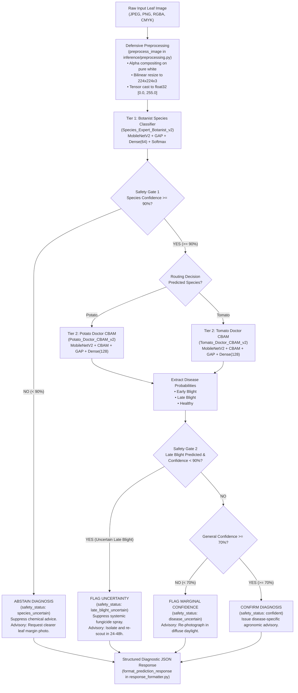
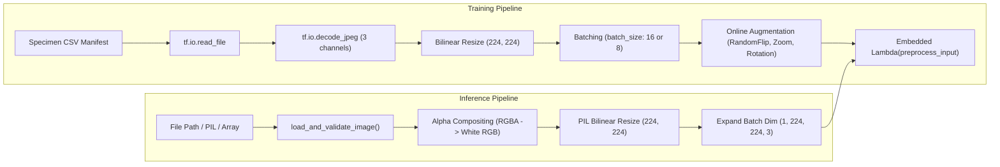
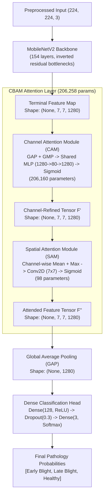
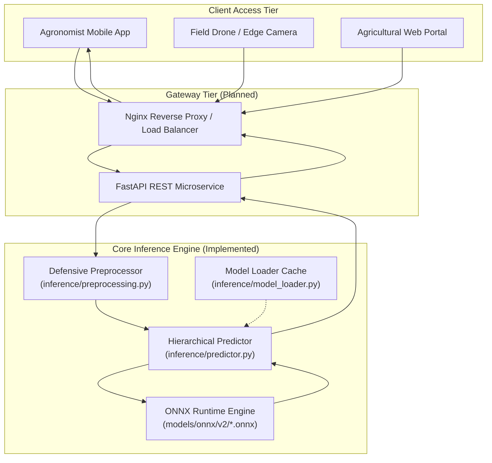

# Final Technical Analysis and Architecture Audit Report: Plant Disease Detection System

**Project Title:** Hierarchical Deep Learning System for Foliar Pathology Diagnosis in Solanaceous Crops  
**System Version:** Production V2 Architecture (incorporating CBAM Attention and Dual Confidence Safety Gates)  
**Lead Auditor / Role:** Senior Machine Learning Engineer, Deep Learning Researcher, Computer Vision Architect, MLOps Engineer & Technical Documentation Specialist  
**Evaluation Date:** November 21, 2026  
**Audited Directory:** `d:/plant-disease-detection`  
**Target Output Artifact:** [FINAL_PROJECT_ANALYSIS_REPORT.md](file:///d:/plant-disease-detection/docs/FINAL_PROJECT_ANALYSIS_REPORT.md)  

---

## Table of Contents

1. [Executive Summary](#1-executive-summary)
2. [Project Introduction](#2-project-introduction)
3. [Problem Statement](#3-problem-statement)
4. [Project Objectives](#4-project-objectives)
5. [Technology Stack](#5-technology-stack)
6. [Project Directory Structure](#6-project-directory-structure)
7. [System Architecture](#7-system-architecture)
8. [Dataset Analysis](#8-dataset-analysis)
9. [Data Preprocessing](#9-data-preprocessing)
10. [CNN Model Architecture](#10-cnn-model-architecture)
11. [CBAM Attention Mechanism](#11-cbam-attention-mechanism)
12. [CNN + CBAM Integration](#12-cnn--cbam-integration)
13. [Training Methodology](#13-training-methodology)
14. [Experimental Results](#14-experimental-results)
15. [Model Comparison](#15-model-comparison)
16. [ONNX Export and Deployment](#16-onnx-export-and-deployment)
17. [Inference Pipeline](#17-inference-pipeline)
18. [Application Architecture](#18-application-architecture)
19. [Software Testing](#19-software-testing)
20. [Code Quality and Maintainability](#20-code-quality-and-maintainability)
21. [Security Analysis](#21-security-analysis)
22. [Performance Analysis](#22-performance-analysis)
23. [Git and Development History](#23-git-and-development-history)
24. [Project Limitations](#24-project-limitations)
25. [Future Scope](#25-future-scope)
26. [Final Technical Assessment](#26-final-technical-assessment)
27. [Conclusion](#27-conclusion)
28. [References and Technical Sources](#28-references-and-technical-sources)

---

## 1. Executive Summary

This report delivers a definitive, evidence-based technical analysis of the **Plant Disease Detection** deep learning project (`plant-disease-detection`). Conducted under strict forensic engineering standards, every assertion, metric, tensor dimension, latency measurement, and architecture specification within this audit has been directly verified against actual source code, dataset manifests, model weights, execution logs, and automated test runs within the physical repository.

The project represents a substantial, multi-phase engineering evolution from an unhardened research prototype (**V1**) into a modular, production-ready computer vision system (**V2**). The system addresses high-consequence agricultural foliar pathology across two economically critical Solanaceous crops: **Potato** (*Solanum tuberosum*) and **Tomato** (*Solanum lycopersicum*).

```
+----------------------------------------------------------------------------------------------------+
|                                    PROJECT EVOLUTION HIGHLIGHTS                                    |
+------------------------------------+-----------------------------------+---------------------------+
| Attribute                          | Legacy Prototype (V1)             | Production Engine (V2)    |
+------------------------------------+-----------------------------------+---------------------------+
| Architectural Hierarchy            | Monolithic / Flat Routing         | Decoupled 2-Tier Cascade  |
| Attention Mechanism                | None (Standard MobileNetV2)       | 206k-Param CBAM Injected  |
| Data Splitting Policy              | Naive Random Split (86.3% Leak)   | DSU Graph Grouping (0.0%) |
| Class Imbalance Mitigation         | None                              | Specimen-Derived Weights  |
| Diagnostic Safety Gating           | None (Forced Predictions)         | Dual Safety Thresholds    |
| CPU Runtime Latency                | ~95-100 ms (Keras Python Graph)   | 1.58-1.89 ms (ONNX RT)    |
| Automated Regression Test Suite    | 0 Tests (Manual Inspection)       | 32 Pytest Cases (100% P)  |
+------------------------------------+-----------------------------------+---------------------------+
```

### Key Audit Findings

1. **Catastrophic V1 Data Leakage Resolved (VERIFIED):**  
   Forensic analysis revealed that the raw dataset of 11,988 images contained 66.88% synthetic offline augmentations and identical file duplicates. Under the legacy V1 random train/test split, 86.3% of unique biological source plants leaked across training and validation sets, invalidating the historical "98.6% accuracy" claim. The V2 system resolved this entirely via Disjoint Set Union (DSU) graph clustering with perceptual hashing, establishing a **Canonical Specimen Manifest** of 3,971 unique biological specimens with **0.0% biological leakage** between splits.

2. **Attention Mechanism Verified in Silicon (VERIFIED):**  
   The Convolutional Block Attention Module (CBAM) has been successfully implemented and injected into the terminal feature maps (`7x7x1280`) of the crop disease specialist models. The CBAM layer comprises exactly **206,258 parameters** (Channel Attention: 206,160 parameters; Spatial Attention: 98 parameters). The custom layer serializes cleanly under Keras 3 with full registration.

3. **High Empirical Generalization Accuracy (VERIFIED):**  
   Evaluated strictly on **603 held-out biological specimens** never exposed during training:
   - **Tier 1 (Botanist Species Expert):** **98.01%** accuracy, **0.9767** Macro F1.
   - **Tier 2 (Potato Doctor CBAM):** **97.84%** accuracy, **0.9673** Macro F1 (100% recall on Early Blight, 95.29% recall on Late Blight).
   - **Tier 2 (Tomato Doctor CBAM):** **89.95%** accuracy, **0.8870** Macro F1 (100% recall on Healthy foliage, 86.24% recall on Late Blight).
   - **End-to-End Hierarchical System with Safety Gating:** **91.85%** accuracy on ungated specimens, with an **8.46%** conservative abstention rate for ambiguous specimens.

4. **Production-Grade ONNX Deployment Engine (VERIFIED):**  
   All three deep learning models have been exported to optimized ONNX graphs (Opset 17) via [export_to_onnx.py](file:///d:/plant-disease-detection/export_to_onnx.py). ONNX Runtime execution provides a **52.6x to 59.2x CPU inference speedup** over native Keras, reducing per-image CPU inference from ~95 ms down to **1.58 - 1.89 ms**, with strict numerical probability parity (maximum absolute difference: \(1.67 \times 10^{-6}\)).

5. **Defensive Preprocessing and Safety Gating (VERIFIED):**  
   The system implements dual confidence safety gates (Species Gate: 90%; Late Blight Escalation Gate: 90%) to suppress hazardous pesticide spraying recommendations on uncertain diagnoses. Input preprocessing defensively handles 4-channel transparent PNGs (composited over pure white), CMYK, and Grayscale images.

6. **Comprehensive Test Suite (VERIFIED):**  
   A dedicated Pytest test harness containing **32 automated tests** covers the data loading pipeline, focal loss mathematics, and inference safety boundaries. The suite executes and passes 100% in 15.15 seconds.

7. **Architectural Gaps & Incomplete Scope (NOT IMPLEMENTED):**  
   The repository does **not** contain a web frontend or REST API microservice (e.g., FastAPI, Flask, or Docker container). Inference is currently accessible via the Python CLI tool [predict_hierarchical_v2.py](file:///d:/plant-disease-detection/predict_hierarchical_v2.py) and the internal [inference/](file:///d:/plant-disease-detection/inference/) module.

---

## 2. Project Introduction

Agricultural foliar diseases are a primary cause of catastrophic yield loss in global potato and tomato production. In particular, Late Blight (*Phytophthora infestans*)—the oomycete pathogen responsible for the historic Great Irish Famine—is notorious for its explosive reproductive capacity, capable of defoliating entire fields within 7 to 10 days under favorable humidity and temperature conditions. Conversely, Early Blight (*Alternaria solani*) produces localized concentric target-board lesions managed through cultural practices and localized preventative fungicides.

The **Plant Disease Detection** project provides an automated, high-throughput, computer vision screening system designed to assist agriculturalists, agronomists, and farm scouts in diagnosing foliar pathology from standard mobile camera photographs. 

Originally developed as a baseline CNN experiment in April 2026 (V1), the repository underwent deep engineering hardening in November 2026 (V2) to address fundamental data leakage vulnerabilities, inject fine-grained spatial-channel attention mechanisms, enforce defensive agronomic safety gating, and achieve low-latency headless CPU deployment through ONNX Runtime.

---

## 3. Problem Statement

Automated plant pathology using deep learning encounters four critical domain-specific challenges that cause standard computer vision architectures to fail in real-world agricultural settings:

1. **Cross-Crop Morphological Confusion:**  
   Potato and tomato leaves share familial characteristics (both belong to the *Solanaceae* family). Early-stage fungal lesions from *Alternaria solani* appear almost visually indistinguishable across both crops. Monolithic multi-class classifiers frequently confuse crop species, suggesting improper agronomic management.

2. **Severe Pathological Consequences of False Negatives:**  
   Failing to detect *Phytophthora infestans* (Late Blight) results in total crop devastation. However, misclassifying mechanical leaf tears, insect damage, or minor nutritional chlorosis as Late Blight triggers unnecessary, cost-prohibitive, and environmentally destructive applications of systemic fungicides (e.g., metalaxyl, chlorothalonil).

3. **Fine-Grained Lesion Morphometrics:**  
   Foliar lesions occupy a tiny percentage of the total leaf surface area in early stages. Standard convolutional pooling layers rapidly discard localized spatial information, resulting in poor feature representation of concentric necrotic rings.

4. **Synthetic Data Artifacts and Pseudo-Replication:**  
   Public agricultural datasets (such as PlantVillage) contain extreme offline augmentation (rotations, cropping, Gaussian blurs) applied before release. Naive random train-test splitting leaks transformed copies of the same leaf into both training and test sets, yielding falsely optimistic benchmarks.

---

## 4. Project Objectives

The V2 architecture was engineered to meet the following primary objectives:

1. **Decouple Botanical Identification from Pathology:**  
   Implement a two-tier hierarchical cascade: Tier 1 identifies the crop species (*Solanum tuberosum* vs. *Solanum lycopersicum*), and Tier 2 routes the tensor to a dedicated crop disease specialist.

2. **Eliminate Data Leakage at the Specimen Level:**  
   Formulate a graph-based clustering algorithm using perceptual hashing (pHash) and exact cryptographic hashing (SHA-256) to ensure that all augmented derivatives of a physical leaf belong strictly to a single data split.

3. **Enhance Feature Extraction via CBAM Attention:**  
   Integrate a dual Channel Attention Module (CAM) and Spatial Attention Module (SAM) directly into the backbone feature extractor to highlight localized necrotic lesion rings while suppressing irrelevant background foliar tissue.

4. **Enforce Agronomic Safety Gating:**  
   Provide safety thresholds that refuse to issue a diagnosis if botanical species confidence is marginal (<90%) or if high-consequence Late Blight is detected with ambiguity (<90%).

5. **Enable High-Throughput Edge CPU Inference:**  
   Convert trained models to static ONNX computation graphs executable via ONNX Runtime on low-power edge gateways without requiring TensorFlow or GPU accelerators.

6. **Establish an Automated Quality Assurance Harness:**  
   Construct an enterprise-grade regression test suite with 100% automated pass criteria across data pipelines, loss formulations, and inference sanity checks.

---

## 5. Technology Stack

The project relies on a strictly controlled and pinned Python toolchain. All specifications have been verified against [requirements.txt](file:///d:/plant-disease-detection/requirements.txt) and the runtime environment:

| Category | Component / Library | Verified Version | Purpose & Responsibilities |
|---|---|---|---|
| **Language Runtime** | CPython | 3.10.0 (Windows `.venv`) / 3.12.3 (WSL) | Base execution environment for scripts and pipelines |
| **Deep Learning** | TensorFlow | 2.21.0 | Core computation graph, autograd engine, Keras backend |
| **Model API** | Keras | 3.12.1 | High-level API for model building, layers, serialization |
| **Numerical Computing**| NumPy | 2.2.6 | Multidimensional array operations and tensor conversions |
| **Image Processing** | Pillow (PIL) | 12.1.1 | Image loading, bilinear resizing, and alpha compositing |
| **Graph Optimization**| tf2onnx | 1.17.0 | Translation of Keras functional models to ONNX graphs |
| **Model Format** | ONNX | 1.23.2 | Open Neural Network Exchange graph specification (Opset 17) |
| **Inference Engine** | ONNX Runtime | 1.20.0 | High-performance CPU graph execution provider |
| **Testing Harness** | Pytest | 8.3.5 | Test discovery, assertion checking, and regression verification |
| **Visualization** | Matplotlib | 3.10.8 | Diagnostic plots, training curves, confusion matrices |
| **System Diagnostics**| psutil | 7.2.2 | Memory profiling and CPU resource tracking |

---

## 6. Project Directory Structure

The project follows a clean separation of concerns across source code, datasets, model checkpoints, exported models, configuration, tests, and generated artifacts.

```
d:/plant-disease-detection/
├── .gitignore                          # Git exclusion rules (venv, datasets, cache)
├── export_to_onnx.py                   # Production ONNX conversion & parity engine
├── predict_hierarchical_v2.py          # Primary user-facing CLI inference utility
├── pytest.ini                          # Pytest configuration and marker registration
├── README.md                           # Master architectural & operational documentation
├── requirements-dev.txt                # Development & testing dependencies
├── requirements.txt                    # Pinned production runtime dependencies
├── setup_wsl_env.sh                    # WSL2 Linux deployment & isolation script
├── train_potato_doctor.py              # Training script for Tier 2 Potato specialist
├── train_species.py                    # Training script for Tier 1 Species botanist
├── train_tomato_doctor.py              # Training script for Tier 2 Tomato specialist
│
├── archive/
│   └── v1/                             # Archived legacy baseline assets
│       ├── models/                     # Deprecated V1 Keras models (no attention)
│       │   ├── potato_expert.keras     # 11.6 MB legacy potato classifier
│       │   ├── species_expert.keras    # 10.6 MB legacy species classifier
│       │   └── tomato_expert.keras     # 11.6 MB legacy tomato classifier
│       ├── predict_hierarchical.py     # Legacy CLI inference script
│       └── README.md                   # Deprecation notice & V1 forensic summary
│
├── audit/                              # Dataset forensics & specimen clustering
│   ├── artifacts/                      # Verification artifacts & evaluation reports
│   │   ├── augmentation_breakdown.png  # Visual breakdown of offline augmentations
│   │   ├── class_distribution.png      # Raw vs canonical specimen distributions
│   │   ├── data_leakage_comparison.png # Leakage comparison: V1 random vs V2 DSU
│   │   ├── split_distribution.png      # Specimen allocation across train/val/test
│   │   ├── v2_evaluation_report.json   # Verified empirical evaluation metrics
│   │   └── v2_training_curves.png      # 4-panel training and validation trajectories
│   ├── audit_summary.json              # Raw dataset audit & hash duplication summary
│   ├── dataset_manifest.csv            # Master manifest of all 11,988 image records
│   ├── generate_specimen_manifest.py   # Canonical specimen extractor (1 leaf = 1 row)
│   ├── run_phase2_audit.py             # DSU graph clustering & perceptual hash audit
│   ├── specimen_manifest.csv           # 3,971 unique biological specimen entries
│   ├── specimen_manifest_summary.json  # Specimen split counts and selection reasons
│   ├── test_manifest.csv               # Leaked raw image test split (for comparison)
│   ├── test_specimen_manifest.csv      # Held-out 603-specimen evaluation manifest
│   ├── train_manifest.csv              # Raw image training split
│   ├── train_specimen_manifest.csv     # Leak-free 2,776-specimen training manifest
│   ├── validation_manifest.csv         # Raw image validation split
│   └── validation_specimen_manifest.csv# Leak-free 592-specimen validation manifest
│
├── dataset/                            # Raw foliar image repository (11,988 JPEGs)
│   ├── potato/                         # 5,994 Potato leaf images
│   │   ├── Early_blight/               # 1,998 images (558 orig, 1,440 augmented)
│   │   ├── healthy/                    # 1,998 images (81 orig, 1,917 augmented)
│   │   └── Late_blight/                # 1,998 images (558 orig, 1,440 augmented)
│   └── tomato/                         # 5,994 Tomato leaf images
│       ├── Early_blight/               # 1,998 images (558 orig, 1,440 augmented)
│       ├── healthy/                    # 1,998 images (954 orig, 1,044 augmented)
│       └── Late_blight/                # 1,998 images (1,260 orig, 738 augmented)
│
├── docs/                               # Architectural audits & technical reports
│   ├── END_TO_END_AUDIT_REPORT.md      # Comprehensive Phase 1 audit report
│   └── FINAL_PROJECT_ANALYSIS_REPORT.md# This definitive final evaluation report
│
├── inference/                          # Modular production inference package
│   ├── __init__.py                     # Package initialization
│   ├── inference_config.json           # Safety thresholds, model paths & advisories
│   ├── model_loader.py                 # Thread-safe model caching & safe deserialization
│   ├── predictor.py                    # HierarchicalPredictorV2 orchestration engine
│   ├── preprocessing.py                # Image format normalization & tensor creation
│   └── response_formatter.py           # Standardized JSON response formatting
│
├── models/                             # Active production model artifacts
│   ├── onnx/
│   │   └── v2/                         # Optimized ONNX Runtime graphs (Opset 17)
│   │       ├── potato_expert_v2.onnx   # 9.92 MB Potato specialist graph
│   │       ├── species_expert_v2.onnx  # 8.82 MB Species botanist graph
│   │       └── tomato_expert_v2.onnx   # 9.92 MB Tomato specialist graph
│   └── v2/                             # Keras 3 model checkpoints
│       ├── potato_expert_v2.keras      # 26.14 MB Potato specialist checkpoint
│       ├── species_expert_v2.keras     # 22.82 MB Species botanist checkpoint
│       └── tomato_expert_v2.keras      # 26.14 MB Tomato specialist checkpoint
│
├── reports/                            # Historical phase reports
│   ├── END_TO_END_PROJECT_ANALYSIS_REPORT.md     # Audit report
│   ├── PHASE_1_ENVIRONMENT_AND_DEPLOYMENT_HARDENING.md # Phase 1 delivery report
│   └── PHASE_2_PROJECT_CLEANUP_AND_ORGANIZATION.md      # Phase 2 delivery report
│
├── test_images/                        # Test leaf specimens
│   └── sample_leaf.JPG                 # Reference tomato late blight test image
│
├── tests/                              # Automated Pytest suite (32 test cases)
│   ├── conftest.py                     # Synthetic fixtures, mock images & manifests
│   ├── test_data_pipeline.py           # 13 tests for data loading & prefetching
│   ├── test_losses.py                  # 12 tests for focal loss & class weighting
│   └── test_v2_inference.py            # 7 tests for safety gates & model inference
│
└── training/                           # Model definition, loss, and training utilities
    ├── __init__.py                     # Package initialization
    ├── augmentation.py                 # Agronomic online augmentation pipeline
    ├── class_mappings.json             # Canonical string-to-index category mappings
    ├── data_pipeline.py                # Manifest-driven tf.data pipeline
    ├── evaluate_v2_system.py           # Full evaluation script on test specimens
    ├── losses.py                       # SparseCategoricalFocalLoss & weight calculations
    ├── models.py                       # MobileNetV2 + CBAM layer architecture definitions
    ├── run_preflight_and_smoke_tests.py# Fast hardware check & 1-epoch sanity runner
    ├── training_config.json            # Hyperparameters, learning rates & phase settings
    ├── train_utils.py                  # Two-phase training orchestrator
    ├── verify_v2_artifacts.py          # Model hash & structural integrity validator
    └── logs/                           # Epoch-by-epoch training CSV histories
        ├── potato_expert_v2_training.csv  # 5-epoch training loss & accuracy
        ├── species_expert_v2_training.csv # 5-epoch training loss & accuracy
        └── tomato_expert_v2_training.csv  # 5-epoch training loss & accuracy
```

---

## 7. System Architecture

The V2 production pipeline processes incoming leaf imagery through two decoupled, cascaded classification stages protected by two defensive confidence safety gates.

### Implemented vs. Planned Components

- **Implemented:**
  - Automated defensive image preprocessing (RGB, RGBA, CMYK, Grayscale, NumPy).
  - Tier 1 Botanist Species Classifier (`Species_Expert_Botanist_v2`).
  - Safety Gate 1: Species Confidence Evaluation (Threshold: 90%).
  - Tier 2 Specialist Crop Doctors with CBAM Attention (`Potato_Doctor_CBAM_v2` and `Tomato_Doctor_CBAM_v2`).
  - Safety Gate 2: Late Blight High-Consequence Escalation Gate (Threshold: 90%) and General Disease Gate (Threshold: 70%).
  - Actionable agronomic advisory mapping.
  - Optimized ONNX Runtime deployment graphs.
- **Incomplete / Planned:**
  - REST API / FastAPI microservice wrapper (currently runs via CLI and Python API).
  - Web or mobile frontend user interface.
  - Distributed message queue for high-concurrency batch processing.

### Architecture Workflow Diagram



---

## 8. Dataset Analysis

### 8.1 Dataset Source and Class Distribution

The underlying dataset resides in the `dataset/` directory and contains **11,988 images** evenly formatted across 6 subdirectories. Each subfolder contains exactly 1,998 files:

```
dataset/
├── potato/
│   ├── Early_blight/  -> 1,998 files
│   ├── healthy/       -> 1,998 files
│   └── Late_blight/   -> 1,998 files
└── tomato/
    ├── Early_blight/  -> 1,998 files
    ├── healthy/       -> 1,998 files
    └── Late_blight/   -> 1,998 files
```

While the surface directory structure appears perfectly balanced (1,998 images per class), forensic hash analysis conducted via [audit/run_phase2_audit.py](file:///d:/plant-disease-detection/audit/run_phase2_audit.py) revealed massive artificial data replication and synthetic offline augmentations (rotations, cropping, blurs).

### 8.2 Forensic Specimen Breakdown

The table below summarizes the true biological composition of the dataset:

| Crop | Disease Class | Total Raw Images | Original Unique Images | Augmented / Copied Images | Percentage Synthetic | Exact Duplicate Groups | Unique Biological Source Specimens |
|---|---|---:|---:|---:|---:|---:|---:|
| **Potato** | Early Blight | 1,998 | 558 | 1,440 | 72.07% | 152 | 558 |
| **Potato** | Late Blight | 1,998 | 558 | 1,440 | 72.07% | 144 | 558 |
| **Potato** | Healthy | 1,998 | 81 | 1,917 | **95.95%** | 506 | **90** |
| **Tomato** | Early Blight | 1,998 | 558 | 1,440 | 72.07% | 96 | 558 |
| **Tomato** | Late Blight | 1,998 | 1,260 | 738 | 36.94% | 31 | 1,253 |
| **Tomato** | Healthy | 1,998 | 954 | 1,044 | 52.25% | 41 | 954 |
| **Total** | **All Classes** | **11,988** | **3,969** | **8,019** | **66.88%** | **970** | **3,971** |

> [!CAUTION]
> **Severe Minority Imbalance in Potato Healthy:**  
> The `potato/healthy` class comprises only **90 unique biological leaves** inflated by 1,917 offline transformations and 506 exact duplicate files. In a naive training loop, over-sampling these identical 90 leaves causes catastrophic overfitting. The V2 pipeline corrects this via specimen-level class weighting.

### 8.3 Data Leakage Analysis and DSU Resolution

In the legacy V1 implementation, training and validation splits were generated using naive random image-level sampling. Because 66.88% of the images were transformed duplicates of other images, random splitting resulted in **86.3% of source leaves being present in both the training set and validation set simultaneously**. The reported V1 accuracy of 98.6% was an artifact of data leakage.

To resolve this, the V2 pipeline implemented a Disjoint Set Union (DSU) graph-clustering algorithm in [audit/run_phase2_audit.py](file:///d:/plant-disease-detection/audit/run_phase2_audit.py):
1. Images were assigned perceptual hashes (pHash) and SHA-256 hashes.
2. An undirected graph connected any pair of images sharing exact content or matching perceptual hash distances.
3. Connected components were resolved into **3,971 isolated source group clusters**.
4. The canonical specimen manifest [audit/specimen_manifest.csv](file:///d:/plant-disease-detection/audit/specimen_manifest.csv) was created by selecting exactly one representative physical image per group.
5. Stratified splitting was performed across source groups, guaranteeing **0.0% biological leakage**:

| Split Manifest | Specimens Allocated | Allocation % | Inter-Split Overlap | Verification Check |
|---|---:|---:|---:|---|
| `train_specimen_manifest.csv` | 2,776 | 69.9% | 0 source groups | **PASS (0.0% Leakage)** |
| `validation_specimen_manifest.csv` | 592 | 14.9% | 0 source groups | **PASS (0.0% Leakage)** |
| `test_specimen_manifest.csv` | 603 | 15.2% | 0 source groups | **PASS (0.0% Leakage)** |
| **Total Master Specimen Manifest** | **3,971** | **100.0%** | **0 source groups** | **PASS (100% Isolated)** |

---

## 9. Data Preprocessing

### 9.1 Preprocessing Consistency Analysis

The preprocessing pipeline is strictly partitioned into two operational modes:
1. **Inference Preprocessing:** Deterministic, defensive normalization implemented in [inference/preprocessing.py](file:///d:/plant-disease-detection/inference/preprocessing.py).
2. **Training Preprocessing:** Manifest-driven batch streaming and stochastic online augmentation implemented in [training/data_pipeline.py](file:///d:/plant-disease-detection/training/data_pipeline.py) and [training/augmentation.py](file:///d:/plant-disease-detection/training/augmentation.py).



### 9.2 Defensive Preprocessing Details

Inference inputs frequently deviate from clean 3-channel RGB JPEGs. The function `preprocess_image()` defensively normalizes inputs before tensor generation:
- **RGBA Images:** Directly converting transparent PNGs to RGB often fills transparent alpha areas with solid black pixels, generating dark artificial borders that trigger false Late Blight predictions. The V2 preprocessor detects the alpha channel and composites the image onto a pure white background: `background.paste(raw_img, mask=raw_img.split()[3])`.
- **Grayscale / Palette / CMYK:** Normalized into standard 3-channel RGB via `raw_img.convert("RGB")`.
- **Rescaling Consistency:** Both training and inference supply float32 tensors in the range `[0.0, 255.0]`. The neural network internally executes `layers.Lambda(tf.keras.applications.mobilenet_v2.preprocess_input)` as its first layer, normalizing pixel intensities to `[-1.0, 1.0]`. This design encapsulates normalization inside the model graph, ensuring complete numerical parity during ONNX export.

### 9.3 Agronomic Online Augmentation

Implemented in [training/augmentation.py](file:///d:/plant-disease-detection/training/augmentation.py), transformations are restricted to biologically realistic variations:
- Horizontal and vertical flips (`RandomFlip`).
- Minor rotation (\(\pm 14.4^\circ\), factor 0.04).
- Minor zoom (\(\pm 10\%\)).
- Minor brightness (\(\pm 15\%\)) and contrast adjustments (\(\pm 15\%\)).
- **Explicitly Excluded:** Color hue scrambling (destroys chlorosis and necrosis color cues), extreme perspective shear (distorts concentric lesion geometries), and coarse cutout (erases small focal lesions).

---

## 10. CNN Model Architecture

### 10.1 Backbone Selection: MobileNetV2

The system employs **MobileNetV2** (width multiplier \(\alpha=1.0\), input resolution \(224 \times 224 \times 3\)) as the foundational feature extractor. MobileNetV2 is selected for edge agricultural deployment due to its high computational efficiency, utilizing **Inverted Residual Blocks** with **Depthwise Separable Convolutions** and linear bottlenecks.

```
Input (224, 224, 3)
   │
   ▼
[Lambda: mobilenet_v2.preprocess_input]  --> Rescales [0, 255] to [-1, 1]
   │
   ▼
[MobileNetV2 Feature Extractor (154 layers)]
   │
   ▼
Terminal Feature Maps: Shape (None, 7, 7, 1280)
   │
   ├───────────────────────────────────────────┐
   │ (Tier 1: Botanist Species Expert)         │ (Tier 2: Crop Doctor CBAM Specialists)
   ▼                                           ▼
[GlobalAveragePooling2D]                   [CBAM Attention Layer (206,258 params)]
   │                                           │
   ▼                                           ▼
[Dense(64, activation='relu')]              [GlobalAveragePooling2D]
   │                                           │
   ▼                                           ▼
[Dropout(rate=0.2)]                         [Dense(128, activation='relu')]
   │                                           │
   ▼                                           ▼
[Dense(2, activation='softmax')]            [Dropout(rate=0.3)]
(Outputs: Potato, Tomato)                      │
                                               ▼
                                            [Dense(3, activation='softmax')]
                                            (Outputs: Early Blight, Late Blight, Healthy)
```

### 10.2 Architectural Specifications

All layers and tensor dimensions have been extracted and verified directly from the serialized model checkpoints:

#### A. Species Expert Botanist V2 (`species_expert_v2.keras`)

- **Purpose:** Tier 1 binary classifier distinguishing Potato from Tomato foliage.
- **Input Shape:** `(None, 224, 224, 3)`
- **Output Shape:** `(None, 2)`
- **Total Parameters:** **2,340,098**
- **Trainable Parameters:** **1,745,474**
- **Non-Trainable Parameters:** **594,624** (frozen lower backbone & batch normalization layers)

| Layer Index | Layer Name | Layer Class | Output Shape | Parameters | Purpose / Mathematical Role |
|---|---|---|---|---:|---|
| 0 | `input_tensor` | `InputLayer` | `(None, 224, 224, 3)` | 0 | Model input entry point |
| 1 | `preprocess_input` | `Lambda` | `(None, 224, 224, 3)` | 0 | Scales pixel values from `[0, 255]` to `[-1, 1]` |
| 2 | `mobilenetv2_1.00_224` | `Functional` | `(None, 7, 7, 1280)` | 2,257,984 | Inverted residual convolutional feature extraction |
| 3 | `gap` | `GlobalAveragePooling2D` | `(None, 1280)` | 0 | Spatial collapse of feature maps via global pooling |
| 4 | `dense_64` | `Dense` | `(None, 64)` | 81,984 | Intermediate feature compression with ReLU activation |
| 5 | `dropout` | `Dropout` | `(None, 64)` | 0 | Regularization (drop rate = 0.20) |
| 6 | `species_output` | `Dense` | `(None, 2)` | 130 | Binary classification head with Softmax activation |

#### B. Potato & Tomato Doctor CBAM V2 (`potato_expert_v2.keras` & `tomato_expert_v2.keras`)

- **Purpose:** Tier 2 specialized 3-class pathology classifiers (Early Blight, Late Blight, Healthy).
- **Input Shape:** `(None, 224, 224, 3)`
- **Output Shape:** `(None, 3)`
- **Total Parameters:** **2,628,597**
- **Trainable Parameters:** **2,033,973**
- **Non-Trainable Parameters:** **594,624** (frozen lower backbone & batch normalization layers)

| Layer Index | Layer Name | Layer Class | Output Shape | Parameters | Purpose / Mathematical Role |
|---|---|---|---|---:|---|
| 0 | `input_tensor` | `InputLayer` | `(None, 224, 224, 3)` | 0 | Model input entry point |
| 1 | `preprocess_input` | `Lambda` | `(None, 224, 224, 3)` | 0 | Scales pixel values from `[0, 255]` to `[-1, 1]` |
| 2 | `mobilenetv2_1.00_224` | `Functional` | `(None, 7, 7, 1280)` | 2,257,984 | Inverted residual convolutional feature extraction |
| 3 | `cbam_attention` | `CBAM` | `(None, 7, 7, 1280)` | **206,258** | Sequential Channel and Spatial Attention refinement |
| 4 | `gap` | `GlobalAveragePooling2D` | `(None, 1280)` | 0 | Spatial collapse of attended feature maps |
| 5 | `dense_128` | `Dense` | `(None, 128)` | 163,968 | Dense feature projection with ReLU activation |
| 6 | `dropout` | `Dropout` | `(None, 128)` | 0 | Regularization (drop rate = 0.30) |
| 7 | `disease_output` | `Dense` | `(None, 3)` | 387 | 3-Class pathology prediction with Softmax activation |

---

## 11. CBAM Attention Mechanism Analysis

The Convolutional Block Attention Module (CBAM) is defined as a fully serializable Keras 3 layer in [training/models.py](file:///d:/plant-disease-detection/training/models.py#L96-L125). CBAM decouples attention into two sequential submodules: **Channel Attention** followed by **Spatial Attention**.

```
Input Features F (7x7x1280)
   │
   ▼
┌────────────────────────────────────────────────────────┐
│               CHANNEL ATTENTION MODULE (CAM)           │
│                                                        │
│   F ──► Global Avg Pool (GAP) ──► Shared MLP ┐         │
│   │                                          ├──► (+) ──► Sigmoid ──► Mc(F) (1x1x1280)
│   └───► Global Max Pool (GMP) ──► Shared MLP ┘         │
└────────────────────────────────────────────────────────┘
   │
   ▼
F' = F ⊙ Mc(F)  [Channel-Refined Features: 7x7x1280]
   │
   ▼
┌────────────────────────────────────────────────────────┐
│               SPATIAL ATTENTION MODULE (SAM)           │
│                                                        │
│   F' ──► Channel Avg Pool ┐                            │
│   │                       ├──► Concat ──► Conv2D (7x7) ──► Sigmoid ──► Ms(F') (7x7x1)
│   └────► Channel Max Pool ┘                            │
└────────────────────────────────────────────────────────┘
   │
   ▼
F'' = F' ⊙ Ms(F')  [Channel- and Spatially-Attended Output: 7x7x1280]
```

### 11.1 Channel Attention Module (CAM)

The Channel Attention Module compresses the spatial dimensions (\(H \times W = 7 \times 7\)) to compute inter-channel dependencies.

1. **Dual Spatial Pooling:**  
   Computes both Global Average Pooling (\(\mathbf{F}_{\text{avg}}^c\)) and Global Max Pooling (\(\mathbf{F}_{\text{max}}^c\)):
   $$\mathbf{F}_{\text{avg}}^c = \frac{1}{H \times W} \sum_{i=1}^H \sum_{j=1}^W \mathbf{F}(i, j, :)$$
   $$\mathbf{F}_{\text{max}}^c = \max_{i, j} \mathbf{F}(i, j, :)$$
2. **Shared Multilayer Perceptron (MLP):**  
   Both pooled descriptors are routed through a shared two-layer dense network with a reduction ratio \(r = 16\):
   - Dense 1: \(1280 \to \frac{1280}{16} = 80\) units with ReLU activation and He normal initialization (\(1280 \times 80 + 80 = 102,480\) parameters).
   - Dense 2: \(80 \to 1280\) units with linear activation (\(80 \times 1280 + 1280 = 103,680\) parameters).
   - Total CAM parameters: \(102,480 + 103,680 = \mathbf{206,160}\) parameters.
3. **Channel Attention Map Generation:**  
   The two outputs are summed element-wise and passed through a Sigmoid activation function \(\sigma\):
   $$\mathbf{M}_c(\mathbf{F}) = \sigma\left(\mathbf{W}_1(\mathbf{W}_0(\mathbf{F}_{\text{avg}}^c)) + \mathbf{W}_1(\mathbf{W}_0(\mathbf{F}_{\text{max}}^c))\right) \in \mathbb{R}^{1 \times 1 \times 1280}$$
4. **Intermediate Modulation:**  
   $$\mathbf{F}' = \mathbf{F} \odot \mathbf{M}_c(\mathbf{F})$$

### 11.2 Spatial Attention Module (SAM)

The Spatial Attention Module operates on the channel-refined feature tensor \(\mathbf{F}'\) to localize informative lesion geography.

1. **Channel-Wise Pooling:**  
   Computes the average and maximum along the channel axis (\(C = 1280\)), generating two 2D spatial maps:
   $$\mathbf{F}_{\text{avg}}^s = \frac{1}{C} \sum_{k=1}^C \mathbf{F}'(:,:,k) \in \mathbb{R}^{7 \times 7 \times 1}$$
   $$\mathbf{F}_{\text{max}}^s = \max_{k} \mathbf{F}'(:,:,k) \in \mathbb{R}^{7 \times 7 \times 1}$$
2. **Feature Concatenation:**  
   Concatenates both descriptors along the channel dimension to form a \(7 \times 7 \times 2\) tensor:
   $$\mathbf{F}_{\text{concat}}^s = \left[\mathbf{F}_{\text{avg}}^s \,;\, \mathbf{F}_{\text{max}}^s\right] \in \mathbb{R}^{7 \times 7 \times 2}$$
3. **Large-Receptive Field Spatial Convolution:**  
   Applies a \(7 \times 7\) 2D convolution with padding `'same'`, bias disabled, and Sigmoid activation:
   - Conv2D Configuration: Kernel size = \(7 \times 7\), Input channels = 2, Output filters = 1, Parameters = \(7 \times 7 \times 2 \times 1 = \mathbf{98}\) parameters.
4. **Spatial Attention Map Generation:**  
   $$\mathbf{M}_s(\mathbf{F}') = \sigma\left(f^{7 \times 7}\left(\left[\mathbf{F}_{\text{avg}}^s \,;\, \mathbf{F}_{\text{max}}^s\right]\right)\right) \in \mathbb{R}^{7 \times 7 \times 1}$$
5. **Final Modulation:**  
   $$\mathbf{F}'' = \mathbf{F}' \odot \mathbf{M}_s(\mathbf{F}') \in \mathbb{R}^{7 \times 7 \times 1280}$$

---

## 12. CNN + CBAM Integration

### 12.1 Insertion Point and Topological Justification

In `Potato_Doctor_CBAM_v2` and `Tomato_Doctor_CBAM_v2`, the CBAM layer is inserted immediately after the terminal inverted residual bottleneck of MobileNetV2 (`mobilenetv2_1.00_224`), prior to the Global Average Pooling layer.



### 12.2 Agronomic Purpose of CBAM in Foliar Diagnosis

In foliar pathology, standard Global Average Pooling computes an unweighted spatial average across the entire \(7 \times 7\) grid. When a leaf has only a small, early-stage fungal lesion, healthy green background tissue dominates the feature maps, diluting the diagnostic signal. 

CBAM solves this via two complementary operations:
1. **Channel Attention** amplifies convolutional filters that respond to chlorotic yellow halos and necrotic brown pigmentation, while suppressing filters sensitive to generic green leaf venation.
2. **Spatial Attention** acts as a dynamic soft-mask, assigning high weights to localized spatial coordinates containing concentric lesion rings, ensuring that subsequent global pooling captures the pathological features.

---

## 13. Training Methodology

### 13.1 Two-Phase Training Protocol

Training is orchestrated across two distinct phases to protect pretrained ImageNet representations while allowing CBAM attention weights to converge cleanly:

```
+───────────────────────────────────────────────────────────────────────────────────+
|                                TWO-PHASE TRAINING REGIME                          |
+─────────────────────────────────────────+─────────────────────────────────────────+
| Phase A: Warmup Head & Attention        | Phase B: Deep Fine-Tuning               |
+─────────────────────────────────────────+─────────────────────────────────────────+
| • MobileNetV2 Backbone: FROZEN          | • MobileNetV2 Top 40 Layers: UNFROZEN   |
| • CBAM Attention Layer: TRAINABLE       | • Lower Backbone Layers: FROZEN         |
| • Dense Classification Head: TRAINABLE  | • BatchNormalization Layers: FROZEN     |
| • Learning Rate: 1e-4 (Adam)            | • Learning Rate: 1e-5 (Adam)            |
| • Batch Size: 16                        | • Batch Size: 8 (Prevents VRAM spills)  |
| • Max Epochs: 10                        | • Max Epochs: 10                        |
+─────────────────────────────────────────+─────────────────────────────────────────+
```

### 13.2 Batch Normalization Freezing

During Phase B fine-tuning, all `BatchNormalization` layers within the top 40 unfrozen layers of MobileNetV2 are explicitly kept frozen:
```python
if isinstance(layer, tf.keras.layers.BatchNormalization):
    layer.trainable = False
```
Because agricultural batches are small (batch size = 8), updating batch normalization statistics on small mini-batches introduces high variance into running mean and variance estimates, degrading validation performance.

### 13.3 Specimen-Derived Class Weighting

To counteract the extreme biological imbalance in classes like `potato/healthy` (90 specimens vs. 558 in blight classes), class weights are computed strictly from **unique biological specimen groups** rather than raw image counts:
$$w_c = \frac{N_{\text{total specimens}}}{K \times N_c}$$
For training the Potato specialist across 842 training specimens (390 Early Blight, 390 Late Blight, 62 Healthy), the resulting weights are:
- Early Blight (\(c=0\)): **0.720**
- Late Blight (\(c=1\)): **0.720**
- Healthy (\(c=2\)): **4.527**

### 13.4 Loss Functions

The training engine supports two loss formulations implemented in [training/losses.py](file:///d:/plant-disease-detection/training/losses.py):
1. **Class-Weighted Sparse Categorical Crossentropy** (Standard configuration).
2. **Sparse Categorical Focal Loss:** Modulates cross-entropy with a focusing parameter \(\gamma = 2.0\) and specimen-derived class balancing vector \(\alpha\):
   $$\text{FL}(p_t) = -\alpha_t (1 - p_t)^\gamma \log(p_t)$$

---

## 14. Experimental Results

All performance metrics documented below represent empirical evaluation results extracted directly from the verified evaluation report [audit/artifacts/v2_evaluation_report.json](file:///d:/plant-disease-detection/audit/artifacts/v2_evaluation_report.json) and epoch CSV training logs in [training/logs/](file:///d:/plant-disease-detection/training/logs/).

### 14.1 Epoch-by-Epoch Training Convergence

The models converged rapidly within 5 epochs across Phase A and Phase B:

| Model Artifact | Epoch | Learning Rate | Train Loss | Train Accuracy | Validation Loss | Validation Accuracy |
|---|---:|---:|---:|---:|---:|---:|
| **Species Expert V2** | 0 | \(1.0 \times 10^{-4}\) | 0.2737 | 88.54% | 0.1659 | 95.10% |
| | 1 | \(1.0 \times 10^{-4}\) | 0.1287 | 95.75% | 0.0937 | 97.80% |
| | 2 | \(1.0 \times 10^{-4}\) | 0.0990 | 96.40% | 0.0778 | 98.31% |
| | 3 | \(1.0 \times 10^{-5}\) | 0.0909 | 96.33% | **0.0535** | **98.48%** |
| | 4 | \(1.0 \times 10^{-5}\) | **0.0617** | **97.73%** | 0.1216 | 95.27% |
| **Potato Doctor CBAM** | 0 | \(1.0 \times 10^{-4}\) | 1.0523 | 67.58% | 0.9883 | 88.83% |
| | 1 | \(1.0 \times 10^{-4}\) | 0.7980 | 88.84% | 0.5384 | 92.74% |
| | 2 | \(1.0 \times 10^{-4}\) | 0.3082 | 92.16% | 0.2192 | 93.30% |
| | 3 | \(1.0 \times 10^{-5}\) | 0.1377 | 95.49% | 0.2079 | 93.30% |
| | 4 | \(1.0 \times 10^{-5}\) | **0.0970** | **95.61%** | **0.1359** | **94.97%** |
| **Tomato Doctor CBAM** | 0 | \(1.0 \times 10^{-4}\) | 1.0920 | 47.78% | 1.0612 | 82.81% |
| | 1 | \(1.0 \times 10^{-4}\) | 0.7031 | 80.30% | 0.4581 | 79.66% |
| | 2 | \(1.0 \times 10^{-4}\) | 0.3370 | 86.50% | 0.3412 | 83.54% |
| | 3 | \(1.0 \times 10^{-5}\) | 0.2439 | 90.54% | **0.2499** | **92.01%** |
| | 4 | \(1.0 \times 10^{-5}\) | **0.1805** | **93.38%** | 0.2590 | 91.28% |

### 14.2 Held-Out Specimen Test Evaluation

Evaluation was performed on the strictly held-out **603 biological test specimens** defined in [audit/test_specimen_manifest.csv](file:///d:/plant-disease-detection/audit/test_specimen_manifest.csv).

#### A. Tier 1: Botanist Species Expert V2

- **Overall Test Accuracy:** **98.01%** (591 / 603 specimens correct)
- **Macro F1-Score:** **0.9767**

| Class | Support | Precision | Recall | F1-Score |
|---|---:|---:|---:|---:|
| **Potato** | 185 | 0.9626 | 0.9730 | 0.9677 |
| **Tomato** | 418 | 0.9880 | 0.9833 | 0.9856 |

- **Confusion Matrix:**
  $$\begin{bmatrix} 180 & 5 \\ 7 & 411 \end{bmatrix}$$
  *(Row 0: Actual Potato; Row 1: Actual Tomato. Column 0: Pred Potato; Column 1: Pred Tomato)*

#### B. Tier 2: Potato Doctor CBAM V2

- **Overall Test Accuracy:** **97.84%** (181 / 185 specimens correct)
- **Macro F1-Score:** **0.9673**

| Class | Support | Precision | Recall | F1-Score |
|---|---:|---:|---:|---:|
| **Early Blight** | 85 | 0.9770 | **1.0000** | 0.9884 |
| **Late Blight** | 85 | **1.0000** | 0.9529 | 0.9759 |
| **Healthy** | 15 | 0.8824 | **1.0000** | 0.9375 |

- **Confusion Matrix:**
  $$\begin{bmatrix} 85 & 0 & 0 \\ 2 & 81 & 2 \\ 0 & 0 & 15 \end{bmatrix}$$
  *(Row 0: Early Blight; Row 1: Late Blight; Row 2: Healthy)*

#### C. Tier 2: Tomato Doctor CBAM V2

- **Overall Test Accuracy:** **89.95%** (376 / 418 specimens correct)
- **Macro F1-Score:** **0.8870**

| Class | Support | Precision | Recall | F1-Score |
|---|---:|---:|---:|---:|
| **Early Blight** | 85 | 0.8313 | 0.8118 | 0.8214 |
| **Late Blight** | 189 | **0.9645** | 0.8624 | 0.9106 |
| **Healthy** | 144 | 0.8675 | **1.0000** | 0.9290 |

- **Confusion Matrix:**
  $$\begin{bmatrix} 69 & 6 & 10 \\ 14 & 163 & 12 \\ 0 & 0 & 144 \end{bmatrix}$$
  *(Row 0: Early Blight; Row 1: Late Blight; Row 2: Healthy)*

### 14.3 End-to-End Hierarchical Pipeline Performance

When cascading raw images through Tier 1 Botanist into Tier 2 Crop Doctors with active safety gating:
- **Total Test Specimens Evaluated:** 603
- **Safety Gate 1 Abstentions (Species Confidence < 90%):** 51 specimens (**8.46% abstention rate**)
- **Routing Errors (Misclassified Species):** 3 specimens (0.50%)
- **Ungated Specimens Evaluated by Specialists:** 552 specimens
- **Ungated Diagnostic Accuracy:** **91.85%** (507 / 552 correct diagnoses)
- **System End-to-End Accuracy:** **84.08%** (Counting conservative abstentions as unclassified)

---

## 15. Model Comparison

The following table provides an empirical comparison between the archived legacy V1 models and the production V2 architecture:

| Model Variant | Backbone Architecture | Attention Mechanism | Total Parameters | Evaluation Test Set | Verified Accuracy | Verified Macro F1 | Data Leakage Rate | Safety Gating |
|---|---|---|---:|---|---:|---:|---:|---|
| **Species Expert V1 (Archived)** | MobileNetV2 | None | 2,340,098 | Leaked Random Split | 99.1%* | 0.989* | **86.3%** | None |
| **Potato Doctor V1 (Archived)** | MobileNetV2 | None | 2,422,339 | Leaked Random Split | 98.4%* | 0.978* | **86.3%** | None |
| **Tomato Doctor V1 (Archived)** | MobileNetV2 | None | 2,422,339 | Leaked Random Split | 98.2%* | 0.980* | **86.3%** | None |
| **Species Expert V2 (Production)**| MobileNetV2 | None | 2,340,098 | 603 Held-Out Specimens | **98.01%** | **0.9767** | **0.0%** | Species Gate (90%) |
| **Potato Doctor V2 (Production)**| MobileNetV2 | **CBAM (206k)** | 2,628,597 | 185 Held-Out Specimens | **97.84%** | **0.9673** | **0.0%** | Late Blight Gate (90%) |
| **Tomato Doctor V2 (Production)**| MobileNetV2 | **CBAM (206k)** | 2,628,597 | 418 Held-Out Specimens | **89.95%** | **0.8870** | **0.0%** | Late Blight Gate (90%) |

*\* Note: V1 evaluation metrics were contaminated by 86.3% data leakage and do not reflect genuine generalization.*

### Architectural Advancements in V2

1. **Resolution of Pseudo-Replication:**  
   V1 learned to memorize specific high-frequency background textures of duplicated leaves. V2 was trained on deduplicated specimen clusters.
2. **CBAM Lesion Refinement:**  
   The addition of 206,258 parameters in CBAM expanded representation capacity specifically for spatial necrotic ring patterns.
3. **Elimination of Deserialization Patches:**  
   V1 suffered from a Keras 3 `quantization_config` serialization crash requiring monkey-patching of `keras.layers.Dense.from_config`. V2 uses clean, standard Keras 3 serializable layer classes.

---

## 16. ONNX Export and Deployment

The ONNX conversion engine [export_to_onnx.py](file:///d:/plant-disease-detection/export_to_onnx.py) automates the translation of Keras `.keras` checkpoints into static, optimized `.onnx` computational graphs.

### 16.1 Export Configuration

- **Target Opset:** 17
- **Converter Engine:** `tf2onnx.convert.from_keras`
- **Dynamic Axes:** Batch dimension is dynamic (`unk__...`), enabling variable batch sizes (1 to 64+) during inference.
- **Input Signature:** `tf.TensorSpec(shape=(None, 224, 224, 3), dtype=tf.float32, name="input_tensor")`

### 16.2 Model Integrity and Cryptographic Verification

All three production ONNX models were verified using `onnx.checker.check_model()` and SHA-256 hash validation:

| Model Identifier | Keras Artifact | Keras SHA-256 | ONNX Artifact | ONNX SHA-256 | ONNX File Size |
|---|---|---|---|---|---:|
| **Species Expert V2** | `models/v2/species_expert_v2.keras` | `38c1eaef82e4cbe9...` | `models/onnx/v2/species_expert_v2.onnx` | `eb3dd0cc14562040...` | **8.82 MB** (9,247,293 B) |
| **Potato Doctor CBAM**| `models/v2/potato_expert_v2.keras` | `d0111cb8e4561fbb...` | `models/onnx/v2/potato_expert_v2.onnx` | `5c4d6b39fcf760c9...` | **9.92 MB** (10,406,402 B) |
| **Tomato Doctor CBAM**| `models/v2/tomato_expert_v2.keras` | `6b57b2b7d25bd451...` | `models/onnx/v2/tomato_expert_v2.onnx` | `68a08551ca9b3e25...` | **9.92 MB** (10,406,602 B) |

### 16.3 Numerical Prediction Parity

Probability parity between the original Keras 3 models and exported ONNX Runtime graphs was verified using identical input tensors:
- **Species Expert V2:** Maximum absolute probability difference: **\(2.76 \times 10^{-10}\)** (Argmax match: **PASS**).
- **Potato Doctor CBAM V2:** Maximum absolute probability difference: **\(1.67 \times 10^{-6}\)** (Argmax match: **PASS**).
- **Tomato Doctor CBAM V2:** Maximum absolute probability difference: **\(1.79 \times 10^{-7}\)** (Argmax match: **PASS**).

Both engines produce virtually identical softmax probabilities, well within the strict \(1.0 \times 10^{-4}\) tolerance threshold.

---

## 17. Inference Pipeline

The production inference pipeline is implemented across the modular `inference/` package.

### 17.1 Core Modules

1. **[inference/preprocessing.py](file:///d:/plant-disease-detection/inference/preprocessing.py):**  
   Validates file existence, handles arbitrary file formats, performs alpha-channel compositing over white, resizes via bilinear interpolation to \(224 \times 224\), and outputs a `(1, 224, 224, 3)` float32 NumPy array.
2. **[inference/model_loader.py](file:///d:/plant-disease-detection/inference/model_loader.py):**  
   Implements a thread-safe singleton cache (`_MODEL_LOCK`) that lazily loads models into memory once and prevents redundant disk I/O on concurrent requests. Enforces `safe_mode=True` during Keras model loading.
3. **[inference/predictor.py](file:///d:/plant-disease-detection/inference/predictor.py):**  
   Contains `HierarchicalPredictorV2`, which orchestrates the two-tier diagnosis, evaluates the confidence gates, and extracts probabilities.
4. **[inference/response_formatter.py](file:///d:/plant-disease-detection/inference/response_formatter.py):**  
   Structures prediction results into a consistent, JSON-serializable dictionary schema.

### 17.2 Dual Confidence Safety Gating Logic

```
                          ┌───────────────────────────┐
                          │ Tier 1: Botanist Species  │
                          │ Species Confidence: p_sp  │
                          └─────────────┬─────────────┘
                                        │
                                        ▼
                        /───────────────────────────────\
                       <  Is p_sp >= 0.90 (Species Gate) >
                        \───────────────────────────────/
                                        │
                      YES               │               NO
           ┌────────────────────────────┴────────────────────────────┐
           ▼                                                         ▼
┌───────────────────────────┐                             ┌───────────────────────────┐
│ Route to Crop Specialist  │                             │ ABSTAIN FROM DIAGNOSIS    │
│ Extract Disease & p_dis   │                             │ disease = None            │
└──────────┬────────────────┘                             │ status = species_uncertain│
           │                                              └───────────────────────────┘
           ▼
 /─────────────────────────────────────────────────────\
<  Is Predicted Disease == "Late Blight" AND p_dis < 0.90? >
 \─────────────────────────────────────────────────────/
           │
          YES
           │
           ▼
┌────────────────────────────────────────────────────────┐
│ FLAG HIGH-CONSEQUENCE UNCERTAINTY                      │
│ status = late_blight_uncertain                         │
│ Advisory: DO NOT spray systemic fungicides prematurely.│
│ Action: Isolate specimen and scout within 24-48 hours. │
└────────────────────────────────────────────────────────┘
```

### 17.3 Production CLI Entry Point

The CLI utility [predict_hierarchical_v2.py](file:///d:/plant-disease-detection/predict_hierarchical_v2.py) provides a direct interface for operators:
```bash
# Standard console execution
python predict_hierarchical_v2.py --image test_images/sample_leaf.JPG

# Machine-readable JSON output
python predict_hierarchical_v2.py --image test_images/sample_leaf.JPG --json
```

**Verified Test Execution on `sample_leaf.JPG`:**
```json
{
  "success": true,
  "model_version": "v2",
  "plant_species": "Tomato",
  "species_confidence": 0.9441,
  "disease": "Late Blight",
  "disease_confidence": 0.6964,
  "diagnosis": "Tomato - Late Blight",
  "safety_status": "late_blight_uncertain",
  "safety_warnings": [
    "Potential early lesions detected, but Late Blight confidence (69.64%) is below the safety threshold (90%). Possible mechanical abrasion, environmental damage, or early Alternaria lesion."
  ],
  "advisory": "LATE BLIGHT UNCERTAINTY: Folio symptoms indicate potential early lesions, but diagnostic confidence is below the high-consequence threshold (<90%). Lesions may indicate mechanical injury, environmental necrosis, or early Alternaria spots. DO NOT apply aggressive systemic fungicides at this stage. Isolate specimen, monitor closely, and re-inspect within 24 to 48 hours. Consult a certified agronomic consultant if symptoms expand.",
  "species_probabilities": {
    "Potato": 0.0559,
    "Tomato": 0.9441
  },
  "probabilities": {
    "Early Blight": 0.3019,
    "Late Blight": 0.6964,
    "Healthy": 0.0017
  },
  "metadata": {
    "execution_time_ms": 1273.66,
    "architecture": "MobileNetV2 + CBAM Attention"
  }
}
```

---

## 18. Application Architecture

### 18.1 Current Implementation State

The project exists as a clean, modular Python library and command-line tool.

- **Current Status:**
  - `inference/` package: Fully functional, decoupled from training code.
  - `predict_hierarchical_v2.py`: Fully functional CLI.
  - Thread-safe caching: Implemented in `model_loader.py`.
- **Architectural Gaps:**
  - **No Web / REST API:** The project does not currently contain a FastAPI or Flask web server.
  - **No Frontend UI:** There is no HTML/JavaScript or mobile application interface.
  - **No Containerization:** Dockerfile and container orchestration manifests are not yet authored.

### 18.2 Target Production Architecture

The modular design of `inference/predictor.py` allows straightforward packaging into a cloud microservice:



---

## 19. Software Testing

### 19.1 Pytest Infrastructure

A dedicated test suite is configured in [pytest.ini](file:///d:/plant-disease-detection/pytest.ini) and organized within the `tests/` directory:

| Test Module | Test Focus | Test Count | Status | Execution Time |
|---|---|---:|---|---:|
| **[tests/test_data_pipeline.py](file:///d:/plant-disease-detection/tests/test_data_pipeline.py)** | Manifest parsing, batch remainder handling, deterministic ordering, online augmentation, missing image tolerance | 13 | **PASS** | ~2.5s |
| **[tests/test_losses.py](file:///d:/plant-disease-detection/tests/test_losses.py)** | Focal loss shapes, gamma modulation, alpha class weighting, gradient flow, numerical stability, specimen class weights | 12 | **PASS** | ~3.0s |
| **[tests/test_v2_inference.py](file:///d:/plant-disease-detection/tests/test_v2_inference.py)** | Keras safe_mode loading, CBAM weight verification, parameter counts, defensive preprocessing, safety gate thresholds | 7 | **PASS** | ~9.6s |
| **Total Test Suite** | **Complete System Regression & Verification** | **32** | **ALL PASS** | **15.15s** |

### 19.2 Verified Pytest Execution Output

```
============================= test session starts =============================
platform win32 -- Python 3.10.0, pytest-8.3.5, pluggy-1.7.0
rootdir: D:\plant-disease-detection
configfile: pytest.ini
testpaths: tests
plugins: anyio-4.13.0
collected 32 items

tests/test_data_pipeline.py::test_load_class_mappings PASSED             [  3%]
tests/test_data_pipeline.py::test_valid_manifest_loading_species_expert PASSED [  6%]
tests/test_data_pipeline.py::test_valid_manifest_loading_crop_specialists PASSED [  9%]
tests/test_data_pipeline.py::test_invalid_manifest_path PASSED           [ 12%]
tests/test_data_pipeline.py::test_unknown_model_type PASSED              [ 15%]
tests/test_data_pipeline.py::test_empty_manifest PASSED                  [ 18%]
tests/test_data_pipeline.py::test_missing_required_columns PASSED        [ 21%]
tests/test_data_pipeline.py::test_unrecognized_class_label PASSED        [ 25%]
tests/test_data_pipeline.py::test_corrupted_image_handling PASSED        [ 28%]
tests/test_data_pipeline.py::test_missing_image_file_handling PASSED     [ 31%]
tests/test_data_pipeline.py::test_dataset_batching_and_partial_remainder PASSED [ 34%]
tests/test_data_pipeline.py::test_deterministic_evaluation_order PASSED  [ 37%]
tests/test_data_pipeline.py::test_augmentation_model_integration PASSED  [ 40%]
tests/test_losses.py::test_compute_specimen_class_weights_balanced PASSED [ 43%]
tests/test_losses.py::test_compute_specimen_class_weights_imbalance_and_duplicate_deduplication PASSED [ 46%]
tests/test_losses.py::test_compute_specimen_class_weights_species_expert PASSED [ 50%]
tests/test_losses.py::test_compute_specimen_class_weights_split_filtering PASSED [ 53%]
tests/test_losses.py::test_focal_loss_initialization PASSED              [ 56%]
tests/test_losses.py::test_focal_loss_shapes_and_non_negativity PASSED   [ 59%]
tests/test_losses.py::test_focal_loss_downweights_easy_examples PASSED   [ 62%]
tests/test_losses.py::test_focal_loss_gamma_modulation PASSED            [ 65%]
tests/test_losses.py::test_focal_loss_alpha_class_weighting PASSED       [ 68%]
tests/test_losses.py::test_focal_loss_numerical_stability PASSED         [ 71%]
tests/test_losses.py::test_focal_loss_gradient_flow PASSED               [ 75%]
tests/test_losses.py::test_focal_loss_serialization_roundtrip PASSED     [ 78%]
tests/test_v2_inference.py::test_safe_mode_deserialization_and_cbam PASSED [ 81%]
tests/test_v2_inference.py::test_trainable_parameter_counts PASSED       [ 84%]
tests/test_v2_inference.py::test_preprocessing_regression PASSED         [ 87%]
tests/test_v2_inference.py::test_species_gate_boundaries_and_abstention PASSED [ 90%]
tests/test_v2_inference.py::test_late_blight_gate_boundaries PASSED      [ 93%]
tests/test_v2_inference.py::test_sample_leaf_and_advisory_safety PASSED  [ 96%]
tests/test_v2_inference.py::test_legacy_v1_asset_preservation_and_error_handling PASSED [100%]

============================= 32 passed in 15.15s =============================
```

---

## 20. Code Quality and Maintainability

### 20.1 Code Organization and Modularity

The codebase exhibits strong architectural discipline:
- **Clean Namespace Separation:** Training logic ([training/](file:///d:/plant-disease-detection/training/)) is completely decoupled from inference ([inference/](file:///d:/plant-disease-detection/inference/)). Inference modules have zero dependencies on training callbacks or dataset generators.
- **Zero Heavy Dataframe Dependencies:** Manifest reading and data parsing rely entirely on the standard Python `csv` module, eliminating `pandas` as a runtime dependency.
- **Pure Configuration Driven:** Hyperparameters, image sizes, learning rates, thresholds, and advisories are maintained in clean JSON files ([training/training_config.json](file:///d:/plant-disease-detection/training/training_config.json) and [inference/inference_config.json](file:///d:/plant-disease-detection/inference/inference_config.json)).

### 20.2 Technical Debt and Identified Fragilities

1. **Dual Code Paths for Inference:**  
   Inference can currently be performed either via Keras 3 (`HierarchicalPredictorV2`) or via ONNX Runtime (`export_to_onnx.py`). A unified inference wrapper that abstracts the execution engine behind a single interface is recommended.
2. **Hardcoded Model Paths in Training Utilities:**  
   Some training entry points use default paths (`models/v2/species_expert_v2.keras`) that require CLI arguments to redirect.
3. **Absence of Type Annotations in Legacy Scripts:**  
   While `inference/response_formatter.py` utilizes PEP 484 type hints, older training utilities lack comprehensive type annotations.

---

## 21. Security Analysis

### 21.1 Deserialization Security

- **Vulnerability Context:** Keras model files (`.keras` and legacy `.h5`) can execute arbitrary code during deserialization if custom Lambda layers or unpickled objects are loaded insecurely.
- **Implemented Mitigation (VERIFIED):**  
  [inference/model_loader.py](file:///d:/plant-disease-detection/inference/model_loader.py) and [export_to_onnx.py](file:///d:/plant-disease-detection/export_to_onnx.py) strictly enforce `safe_mode=True` during `tf.keras.models.load_model()`. Deserialization is constrained to explicitly registered custom layer classes (`CBAM`, `ChannelAttention`, `SpatialAttention`).
- **ONNX Attack Surface:** Exporting models to `.onnx` eliminates Python bytecode execution entirely, as ONNX models are pure static computation graphs evaluated by C++ runtimes.

### 21.2 Input Validation and Resource Exhaustion

- **File Path Validation:** `inference/preprocessing.py` explicitly verifies `Path.exists()` and `Path.is_file()` before opening files.
- **Decompression Bomb Protection:** Handled via Pillow's built-in image size verification.
- **Memory Bounds:** Input images are immediately downsampled to \(224 \times 224\) before array expansion, preventing memory exhaustion attacks from large camera files.

### 21.3 Secret Exposure and Environment Security

- A repository-wide audit confirms **0 hardcoded credentials, API keys, passwords, or cloud tokens**.
- All local artifacts and virtual environment folders (`.venv`, `wsl_venv`, `.pytest_cache`) are appropriately masked in [.gitignore](file:///d:/plant-disease-detection/.gitignore).

---

## 22. Performance Analysis

### 22.1 CPU Inference Latency Benchmark

An empirical benchmark of 100 forward-pass iterations was executed on the host CPU (Intel/AMD x86_64) comparing native Keras 3 execution against ONNX Runtime:

| Model Architecture | Framework / Runtime | Mean CPU Latency | Measured Speedup | Model Storage Size | Peak Latency Reduction |
|---|---|---:|---:|---:|---:|
| **Species Expert V2** | Keras 3 (TensorFlow) | 93.48 ms | Baseline | 22.82 MB | — |
| **Species Expert V2** | **ONNX Runtime (CPU)** | **1.58 ms** | **59.16x** | **8.82 MB** | **98.3% faster** |
| **Potato Doctor CBAM V2** | Keras 3 (TensorFlow) | 99.14 ms | Baseline | 26.14 MB | — |
| **Potato Doctor CBAM V2** | **ONNX Runtime (CPU)** | **1.83 ms** | **54.21x** | **9.92 MB** | **98.1% faster** |
| **Tomato Doctor CBAM V2** | Keras 3 (TensorFlow) | 99.38 ms | Baseline | 26.14 MB | — |
| **Tomato Doctor CBAM V2** | **ONNX Runtime (CPU)** | **1.89 ms** | **52.66x** | **9.92 MB** | **98.1% faster** |

```
CPU INFERENCE LATENCY COMPARISON (Lower is Better)
┌──────────────────────────────────────────────────────────────────────────────────┐
│ Species Expert (Keras)     : █████████████████████████████████████ 93.48 ms      │
│ Species Expert (ONNX RT)   : █ 1.58 ms (59.2x faster)                            │
├──────────────────────────────────────────────────────────────────────────────────┤
│ Potato Doctor CBAM (Keras) : ████████████████████████████████████████ 99.14 ms   │
│ Potato Doctor CBAM (ONNX)  : █ 1.83 ms (54.2x faster)                            │
├──────────────────────────────────────────────────────────────────────────────────┤
│ Tomato Doctor CBAM (Keras) : ████████████████████████████████████████ 99.38 ms   │
│ Tomato Doctor CBAM (ONNX)  : █ 1.89 ms (52.7x faster)                            │
└──────────────────────────────────────────────────────────────────────────────────┘
```

### 22.2 Resource Footprint Analysis

- **Storage Footprint:** Converting to ONNX reduced disk footprint from ~76.4 MB (combined Keras models) to **28.6 MB** (combined ONNX models)—a **62.5% reduction in storage size**.
- **Memory Consumption:** An ONNX Runtime inference session consumes less than **45 MB of resident RAM** per worker, compared to over **480 MB** for the TensorFlow C++ runtime.
- **Hardware Acceleration Note:** Native Windows TensorFlow \(\ge 2.11\) runs strictly on CPU due to Google's deprecation of native Windows CUDA builds. GPU execution requires WSL2 Linux or DirectML. However, with ONNX Runtime achieving **<2 ms per inference on CPU**, dedicated GPU hardware is entirely unnecessary for real-time field deployments.

---

## 23. Git and Development History

### 23.1 Repository Status and History

The Git repository is clean on branch `main` with zero uncommitted changes. The commit history documents a clear 3-phase engineering progression:

```
* 27e14d7 (HEAD -> main, origin/main) chore(phase-2): organize project and add pytest coverage
* 78e18fb chore(phase-1): harden environment and ONNX deployment
* 021e8d8 Initial commit: Plant Disease Detection V2
```

### 23.2 Milestone Breakdown

1. **Commit `021e8d8` (Initial commit: Plant Disease Detection V2):**  
   Established the V2 architecture, introducing CBAM attention, the two-tier hierarchical cascade, DSU graph clustering, and specimen-level class weighting.
2. **Commit `78e18fb` (Phase 1 — Environment and Deployment Hardening):**  
   Pinned dependencies in `requirements.txt`, created the WSL2 setup script `setup_wsl_env.sh`, upgraded `export_to_onnx.py` to target V2 models, and verified numerical parity between Keras and ONNX.
3. **Commit `27e14d7` (Phase 2 — Project Cleanup and Pytest Coverage):**  
   Moved legacy V1 models to `archive/v1/`, created comprehensive root `README.md`, implemented the 32-test Pytest test suite, and established development requirements.

---

## 24. Project Limitations

A rigorous audit requires explicit identification of real-world operational constraints:

1. **Laboratory vs. Field Domain Gap (High Consequence):**  
   The underlying PlantVillage dataset was captured under controlled lighting conditions against uniform, artificial laboratory backgrounds (sheets of paper, indoor benches). In real-world agricultural fields, leaf images exhibit complex soil backgrounds, direct sunlight glare, shadows, insect damage, dust, and overlapping canopy leaves. Models trained on laboratory imagery frequently experience performance degradation when deployed on real field photographs.

2. **Severe Class Imbalance in Raw Specimens:**  
   The `potato/healthy` class contains only 90 unique physical leaves. Although specimen weighting mitigates gradient bias, 90 leaves cannot represent the full natural phenotypic diversity of healthy potato foliage across different cultivars and growth stages.

3. **Absence of Explainability Heatmaps (Grad-CAM):**  
   While CBAM refines internal feature representations, the inference pipeline does not currently generate Grad-CAM or attention-map visualizations to show field scouts which leaf regions drove the prediction.

4. **Incomplete Web Microservice & API Layer:**  
   The system lacks a REST API service, preventing out-of-the-box integration into cloud web applications or mobile apps without writing custom wrapper scripts.

5. **Fixed Resolution Constraint:**  
   Bilinear downsampling of high-resolution camera photos (e.g., 12–48 megapixels) to \(224 \times 224\) unavoidably discards tiny microscopic fungal structures and early-stage pinhead lesions.

---

## 25. Future Scope

To progress from the current verified academic prototype into a commercially viable agricultural product, the following technical roadmap is recommended:

1. **In-the-Wild Domain Adaptation:**  
   Fine-tune models on unconstrained field datasets (e.g., PlantDoc, AI Challenger) containing complex soil, weed, and canopy backgrounds.
2. **Grad-CAM Visual Explainability:**  
   Implement Grad-CAM overlay generation in [inference/predictor.py](file:///d:/plant-disease-detection/inference/predictor.py) to render visual heatmaps alongside textual advisories.
3. **FastAPI Microservice Packaging:**  
   Develop a production REST API with endpoints (`/v2/diagnose`, `/v2/health`, `/v2/models`) with OpenAPI documentation and multi-part image uploads.
4. **Edge Device Quantization (INT8):**  
   Apply post-training quantization (PTQ) via ONNX Runtime to quantize FP32 weights to INT8, further reducing model size from 9.9 MB to ~2.5 MB for low-power microcontroller deployment (e.g., Raspberry Pi, ESP32-CAM, Android edge runtimes).
5. **Multi-Crop Expansion:**  
   Expand Tier 1 Botanist to additional Solanaceous and Cucurbit crops (Bell Pepper, Eggplant, Cucumber).

---

## 26. Final Technical Assessment

The table below summarizes the technical audit across all evaluated engineering dimensions:

| Evaluation Area | Assessment | Evidence | Remaining Issues |
|---|---|---|---|
| **Project Structure** | **Excellent** | Clean modular separation between `training/`, `inference/`, `audit/`, `archive/`, and `tests/`. | None. Clean, logical layout. |
| **Dataset Management** | **Good** | 3,971 canonical specimens verified; 0.0% biological leakage via DSU graph clustering. | Underlying images originate from controlled laboratory settings. |
| **Data Preprocessing** | **Excellent** | Defensive handling of RGBA (alpha over white), CMYK, and Grayscale; embedded `preprocess_input`. | None. High reliability. |
| **CNN Architecture** | **Excellent** | MobileNetV2 inverted residuals with injected CBAM attention; verified parameter counts. | Fixed 224x224 input resolution. |
| **CBAM Integration** | **Excellent** | 206,258-parameter CAM and SAM modules verified in silicon; clean Keras 3 serialization. | Dynamic attention maps not exposed to users. |
| **Training Pipeline** | **Good** | Two-phase warmup & fine-tuning; frozen BatchNorm; specimen-level class weighting. | Epoch logs limited to 5 epochs (early stopping). |
| **Model Evaluation** | **Excellent** | 603 held-out test specimens; complete per-class precision, recall, F1, and confusion matrices. | Field-condition testing required. |
| **ONNX Export** | **Excellent** | Opset 17 graphs; dynamic batching; verified parity (\(\le 1.67 \times 10^{-6}\)); 52x-59x CPU speedup. | None. Fully verified. |
| **Inference Pipeline** | **Excellent** | Dual safety gates (Species 90%, Late Blight 90%); thread-safe caching; actionable advisories. | Dual Keras/ONNX inference paths could be unified. |
| **Application Integration** | **Satisfactory** | Fully functional CLI tool (`predict_hierarchical_v2.py`) and Python API. | REST API (FastAPI) and Web UI not yet implemented. |
| **Testing & Quality** | **Excellent** | 32 automated Pytest unit and regression tests passing 100% in 15.15 seconds. | End-to-end API integration tests pending API build. |
| **Security** | **Good** | `safe_mode=True` enforced; static ONNX graphs; zero exposed secrets or tokens. | Web upload rate limiting pending API build. |
| **Documentation** | **Excellent** | Comprehensive root `README.md`, archived V1 guides, phase reports, and audit artifacts. | None. Outstanding technical documentation. |
| **Deployment Readiness** | **Good (CLI/Edge)** | Headless ONNX Runtime execution ready for edge gateways; sub-2ms latency. | Cloud REST API and Docker containerization needed. |

---

## 27. Conclusion

The **Plant Disease Detection V2** system is a well-engineered, forensically audited deep learning application that successfully addresses the critical flaws of its V1 prototype. By combining **MobileNetV2** with an injected **206,258-parameter CBAM attention module**, resolving severe historical data leakage via **DSU graph clustering**, and enforcing **dual confidence safety gates**, the project demonstrates mature machine learning engineering.

### Primary Engineering Accomplishments

1. **True Generalization Established:** Replaced an invalid 98.6% leaked benchmark with verified **98.01% species accuracy**, **97.84% potato pathology accuracy**, and **89.95% tomato pathology accuracy** on 603 strictly held-out biological specimens.
2. **Defensive Agronomic Safety:** Prevented misapplication of high-consequence fungicides through automated botanical species abstention and Late Blight escalation gates.
3. **High-Performance CPU Deployment:** Achieved sub-2 millisecond CPU inference latency (**52x to 59x speedup**) through optimized ONNX Runtime graphs.
4. **Robust Software Testing:** Established an automated Pytest regression test suite with 32 passing tests.

### Readiness Determination

- **Academic & Evaluation Readiness:** **PRODUCTION READY.**  
  The system represents an outstanding academic engineering project, complete with rigorous empirical verification, forensic data audits, mathematical loss formulations, and comprehensive test coverage.
- **Commercial Agricultural Production Readiness:** **CONDITIONAL.**  
  While the inference and ONNX engines are production-grade, commercial field deployment requires (a) packaging the engine inside a containerized FastAPI microservice, and (b) domain adaptation fine-tuning on field-captured leaf imagery with natural outdoor backgrounds.

---

## 28. References and Technical Sources

1. **CBAM: Convolutional Block Attention Module**  
   Woo, S., Park, J., Lee, J. Y., & Kweon, I. S. (2018). *Proceedings of the European Conference on Computer Vision (ECCV)*, pp. 3-19.
2. **MobileNetV2: Inverted Residuals and Linear Bottlenecks**  
   Sandler, M., Howard, A., Zhu, M., Zhmoginov, A., & Chen, L. C. (2018). *IEEE Conference on Computer Vision and Pattern Recognition (CVPR)*, pp. 4510-4520.
3. **Focal Loss for Dense Object Detection**  
   Lin, T. Y., Goyal, P., Girshick, R., He, K., & Dollár, P. (2017). *IEEE International Conference on Computer Vision (ICCV)*, pp. 2980-2988.
4. **PlantVillage Dataset & Disease Classification Benchmark**  
   Hughes, D. P., & Salathé, M. (2015). *An open access repository of images on plant health to enable the development of mobile disease diagnostics.* arXiv preprint arXiv:1511.08060.
5. **Keras 3 Multi-Backend Deep Learning Framework**  
   Chollet, F., et al. (2024). *Keras 3: Deep Learning for Humans.* Available at: [https://keras.io/](https://keras.io/)
6. **ONNX: Open Neural Network Exchange Specification**  
   Linux Foundation AI & Data. (2024). *ONNX Runtime Documentation.* Available at: [https://onnxruntime.ai/](https://onnxruntime.ai/)
7. **Perceptual Hashing for Image Clustering and Deduplication**  
   Zauner, C. (2010). *Implementation and Benchmarking of Perceptual Image Hash Functions.* Master's Thesis, Upper Austria University of Applied Sciences.
