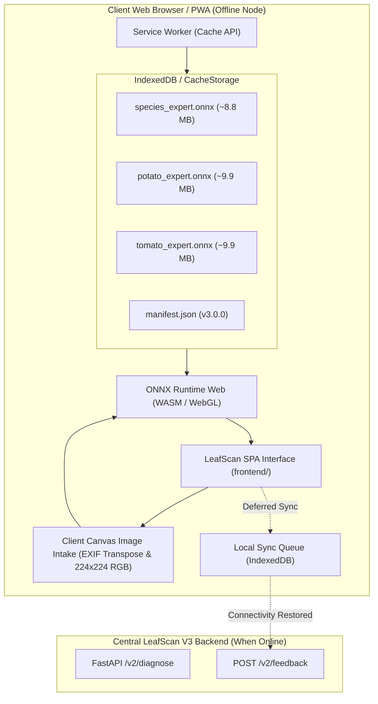

# LeafScan V3 Offline Edge & PWA Inference Architecture

**Target:** Browser-Based On-Device Diagnostic Screening  
**Runtime:** ONNX Runtime Web (`ort-web`) + WebAssembly (WASM) / WebGL / WebGPU  
**Operational Status:** Architectural Design & Reference Specification  

---

## 1. Executive Summary

To support smallholder farmers and agricultural extension officers operating in remote rural locations with intermittent or zero cellular connectivity, LeafScan V3 establishes an **Offline Edge Architecture** using Progressive Web App (PWA) standards and ONNX Runtime Web.

The browser operates as an autonomous diagnostic node executing the identical two-tier MobileNetV2 + CBAM classification pipeline and dual confidence safety gates without sending image bytes over the network.

---

## 2. Edge Architecture Topology



---

## 3. Core Edge Subsystems

### 3.1 Model Asset Distribution & Service Worker Caching
1. **Asset Footprint:**
   - `species_expert.onnx`: 8.82 MB (gzipped: ~7.6 MB)
   - `potato_expert.onnx`: 9.92 MB (gzipped: ~8.7 MB)
   - `tomato_expert.onnx`: 9.92 MB (gzipped: ~8.7 MB)
   - Total model payload: ~28.6 MB (downloaded once on user opt-in for offline capability).
2. **Service Worker Cache Strategy:**
   - Pre-caches `index.html`, `tokens.css`, `app.js`, and SVG icons on install (`Cache-First`).
   - Downloads ONNX models to the browser `CacheStorage` or `IndexedDB` with streaming integrity hash validation against `manifest.json`.

### 3.2 In-Browser Preprocessing Compatibility
To ensure 100% parity with server-side Python Pillow preprocessing:
- **Canvas Decoding:** An HTML5 `OffscreenCanvas` decodes uploaded camera photos.
- **EXIF Transposition:** Orientation metadata is parsed from JPEG headers and applied via canvas 2D matrix transformation.
- **Bilinear Rescaling:** Canvas `drawImage()` resizes the leaf to \(224 \times 224\).
- **White Background Matting:** Canvas is initialized with `fillStyle = "#ffffff"` before drawing to eliminate alpha-channel dark artifacts.
- **Tensor Construction:** Pixel RGBA data extracted via `getImageData()` is converted to a `Float32Array` of shape `[1, 224, 224, 3]` in pixel range `[0.0, 255.0]`.

### 3.3 Two-Tier Execution via ONNX Runtime Web
```javascript
// Reference client-side inference loop
import * as ort from "onnxruntime-web";

// Configure WASM multi-threading
ort.env.wasm.numThreads = 2;

// 1. Species Inference
const spSession = await ort.InferenceSession.create("models/bundles/v3/species_expert.onnx");
const spFeeds = { input_tensor: inputTensor };
const spResults = await spSession.run(spFeeds);
const spProbs = spResults.species_output.data;

// 2. Safety Gate 1 (0.90 threshold)
if (spProbs[spIdx] < 0.90) {
    return { plant_species: spName, disease: null, safety_status: "species_uncertain" };
}

// 3. Specialist Inference
const specSession = spName === "Potato" ? potatoSession : tomatoSession;
const disResults = await specSession.run({ input_tensor: inputTensor });
// ... Safety Gate 2 evaluation identical to server
```

### 3.4 Local Offline Synchronization
- Diagnoses generated offline are displayed immediately to the farmer.
- Optional anonymized telemetry and user feedback are staged in `IndexedDB`.
- When the browser `navigator.onLine` event triggers, queued submissions are uploaded in background batches to `POST /v2/feedback`.
