# LeafScan V3 MLOps Pipeline & Model Governance Architecture

**Pipeline Version:** 3.0.0  
**Target:** Continuous Model Integration, Evaluation, Packaging & Governance  
**Lifecycle:** `Train → Evaluate → Export → Parity → Gate Regression → Manifest → Sign → Publish`  

---

## 1. End-to-End Automated Pipeline Topology

The LeafScan MLOps pipeline automates the release lifecycle of high-consequence agricultural neural networks, ensuring that no model weight update can be deployed without passing strict specimen leakage audits, numerical parity checks, and zero-gate-flip safety regressions.

```mermaid
flowchart LR
    Data["Specimen Manifest<br/>(DVC Tracked)"] --> Train["Two-Phase Warmup<br/>& Fine-Tuning"]
    Train --> Checkpoint["Keras 3 Checkpoint<br/>(.keras)"]
    Checkpoint --> Eval["Specimen Group<br/>Held-Out Evaluation"]
    Eval --> Export["tf2onnx Converter<br/>(Opset 17)"]
    Export --> Parity["Numerical Parity Audit<br/>(Tol <= 1e-4)"]
    Parity --> GateReg["603-Specimen Gate<br/>Regression (0 Flips)"]
    GateReg --> Bundle["Model Bundle Packaging<br/>(SHA-256 Manifest)"]
    Bundle --> Sign["Cosign / Cryptographic<br/>Bundle Signing"]
    Sign --> Registry["Production Registry<br/>(models/bundles/vX)"]
```

---

## 2. Pipeline Execution Stages

### Stage 1: Data Governance (DVC)
- Dataset manifests are tracked with Data Version Control (`DVC`).
- Partitioning is strictly grouped by `source_group_id` across 3,971 biological specimen clusters to guarantee **0.00% train/val/test leakage**.
- Class imbalances are compensated via specimen-deduplicated inverse frequency weights and `SparseCategoricalFocalLoss` ($\gamma=2.0, \alpha$).

### Stage 2: Export & Validation
- Keras 3 `.keras` artifacts are converted using `export_to_onnx.py`.
- Dynamic batch dimension `[None, 224, 224, 3]` is enforced with opset 17.
- `onnx.checker.check_model()` validates graph topology and tensor typing.

### Stage 3: Numerical & Safety Gate Parity
Before any model candidate is promoted:
- **Numerical Tolerance:** $\max |P_{\text{Keras}} - P_{\text{ONNX}}| \le 1\times 10^{-4}$.
- **Zero Gate Flips:** Candidate ONNX model must produce identical Safety Gate 1 (0.90) and Safety Gate 2 (0.90 / 0.70) decisions across all 603 held-out test specimens in `audit/test_specimen_manifest.csv`.
- **Late Blight Recall Floor:** Late Blight recall must not decrease compared to the active production bundle.

### Stage 4: Versioned Bundle Packaging & Signing
- A new release bundle `models/bundles/v{N}/` is assembled containing:
  - `species_expert.onnx`
  - `potato_expert.onnx`
  - `tomato_expert.onnx`
  - `manifest.json` (SHA-256 hashes, input specs, thresholds, calibration parameters)
- Checksums are signed using Sigstore/Cosign in CI.

---

## 3. Deployment Strategies: Shadow, Canary & Rollback

### Shadow Testing
New bundle candidates run in parallel with the active production bundle on a random percentage of production traffic.
- Shadow predictions are asynchronously logged to telemetry.
- **Invariant:** Shadow predictions **never** override the active production result returned to the agricultural client.

### Canary Deployment
- 5% -> 25% -> 100% traffic allocation.
- Automatic rollback triggered if:
  - Error rate increases by > 0.1%.
  - Abstention rate shifts by > 5.0% compared to historical baseline.
  - p95 inference latency exceeds 100 ms.

### Instant Rollback
To rollback to a previous bundle, update `LEAFSCAN_MODEL_BUNDLE_PATH` in the container environment or deployment config to point to the prior verified directory (e.g. `models/bundles/v2_legacy` or a rollback release tag). Zero database schema migrations or state reconciliations are required because LeafScan is completely stateless.
